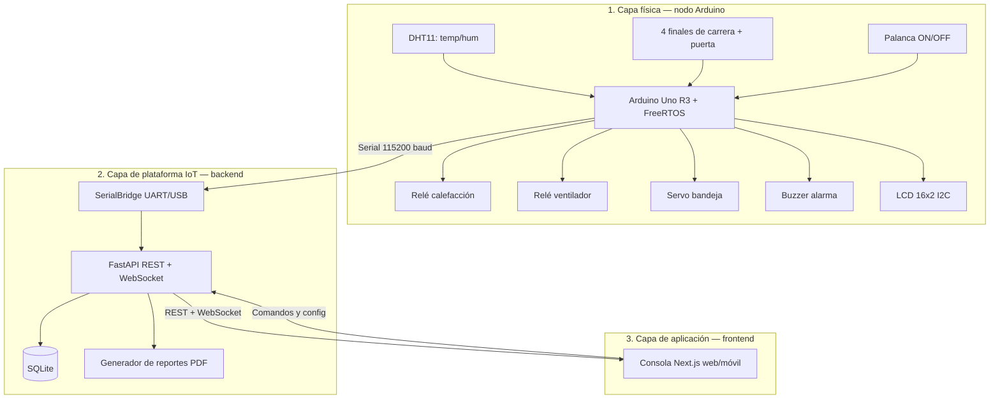
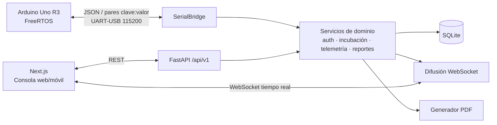
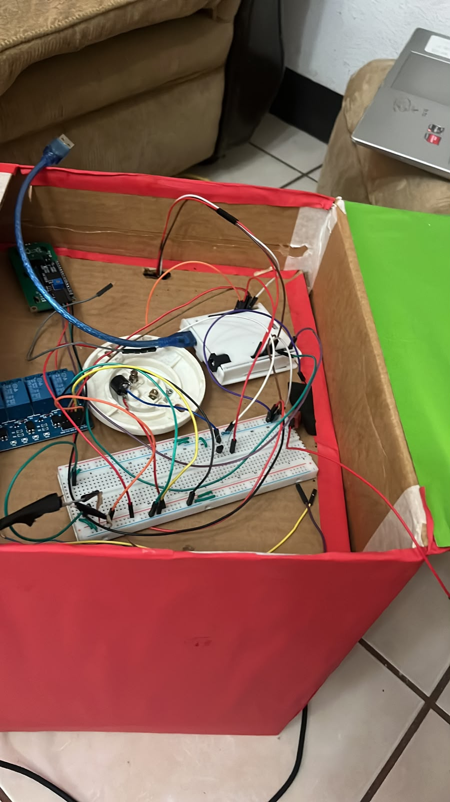
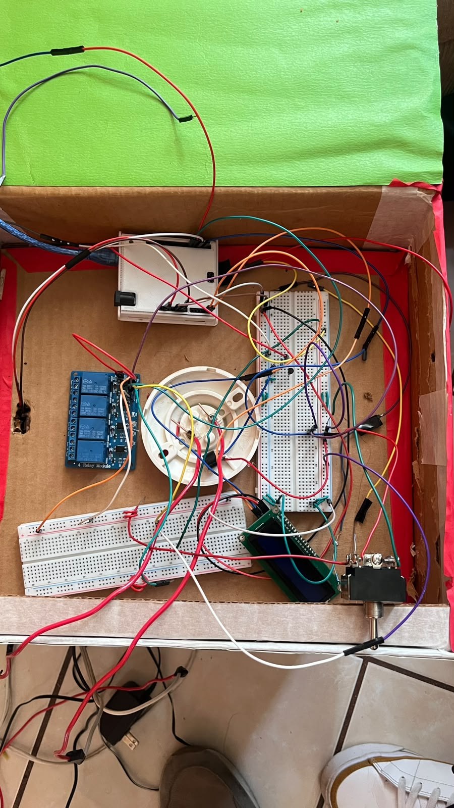
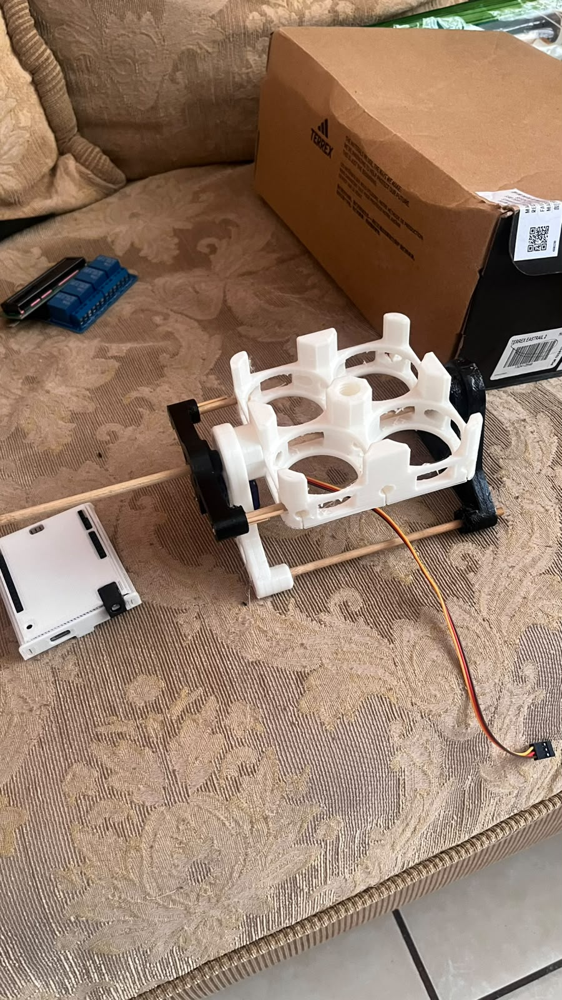
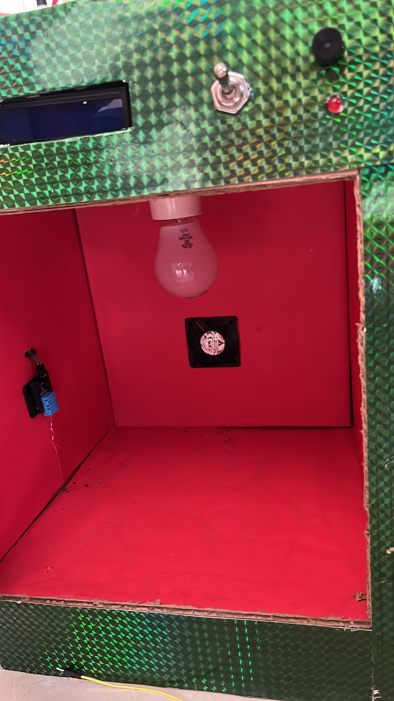
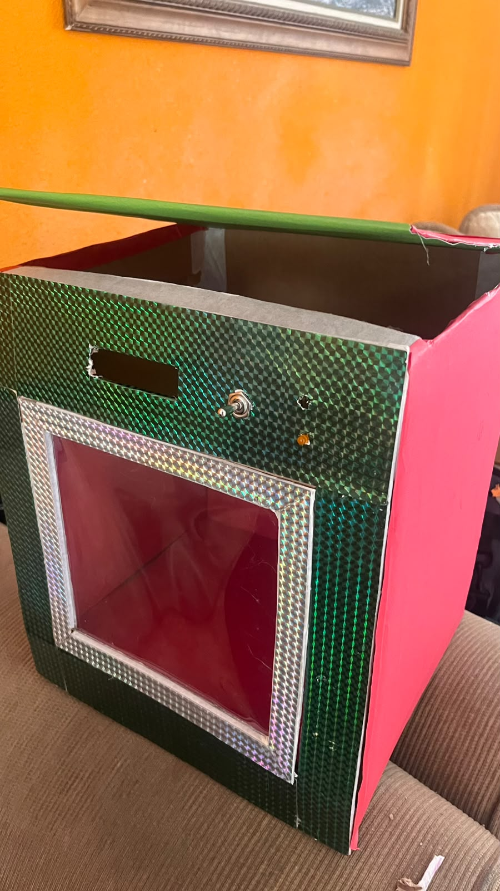

# Práctica 1 — SmartEgg: Incubadora Inteligente IoT

Práctica 1 del curso Arquitectura de Computadoras y Ensambladores 2 (2S2026). Desarrollamos
**SmartEgg**, el nodo físico de una incubadora inteligente que mide temperatura y humedad,
controla sus actuadores por umbrales, rota los huevos automáticamente y expone sus datos a
una aplicación web mediante un backend REST.

- [Enunciado de la práctica](docs/enunciado/Practica_1_SmartEgg_2S2026.pdf)
- [Firmware (Arduino + FreeRTOS)](firmware/README.md)
- [Backend (FastAPI)](server/README.md)
- [Frontend (Next.js)](client/README.md)

## Descripción de la solución

La Facultad de Ciencias Agronómicas nos pidió reducir las pérdidas de incubación (30–40 %)
causadas por control impreciso de temperatura/humedad, rotación manual inconsistente y
ausencia de monitoreo y registro digital. SmartEgg resuelve esto con tres piezas que se
comunican entre sí:

1. **Nodo físico** (Arduino Uno R3 + FreeRTOS): lee el DHT11 y los finales de carrera,
   controla el relé de calefacción, el relé del ventilador, el servo de rotación y el
   buzzer por lógica de umbrales, y muestra el estado en tiempo real en el LCD 16×2. Este
   control de seguridad corre localmente y sigue funcionando aunque la computadora se
   desconecte.
2. **Backend** (FastAPI + SQLite): recibe la telemetría del Arduino por UART/USB, la
   persiste, gestiona técnicos/lotes/huevos, expone REST + WebSocket y genera el reporte
   PDF diario.
3. **Frontend** (Next.js): consola web/móvil para que el ingeniero agrónomo visualice
   sensores y actuadores en vivo, registre huevos y lotes, y descargue los reportes.

Los rangos de control que implementamos siguen el objetivo SMART del enunciado: temperatura
37–38 °C, humedad 50–65 %, rotación ±45° cada 2 minutos, y alarma ante condiciones críticas.

## Capas del Framework IoT

Usamos las tres capas que define la rúbrica de la práctica:

- **Capa física**: sensores, actuadores y control ON/OFF por umbrales, corriendo en
  FreeRTOS sobre el Arduino. Ver [`firmware/README.md`](firmware/README.md).
- **Capa de plataforma IoT**: puente Serial, API REST/WebSocket, base de datos y generación
  de reportes. Ver [`server/README.md`](server/README.md).
- **Capa de aplicación**: consola web/móvil de visualización y control remoto. Ver
  [`client/README.md`](client/README.md).

## Diagrama de Arquitectura de Software

Detalle de tareas FreeRTOS del firmware y del modelo de datos del backend en sus respectivos
README ([firmware](firmware/README.md#arquitectura-freertos),
[server](server/README.md#modelo-de-datos)).

## Multitarea: FreeRTOS e interrupciones

Implementamos **ambas** alternativas que acepta la rúbrica:

- Dos tareas preemptivas de FreeRTOS (`SensorControl` y `Communication`) con prioridades y
  periodicidad propias.
- Dos interrupciones externas (`INT0` para la palanca ON/OFF, `INT1` para la puerta), que
  solo levantan banderas `volatile` y dejan el trabajo pesado a las tareas.

La explicación completa, con el diagrama de tareas y la tabla de periodicidad, está en
[`firmware/README.md → Arquitectura FreeRTOS`](firmware/README.md#arquitectura-freertos).

## API Contracts

El contrato completo de endpoints REST, el modelo de datos y el protocolo Serial UART/USB
(Arduino ↔ backend) están documentados en
[`server/README.md → Contrato de API`](server/README.md#contrato-de-api) y se generan
automáticamente en Swagger UI (`/docs`) y ReDoc (`/redoc`) al levantar el backend.

## Fotografías del prototipo

### Proceso de elaboración

Cableado y pruebas sobre breadboard antes de fijar los componentes en la carcasa:

  
  

Mecanismo de rotación de la bandeja, impreso en 3D y acoplado al servomotor:

### Prototipo final (encapsulado)

  
  

**Pendiente**: mockup/boceto del prototipo antes de construirlo (rúbrica 7.3) y
fotografías/video del prototipo ya **operando** (LCD mostrando lecturas en vivo, alarma
activa, servo rotando) — la rúbrica 7.9/9 las pide por separado de las fotos estáticas de
arriba.

## Mockups de la Aplicación Web/Móvil

**Pendiente.** Falta agregar capturas de pantalla o mockup de las pantallas del frontend
(`client/`) — panel de sensores/actuadores, ficha de identificación del huevo, historial y
reportes — tanto en disposición de escritorio ("plano") como móvil ("pila"). El diseño de
esas pantallas ya está descrito en [`client/README.md`](client/README.md).

## Diagramado de Conexiones (esquemático electrónico)

La tabla de pines, polaridades y protecciones está en
[`firmware/CIRCUITO.md`](firmware/CIRCUITO.md), con las fotos de cableado real incluidas
arriba. El diagrama de conexiones en herramienta oficial vive en
[`firmware/wokwi/diagram.json`](firmware/wokwi/diagram.json) (Wokwi) — se importa en un
proyecto Arduino Uno nuevo en [wokwi.com](https://wokwi.com/projects/new/arduino-uno) o con
la extensión de Wokwi para VS Code. Las simplificaciones deliberadas (DHT11 representado con
la huella del DHT22, buzzer sin el transistor de protección, contactos de los relés sin la
carga de 110 V/ventilador) están explicadas en
[`firmware/CIRCUITO.md → Diagrama de conexiones en Wokwi`](firmware/CIRCUITO.md#diagrama-de-conexiones-en-wokwi).

**Pendiente**: alguien del equipo debe abrir `diagram.json` en Wokwi para confirmar
visualmente que carga sin errores antes de la entrega — se armó por especificación de pines,
sin poder ejecutar el simulador desde aquí.

## Manual de Usuario

### Nodo físico

1. Conectar el Arduino a la computadora por USB (alimenta el Uno y habilita el puerto
   Serial a 115200 baudios).
2. Encender el sistema con la palanca frontal; el LCD muestra la animación de arranque y
   pasa a la pantalla de estado (temperatura, humedad, ángulo de bandeja, espacios
   ocupados/libres y estado de alarma).
3. El control de calefacción, ventilación, rotación y alarma es automático por umbrales; no
   requiere intervención manual salvo apagar el sistema con la misma palanca.
4. Abrir Arduino IDE → Serial Plotter (115200 baud) para graficar `TEMP` y `HUM` en tiempo
   real, o Serial Monitor para ver la trama completa (`MSG:...,TEMP:...,HUM:...`).

### Backend + Frontend

1. Levantar el backend (`uv run fastapi dev --host 0.0.0.0` dentro de `server/`) — ver
   [`server/README.md`](server/README.md) para variables de entorno y arranque en
   producción.
2. Crear el primer técnico con `POST /api/v1/auth/bootstrap` y autenticarse con
   `POST /api/v1/auth/login`.
3. Registrar la incubadora, sus lotes y huevos desde Swagger (`/docs`) o desde el frontend.
4. Levantar el frontend (`pnpm dev` dentro de `client/`) y abrir
   `http://localhost:3000` (o la IP local, desde un teléfono/tablet en la misma red) para
   visualizar sensores/actuadores en vivo, registrar huevos y descargar el reporte PDF
   diario desde la sección de reportes.

**Pendiente**: agregar capturas de pantalla paso a paso una vez estén los mockups del
frontend.

## Evidencia de commits (GitHub)

**Pendiente**: agregar aquí la captura del historial de commits del repositorio (sección
6 del enunciado) antes de la entrega final, además de que cada integrante complete al menos
2 commits (sección 4).

## Estado del proyecto

- Firmware: implementación completa en FreeRTOS + interrupciones, validado por pruebas de
  host; pendiente la validación final sobre el hardware armado (ver
  [`firmware/RUBRIC_CHECKLIST.md`](firmware/RUBRIC_CHECKLIST.md)).
- Encapsulado: armado y fotografiado (ver fotos arriba); diagrama de conexiones en Wokwi
  agregado (pendiente de validar abriéndolo en el editor); falta el video/fotos del
  prototipo operando.
- Backend y frontend: implementados según [`server/README.md`](server/README.md) y
  [`client/README.md`](client/README.md); falta integrarlos con el Arduino físico y tomar
  los mockups/capturas para esta documentación.
