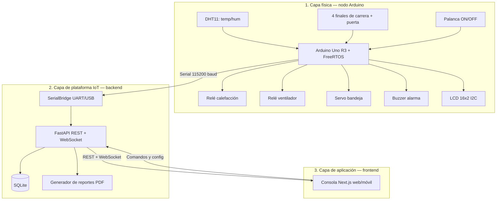
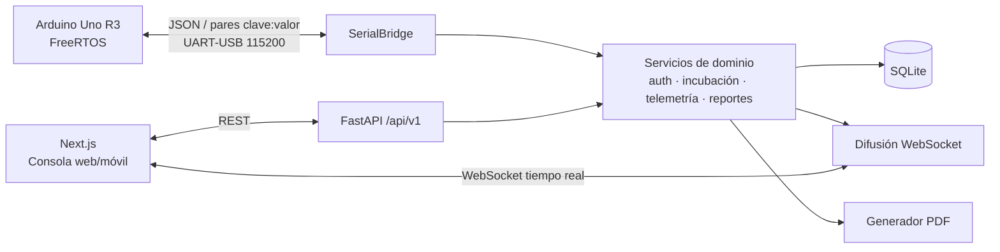
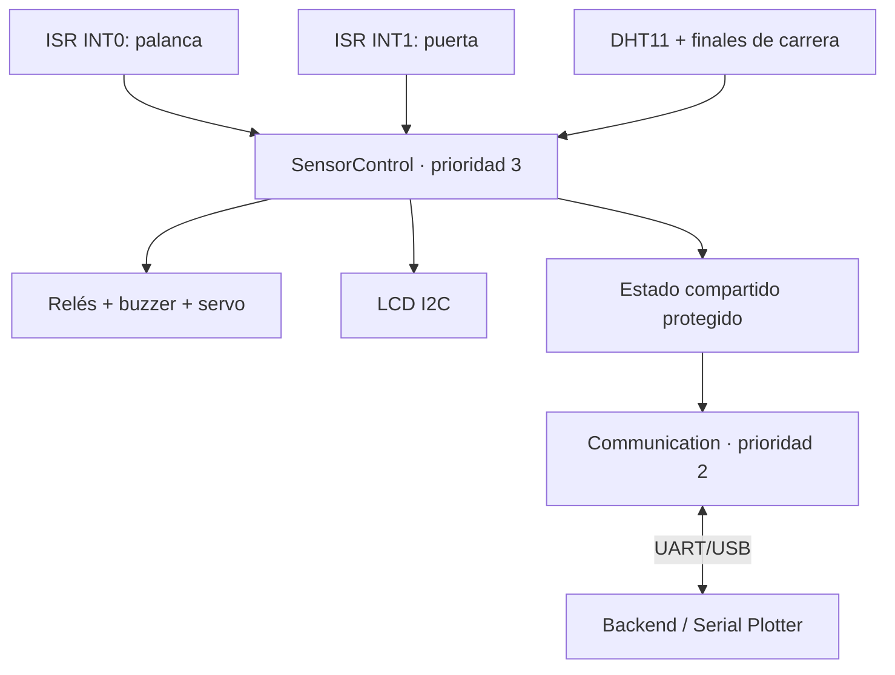
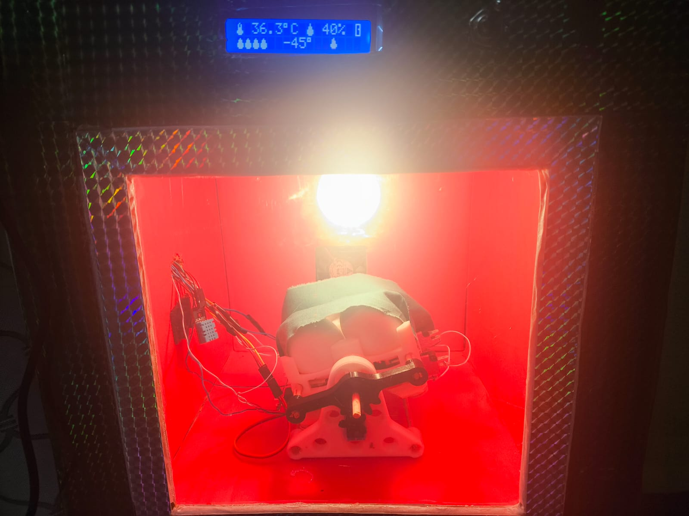
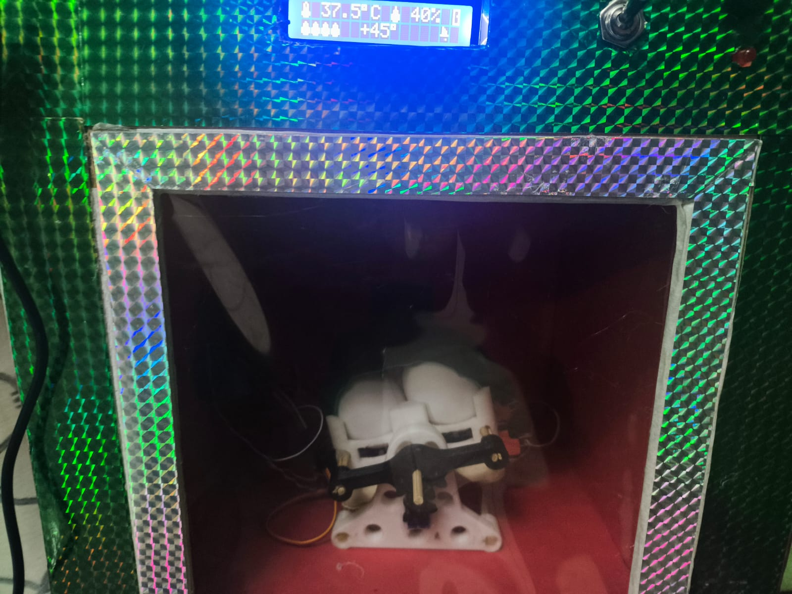
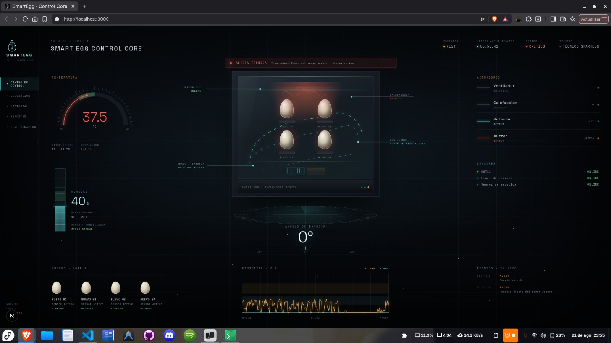
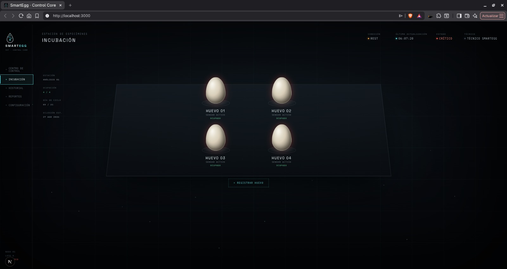
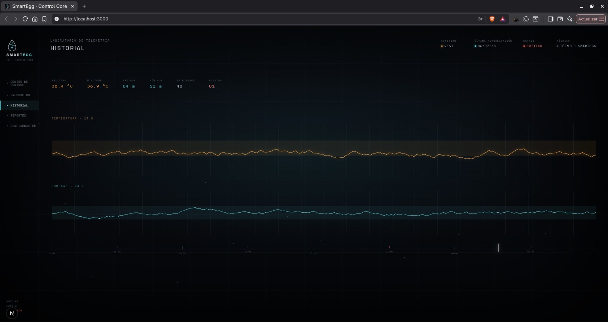
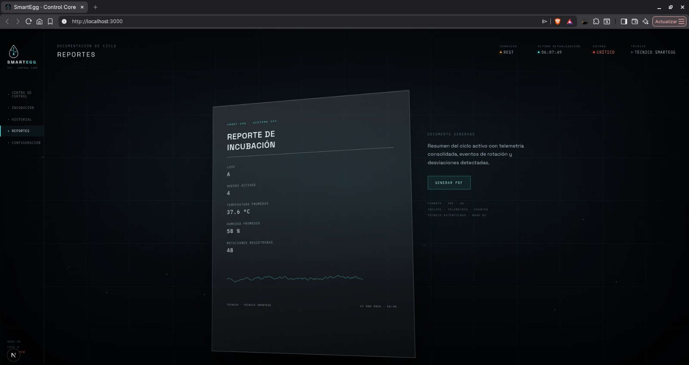
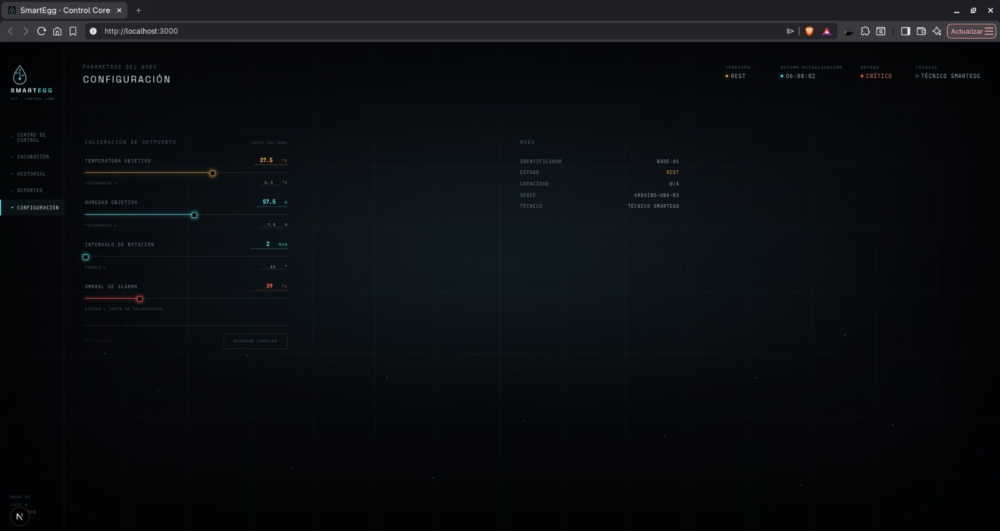

# Informe técnico — SmartEgg: Incubadora Inteligente IoT

Práctica 1 del curso Arquitectura de Computadoras y Ensambladores 2 (2S2026). Desarrollamos
**SmartEgg**, el nodo físico de una incubadora inteligente que mide temperatura y humedad,
controla sus actuadores por umbrales, rota los huevos automáticamente y expone sus datos a
una aplicación web mediante un backend REST.

- [Enunciado de la práctica](enunciado/Practica_1_SmartEgg_2S2026.pdf)
- [Firmware (Arduino + FreeRTOS)](../firmware/README.md)
- [Backend (FastAPI)](../server/README.md)
- [Frontend (Next.js)](../client/README.md)

## Descripción de la solución

La Facultad de Ciencias Agronómicas nos pidió reducir las pérdidas de incubación (30–40 %)
causadas por control impreciso de temperatura/humedad, rotación manual inconsistente y
ausencia de monitoreo y registro digital. SmartEgg resuelve esto con tres piezas que se
comunican entre sí:

1. **Nodo físico** (Arduino Uno R3 + FreeRTOS): lee el DHT11 y los finales de carrera,
   controla el relé de calefacción, el relé del ventilador, el servo de rotación y el
   buzzer por lógica de umbrales, y muestra el estado en tiempo real en el LCD 16×2. Este
   control de seguridad corre localmente y sigue funcionando aunque la computadora se
   desconecte.
2. **Backend** (FastAPI + SQLite): recibe la telemetría del Arduino por UART/USB, la
   persiste, gestiona técnicos/lotes/huevos, expone REST + WebSocket y genera el reporte
   PDF diario.
3. **Frontend** (Next.js): consola web/móvil para que el ingeniero agrónomo visualice
   sensores y actuadores en vivo, registre huevos y lotes, y descargue los reportes.

Los rangos de control que implementamos siguen el objetivo SMART del enunciado: temperatura
37–38 °C, humedad 50–65 %, rotación ±45° cada 2 minutos, y alarma ante condiciones críticas.

## Capas del Framework IoT

Usamos las tres capas que define la rúbrica de la práctica:



- **Capa física**: sensores, actuadores y control ON/OFF por umbrales, corriendo en
  FreeRTOS sobre el Arduino. Ver [`firmware/README.md`](../firmware/README.md).
- **Capa de plataforma IoT**: puente Serial, API REST/WebSocket, base de datos y generación
  de reportes. Ver [`server/README.md`](../server/README.md).
- **Capa de aplicación**: consola web/móvil de visualización y control remoto. Ver
  [`client/README.md`](../client/README.md).

## Diagrama de Arquitectura de Software



Detalle de tareas FreeRTOS del firmware y del modelo de datos del backend en sus respectivos
README ([firmware](../firmware/README.md#arquitectura-freertos),
[server](../server/README.md#modelo-de-datos)).

## Multitarea: FreeRTOS e interrupciones

Implementamos **ambas** alternativas que acepta la rúbrica:

- Dos tareas preemptivas de FreeRTOS (`SensorControl` y `Communication`) con prioridades y
  periodicidad propias.
- Dos interrupciones externas (`INT0` para la palanca ON/OFF, `INT1` para la puerta), que
  solo levantan banderas `volatile` y dejan el trabajo pesado a las tareas.



| Tarea | Periodicidad | Responsabilidad |
|---|---:|---|
| `SensorControl` | 50 ms | Leer entradas, procesar interrupciones, aplicar umbrales, controlar actuadores y actualizar el LCD |
| `Communication` | 20 ms; telemetría cada 2 s | Recibir comandos sin bloqueo y emitir tramas por Serial |

Las rutinas de interrupción no llaman al LCD, a `Serial` ni a lógica pesada. Únicamente
actualizan banderas `volatile`, que luego consume `SensorControl`. Las tareas ceden tiempo
con `vTaskDelayUntil()` y `vTaskDelay()` para evitar esperas activas. Se eligieron dos tareas
porque el Arduino Uno dispone de 2 KB de SRAM y cada tarea adicional necesita reservar su
propia pila. La implementación se encuentra en
[`Tasks.cpp`](../firmware/SmartEggFirmware/Tasks.cpp) y la creación del scheduler en
[`SmartEggFirmware.ino`](../firmware/SmartEggFirmware/SmartEggFirmware.ino).

## Contratos de API

Todos los endpoints funcionales utilizan el prefijo `/api/v1`. Salvo el estado de salud,
el registro inicial y el inicio de sesión, requieren un JWT en el encabezado
`Authorization: Bearer <token>`.

| Área | Operaciones principales |
|---|---|
| Autenticación | `POST /auth/bootstrap`, `POST /auth/login`, `GET /auth/me`, `POST /auth/technicians` |
| Incubadoras | `POST/GET /incubators`, `GET /incubators/{id}/state` |
| Configuración | `GET/PUT /incubators/{id}/config` |
| Lotes | `POST/GET /lots`, `GET/PATCH /lots/{id}` |
| Huevos | `POST/GET /eggs`, `GET/PATCH /eggs/{id}` |
| Ocupación | `GET /incubators/{id}/occupancy` |
| Sensores | `GET /incubators/{id}/sensors`, `PATCH /incubators/{id}/sensors/{sensor_id}` |
| Telemetría | `POST /telemetry`, consultas de historial, última lectura y estadísticas |
| Actuadores | Consulta de estado y `POST /incubators/{id}/actuators/{kind}/commands` |
| Rotación | `POST/GET /incubators/{id}/rotations` |
| Alarmas | Consulta y confirmación de alarmas |
| Reportes | `GET /reports/incubators/{id}/daily.pdf?day=AAAA-MM-DD` |
| Tiempo real | `WS /ws/incubators/{id}?token=<JWT>` |
| Puerto serial | `GET /serial/status` |

FastAPI publica el contrato exacto, sus esquemas y respuestas en `/openapi.json`, Swagger
UI (`/docs`) y ReDoc (`/redoc`). El código de los controladores está en
[`server/app/api`](../server/app/api).

### Contrato UART/USB

El Arduino se comunica a `115200 8N1`, con una trama por línea. Una lectura típica es:

```text
MSG:1,TEMP:37.52,HUM:58.1,DOOR:0,SLOTS:3,HEATER:0,FAN:0,SERVO:-45,BUZZER:0,POWER:1,SENSOR:1
```

Los comandos viajan como JSON compacto terminado en salto de línea. Por ejemplo:

```json
{"type":"rotate","angle_degrees":-45}
{"type":"actuator","kind":"fan","enabled":true,"mode":"manual","value":null}
{"type":"config","temperature_min_c":37.0,"temperature_max_c":38.0}
```

El significado de todos los campos, eventos, errores y reglas de seguridad se especifica
en el [contrato serial](../firmware/PROTOCOL.md).

## Fotografías del prototipo

### Proceso de elaboración

Cableado y pruebas sobre breadboard antes de fijar los componentes en la carcasa:

<p float="left">
  
  
</p>

Mecanismo de rotación de la bandeja, impreso en 3D y acoplado al servomotor:


### Prototipo final (encapsulado)

<p float="left">
  
  
</p>

### Prototipo en operación

Validación del sistema completo con el LCD mostrando temperatura, humedad, ocupación y
ángulo en tiempo real. Las dos posiciones extremas confirman el recorrido de rotación
de la bandeja; la primera imagen también muestra la calefacción activa.

<p float="left">
  
  
</p>

**Pendiente**: agregar el mockup o boceto previo a la construcción solicitado por la
rúbrica 7.3.

## Capturas de la Aplicación Web/Móvil

Capturas de la aplicación ejecutándose localmente y conectada al backend. El Centro de
Control consolida telemetría, alarma, actuadores, sensores, ocupación y ángulo de bandeja
en una sola vista.



La estación de incubación representa las cuatro posiciones físicas reportadas por el
Arduino. Las pantallas de historial y reportes presentan la información persistida por el
backend y permiten generar el PDF del ciclo.

<p float="left">
  
  
</p>

<p float="left">
  
  
</p>

La implementación y el comportamiento adaptable de estas vistas se documentan en
[`client/README.md`](../client/README.md).

## Diagramado de Conexiones (esquemático electrónico)

La tabla de pines, polaridades y protecciones está en
[`firmware/CIRCUITO.md`](../firmware/CIRCUITO.md), con las fotos de cableado real incluidas
arriba. El diagrama de conexiones en herramienta oficial vive en
[`firmware/wokwi/diagram.json`](../firmware/wokwi/diagram.json) (Wokwi) — se importa en un
proyecto Arduino Uno nuevo en [wokwi.com](https://wokwi.com/projects/new/arduino-uno) o con
la extensión de Wokwi para VS Code. Las simplificaciones deliberadas (DHT11 representado con
la huella del DHT22, buzzer sin el transistor de protección, contactos de los relés sin la
carga de 110 V/ventilador) están explicadas en
[`firmware/CIRCUITO.md → Diagrama de conexiones en Wokwi`](../firmware/CIRCUITO.md#diagrama-de-conexiones-en-wokwi).

Validado abriendo `diagram.json` en Wokwi: carga sin errores y todos los componentes quedan
conectados como se documenta arriba.


Wokwi cubre el lado lógico de 5 V, pero no representa los componentes discretos ni las
cargas reales de los relés. El esquema siguiente completa el circuito con el 2N2222 y el
diodo 1N4007 del buzzer, el ventilador de 5 V conectado al canal 2 y la bombilla de 110 V
con fusible conectada al canal 1.


La sección de 110 V se mantiene aislada de la electrónica de control, dentro de una caja
cerrada y sin utilizar protoboard ni cables Dupont. El montaje y la revisión antes de
energizar corresponden a una persona calificada.

## Manual de Usuario

### Nodo físico

1. Conectar el Arduino a la computadora por USB (alimenta el Uno y habilita el puerto
   Serial a 115200 baudios).
2. Encender el sistema con la palanca frontal; el LCD muestra la animación de arranque y
   pasa a la pantalla de estado (temperatura, humedad, ángulo de bandeja, espacios
   ocupados/libres y estado de alarma).
3. El control de calefacción, ventilación, rotación y alarma es automático por umbrales; no
   requiere intervención manual salvo apagar el sistema con la misma palanca.
4. Abrir Arduino IDE → Serial Plotter (115200 baud) para graficar `TEMP` y `HUM` en tiempo
   real, o Serial Monitor para ver la trama completa (`MSG:...,TEMP:...,HUM:...`).

### Backend + Frontend

1. Levantar el backend (`uv run fastapi dev --host 0.0.0.0` dentro de `server/`) — ver
   [`server/README.md`](../server/README.md) para variables de entorno y arranque en
   producción.
2. Crear el primer técnico con `POST /api/v1/auth/bootstrap` y autenticarse con
   `POST /api/v1/auth/login`.
3. Registrar la incubadora, sus lotes y huevos desde Swagger (`/docs`) o desde el frontend.
4. Levantar el frontend (`pnpm dev` dentro de `client/`) y abrir
   `http://localhost:3000` (o la IP local, desde un teléfono/tablet en la misma red) para
   visualizar sensores/actuadores en vivo, registrar huevos y descargar el reporte PDF
   diario desde la sección de reportes.

Las capturas de las cinco pantallas principales se incluyen en la sección
[Capturas de la Aplicación Web/Móvil](#capturas-de-la-aplicación-webmóvil).

## Evidencia de commits (GitHub)

**Pendiente**: agregar aquí la captura del historial de commits del repositorio (sección
6 del enunciado) antes de la entrega final, además de que cada integrante complete al menos
2 commits (sección 4).

## Evidencias pendientes para la entrega

- Mockup o boceto del prototipo previo a su construcción.
- Captura del Serial Plotter con temperatura y humedad en tiempo real.
- Captura de la implementación de las tareas FreeRTOS o interrupciones en Arduino IDE.
- Captura del historial de commits de GitHub.

Estos elementos requieren capturas del entorno o del equipo físico; no se sustituyen con
imágenes generadas ni con fragmentos recreados para el informe.

## Estado del proyecto

- Firmware: implementación completa en FreeRTOS + interrupciones, validada con pruebas de
  host y sobre el hardware armado (ver
  [`firmware/RUBRIC_CHECKLIST.md`](../firmware/RUBRIC_CHECKLIST.md)).
- Encapsulado: armado y fotografiado tanto apagado como en operación; diagrama de
  conexiones en Wokwi agregado y validado.
- Backend y frontend: implementados e integrados con la telemetría del nodo físico según
  [`server/README.md`](../server/README.md) y [`client/README.md`](../client/README.md); las
  capturas de las pantallas principales se incluyen arriba.
