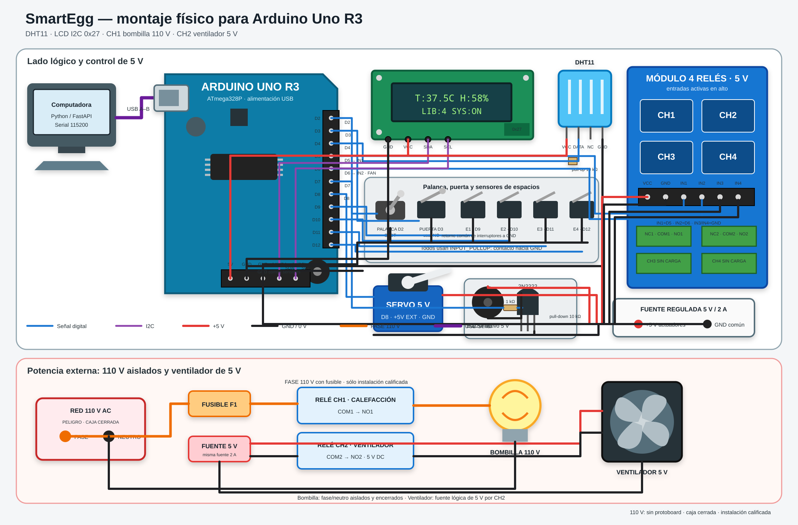
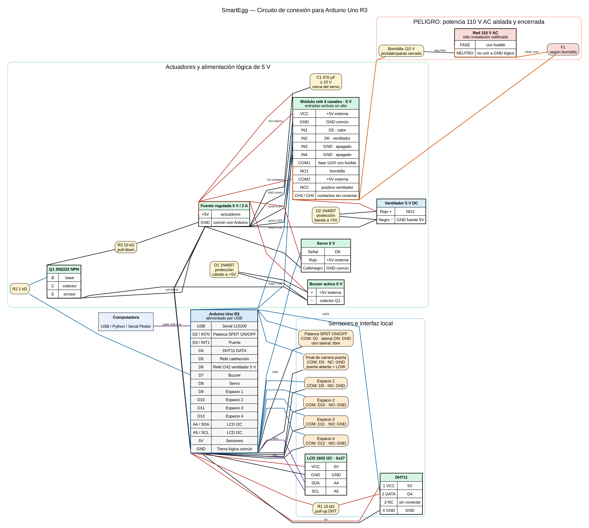
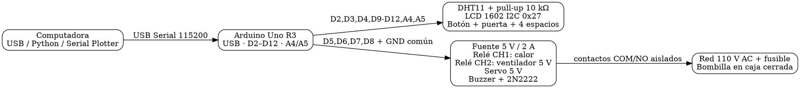

# Circuito SmartEgg para Arduino Uno R3

Este circuito coincide con los pines y polaridades de `SmartEggFirmware/Config.h`.
Utiliza una bombilla de **110 V AC** en CH1 y un ventilador de **5 V DC** en CH2. Las
conexiones de red deben quedar encerradas y físicamente separadas de toda la lógica de
5 V. No requiere un adaptador UART: el cable USB A–B del Uno sirve para cargar el
programa y comunicarlo con Python.

## Vista de montaje físico



La versión vectorial editable está disponible en
[`CIRCUITO_REALISTA.svg`](CIRCUITO_REALISTA.svg). La forma y el orden de los conectores
representan un módulo genérico; antes del montaje debe respetarse la serigrafía impresa
en el módulo de relés real.

## Diagrama lógico



## Materiales

- Arduino Uno R3 y cable USB A–B.
- DHT11 y resistencia de 10 kΩ si el sensor no viene en módulo.
- LCD 1602 con backpack I2C en dirección `0x27`.
- Módulo de cuatro relés de 5 V con entradas activas en alto.
- Diodo 1N4007 de rueda libre para el ventilador de 5 V.
- Servomotor de 5 V compatible con la mecánica de la bandeja.
- Buzzer activo de 5 V, transistor 2N2222, resistencias de 1 kΩ y 10 kΩ y diodo
  1N4007.
- Switch de palanca SPDT de tres terminales, un final de carrera para puerta y cuatro
  finales de carrera para espacios.
- Fuente regulada de 5 V y al menos 2 A para relés, ventilador, servo y buzzer.
- Condensador electrolítico de 470 µF o mayor, con tensión nominal de al menos 10 V.
- Bombilla de 110 V, portalámparas, cableado, borneras y fusible aptos para tensión de
  red; su selección e instalación corresponde a una persona calificada.

## Conexiones exactas

| Arduino | Componente | Terminal |
|---|---|---|
| D2 | Palanca SPDT ON/OFF | COM a D2; lateral ON a GND; otro lateral libre |
| D3 | Final de puerta | COM; NC a GND |
| D4 | DHT11 | DATA; pull-up de 10 kΩ hacia 5 V |
| D5 | Relé de calefacción | IN1, activo en alto |
| D6 | Relé del ventilador | IN2, activo en alto |
| D7 | Buzzer | Base del 2N2222 mediante 1 kΩ |
| D8 | Servo | Señal |
| D9–D12 | Espacios 1–4 | COM de cada final; NO a GND |
| A4 | LCD I2C | SDA |
| A5 | LCD I2C | SCL |
| 5 V | DHT11 y LCD | VCC |
| GND | Todos los dispositivos lógicos | Tierra común |

En el módulo de cuatro canales, D5 controla `IN1` y D6 controla `IN2`. Conecte `IN3` e
`IN4` a GND para mantener libres esos canales. CH1 controla la calefacción y CH2 el
ventilador; deje sin conectar los contactos de CH3 y CH4.

La palanca usa `INPUT_PULLUP`: cuando COM toca el lateral conectado a GND, el sistema
queda encendido (`LOW`); en la otra posición queda apagado (`HIGH`). No conecte ninguno
de sus terminales a 5 V y no haga pasar corriente de actuadores por esta palanca.

El final de puerta usa el contacto NC de manera deliberada: con la puerta abierta y el
interruptor sin presionar, D3 queda conectado a GND, que es el estado `LOW` esperado por
el firmware. Cada huevo debe presionar su final de carrera y cerrar el contacto NO hacia
GND.

## Alimentación y protección

1. Alimente el Arduino únicamente mediante USB durante el prototipo.
2. Alimente servo, módulo relé y buzzer desde la fuente regulada externa de 5 V.
3. Una el GND de esa fuente con GND del Arduino. **No una su salida +5 V con el pin 5 V
   del Arduino mientras el Uno esté alimentado por USB**, para evitar alimentación
   inversa.
4. Coloque el condensador de 470 µF entre +5 V y GND cerca del servo, respetando su
   polaridad.
5. Use el 2N2222 para manejar el buzzer: emisor a GND, colector al negativo del buzzer,
   positivo del buzzer a +5 V y resistencia de 10 kΩ entre base y GND. El diodo va en
   paralelo con el buzzer, con cátodo hacia +5 V.
6. Para el ventilador, conecte +5 V externo a `COM2`, `NO2` al cable rojo y el cable
   negro a GND de la fuente. Coloque un 1N4007 en paralelo con el ventilador: banda hacia
   el cable rojo y ánodo hacia el negro. De esta forma queda apagado con CH2 desactivado.
7. No monte la sección de 110 V en protoboard. La conexión conceptual es fase con
   fusible hacia `COM1`, `NO1` hacia un terminal del portalámparas y neutro hacia el otro.
   Debe realizarse desenergizada, dentro de una caja aislante cerrada y ser revisada por
   una persona calificada. El valor del fusible depende de la potencia de la bombilla y
   de las especificaciones impresas del módulo de relés.

> Los 110 V nunca deben pasar por protoboard, cables Dupont ni terminales expuestos.
> Mantenga esa sección separada de los 5 V, use una caja aislante cerrada, alivio de
> tensión, fusible y componentes certificados; una persona calificada debe montarla y
> revisarla antes de energizarla.

> La disposición física de las patas E/B/C del 2N2222 cambia según el fabricante y el
> encapsulado. Identifíquelas con la hoja de datos del transistor comprado; no se deducen
> mirando únicamente la cara plana.

## Comprobación antes de energizar

1. Desconecte físicamente la alimentación de 110 V y verifique ausencia de tensión.
2. Encienda Arduino y fuente de 5 V; ningún relé debe activarse durante el arranque.
3. Verifique DHT11 y LCD antes de conectar servo y relés.
4. Conecte el servo sin acoplar la bandeja y confirme centro y recorrido de ±45°.
5. Pruebe el buzzer y cada relé sin cargas.
6. La alimentación de 110 V se conecta únicamente al final, con la caja cerrada y tras
   la revisión de una persona calificada.

## Fuente Graphviz resumida



El archivo [`CIRCUITO.dot`](CIRCUITO.dot) contiene la fuente detallada utilizada para
generar las versiones [`CIRCUITO.png`](CIRCUITO.png) y
[`CIRCUITO.svg`](CIRCUITO.svg). Puede volver a renderizarse con:

```bash
dot -Gdpi=180 -Tpng CIRCUITO.dot -o CIRCUITO.png
```

Wokwi no ofrece actualmente un componente DHT11 oficial; utiliza DHT22. Por eso no se
incluye una simulación que aparentaría usar el sensor real pero transmitiría un formato
de datos diferente. El diagrama representa el montaje físico confirmado.
