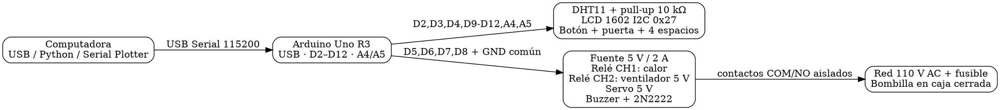
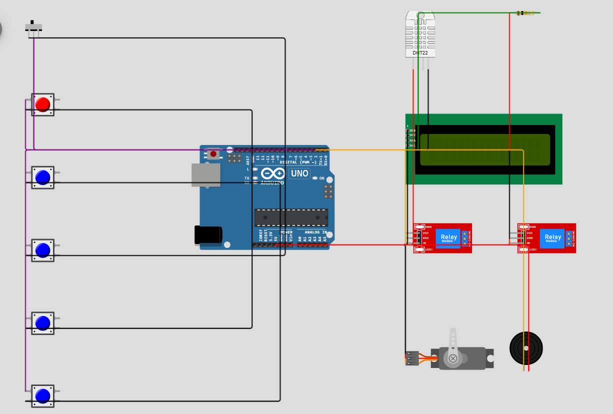
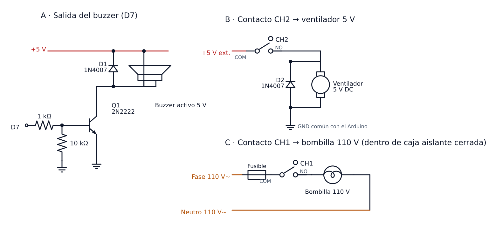

# Circuito SmartEgg para Arduino Uno R3

Este circuito corresponde exactamente a los pines y polaridades que dejamos en
`SmartEggFirmware/Config.h`. Usamos una bombilla de **110 V AC** en CH1 y un ventilador
de **5 V DC** en CH2. Toda la parte de red la dejamos encerrada y físicamente separada
de la lógica de 5 V. No nos hizo falta un adaptador UART: el mismo cable USB A–B del Uno
nos sirve para cargar el programa y para comunicarlo con Python.

Los diagramas gráficos se conservan fuera del repositorio. Este documento mantiene la
tabla de conexiones, las protecciones y un diagrama lógico en texto para que el montaje
no dependa de archivos generados. La forma y el orden de los conectores de un módulo
genérico pueden variar; siempre nos guiamos por la serigrafía del módulo real.

## Materiales que usamos

- Arduino Uno R3 y cable USB A–B.
- DHT11 y resistencia de 10 kΩ, porque nuestro sensor no venía en módulo.
- LCD 1602 con backpack I2C en la dirección `0x27`.
- Módulo de cuatro relés de 5 V con entradas activas en bajo.
- Diodo 1N4007 de rueda libre para el ventilador de 5 V.
- Servomotor de 5 V compatible con la mecánica de la bandeja.
- Buzzer activo de 5 V, transistor 2N2222, resistencias de 1 kΩ y 10 kΩ y diodo 1N4007.
- Switch de palanca SPDT de tres terminales, un final de carrera para la puerta y cuatro
  finales de carrera para los espacios.
- Fuente regulada de 5 V y al menos 2 A para relés, ventilador, servo y buzzer.
- Condensador electrolítico de 470 µF o mayor, con tensión nominal de al menos 10 V.
- Bombilla de 110 V, portalámparas, cableado, borneras y fusible aptos para tensión de
  red. Esa selección y su instalación las dejamos en manos de una persona calificada.

## Conexiones exactas

| Arduino | Componente | Terminal |
|---|---|---|
| D2 | Palanca SPDT ON/OFF | COM a D2; lateral ON a GND; otro lateral libre |
| D3 | Final de puerta | NO a D3; COM a GND; NC libre |
| D4 | DHT11 | DATA; pull-up de 10 kΩ hacia 5 V |
| D5 | Relé de calefacción | IN1, activo en bajo |
| D6 | Relé del ventilador | IN2, activo en bajo |
| D7 | Buzzer | Base del 2N2222 mediante 1 kΩ |
| D8 | Servo | Señal |
| D9–D12 | Espacios 1–4 | COM de cada final; NO a GND |
| A4 | LCD I2C | SDA |
| A5 | LCD I2C | SCL |
| 5 V | DHT11 y LCD | VCC |
| GND | Todos los dispositivos lógicos | Tierra común |

En el módulo de cuatro canales, D5 controla `IN1` y D6 controla `IN2`. A `IN3` e `IN4`
les pusimos 5 V para mantener apagados esos canales, que también son activos en bajo.
CH1 nos maneja la calefacción y CH2 el ventilador; los contactos de CH3 y CH4 quedaron
sin conectar.

La palanca la leemos con `INPUT_PULLUP`: cuando COM toca el lateral conectado a GND, el
sistema queda encendido (`LOW`), y en la otra posición queda apagado (`HIGH`). Ninguno de
sus terminales va a 5 V, y por esa palanca no hacemos pasar corriente de actuadores.

El final de puerta lo cableamos con `COM` a GND y `NO` a D3, dejando `NC` libre. Con la
puerta cerrada, el final queda presionado y da `LOW`; al abrirla, el contacto se libera y
el `INPUT_PULLUP` lo lleva a `HIGH`. Cada huevo, a su vez, presiona su propio final de
carrera y cierra el contacto NO hacia GND.

## Alimentación y protección

Este es el esquema de alimentación que armamos:

1. Durante el prototipo alimentamos el Arduino únicamente por USB.
2. El servo, el módulo relé y el buzzer los alimentamos desde la fuente regulada externa
   de 5 V.
3. Unimos el GND de esa fuente con el GND del Arduino. **Lo que no hacemos nunca es unir
   su salida +5 V con el pin 5 V del Arduino mientras el Uno está alimentado por USB**,
   para no meterle alimentación inversa.
4. Pusimos el condensador de 470 µF entre +5 V y GND, cerca del servo y respetando su
   polaridad.
5. El buzzer lo manejamos con el 2N2222: emisor a GND, colector al negativo del buzzer,
   positivo del buzzer a +5 V y una resistencia de 10 kΩ entre base y GND. El diodo va en
   paralelo con el buzzer, con el cátodo hacia +5 V.
6. Para el ventilador llevamos el +5 V externo a `COM2`, `NO2` al cable rojo y el cable
   negro al GND de la fuente. En paralelo con el ventilador va un 1N4007, con la banda
   hacia el cable rojo y el ánodo hacia el negro. Así queda apagado mientras CH2 está
   desactivado.
7. La sección de 110 V no la montamos en protoboard. La conexión conceptual es fase con
   fusible hacia `COM1`, `NO1` hacia un terminal del portalámparas y neutro hacia el otro.
   La hicimos desenergizada, dentro de una caja aislante cerrada, y la revisó una persona
   calificada. El valor del fusible depende de la potencia de la bombilla y de las
   especificaciones impresas del módulo de relés.

> Los 110 V nunca pasan por protoboard, cables Dupont ni terminales expuestos. Mantuvimos
> esa sección separada de los 5 V, dentro de una caja aislante cerrada, con alivio de
> tensión, fusible y componentes certificados; una persona calificada la montó y la
> revisó antes de energizarla.

> La disposición física de las patas E/B/C del 2N2222 cambia según el fabricante y el
> encapsulado. Las identificamos con la hoja de datos del transistor que compramos,
> porque mirando sólo la cara plana no se deducen.

## Comprobación antes de energizar

Este es el orden en que verificamos todo antes de meterle tensión de red:

1. Desconectamos físicamente la alimentación de 110 V y verificamos ausencia de tensión.
2. Encendimos Arduino y fuente de 5 V, confirmando que ningún relé se activara durante el
   arranque.
3. Verificamos DHT11 y LCD antes de conectar servo y relés.
4. Conectamos el servo sin acoplar la bandeja y confirmamos el centro y el recorrido de
   ±45°.
5. Probamos el buzzer y cada relé sin cargas.
6. La alimentación de 110 V la conectamos hasta el final, con la caja cerrada y después
   de la revisión de una persona calificada.

## Fuente Graphviz resumida

Consideramos armar una simulación en Wokwi, pero ahí no hay un componente DHT11 oficial
todavía: sólo DHT22. Preferimos no incluir una simulación que aparentara usar el sensor
real y terminara transmitiendo un formato de datos distinto. El diagrama que dejamos
representa el montaje físico que confirmamos.

## Diagrama de conexiones en Wokwi

Para cumplir con el formato de diagrama que pide el enunciado (Fritzing/Proteus/KiCad/
TinkerCad/Wokwi), agregamos [`wokwi/diagram.json`](wokwi/diagram.json): un diagrama de
**conexiones**, no una simulación de firmware. Se abre importándolo en un proyecto Arduino
Uno nuevo en [wokwi.com](https://wokwi.com/projects/new/arduino-uno) (pestaña `diagram.json`)
o con la extensión de Wokwi para VS Code.

Así está organizado el dibujo, para que se lea de un vistazo:

- **Arriba** las entradas digitales: los cuatro finales de carrera de los espacios
  (D12→D9, de izquierda a derecha), el final de puerta (D3) y la palanca ON/OFF (D2). El
  cable negro que los enlaza es la **barra común de GND** que baja a `GND` del Uno; cada
  contacto sólo cierra su pin contra esa barra, que es justo lo que espera `INPUT_PULLUP`.
- **Arriba a la derecha** el sensor con su resistencia de 10 kΩ puenteando `VCC`–`DATA`,
  para que se vea que el pull-up va en la línea de datos y no en otro lado.
- **A la derecha** los actuadores en el orden de sus pines (D8 servo, D7 buzzer, D6 relé
  del ventilador, D5 relé de calefacción). Los cables naranja son señales de salida.
- **Abajo** el LCD I2C y el **riel común de 5 V y GND**: sale del Uno, pasa por el LCD y
  recorre los módulos en cadena, igual que la línea de alimentación de una protoboard.

Simplificaciones deliberadas frente al montaje real, para que quede claro qué mirar en el
diagrama y qué seguir tomando de la tabla de conexiones de arriba:

- El DHT11 se representa con la huella del `wokwi-dht22` (mismo pinout VCC/SDA/GND), porque
  Wokwi no tiene un componente DHT11 oficial. No la usamos para simular lecturas, solo para
  dibujar el cableado.
- El buzzer se dibuja conectado entre D7 y GND, respetando la polaridad de un buzzer activo
  (D7 en el positivo). El transistor 2N2222, sus dos resistencias y el diodo 1N4007 **no
  están en el catálogo de Wokwi** (no hay transistores ni diodos discretos), así que esa
  etapa va aparte, en el esquema de potencia de abajo.
- El riel de 5 V del diagrama nace del pin `5V` del Uno. En el montaje real el servo, el
  módulo de relés y el buzzer se alimentan de la fuente externa de 5 V con GND común, nunca
  del regulador del Arduino.
- Los contactos `COM`/`NO`/`NC` de los dos módulos de relé se dejan sin conectar en el
  diagrama: Wokwi tampoco tiene una bombilla ni un motor con los que dibujar esa carga, y es
  la parte de alta tensión que mantuvimos fuera del área de 5 V por seguridad. El diagrama
  sólo cubre el lado de control (`IN`/`VCC`/`GND`) que conecta al microcontrolador; la carga
  va en el esquema de potencia.

Lo abrimos en wokwi.com y cargó sin errores, con todos los componentes conectados según lo
descrito arriba:

## Esquema de la etapa de potencia

Esto es lo que el diagrama de Wokwi no puede dibujar: el transistor que maneja el buzzer,
los diodos de rueda libre y las dos cargas que cuelgan de los contactos del relé. Lo
generamos con Schemdraw a partir de los mismos valores de la sección "Alimentación y
protección".

- **A · Buzzer (D7).** D7 entra por una resistencia de 1 kΩ a la base del 2N2222 y una de
  10 kΩ mantiene la base a GND mientras el pin está en alta impedancia (por ejemplo durante
  el arranque). El emisor va a GND y el colector al negativo del buzzer; el positivo va a
  +5 V. El 1N4007 queda en paralelo con el buzzer, **con el cátodo hacia +5 V**, para
  descargar el pico inductivo cuando el transistor corta.
- **B · CH2 → ventilador de 5 V.** El +5 V de la fuente entra por `COM2` y sale por `NO2`
  hacia el cable rojo del ventilador; el negro vuelve al GND de la fuente, que es común con
  el del Arduino. El segundo 1N4007 va en paralelo con el motor, otra vez con el cátodo
  hacia +5 V.
- **C · CH1 → bombilla de 110 V.** Fase con fusible hacia `COM1`, `NO1` a un terminal del
  portalámparas y neutro al otro. Esta sección va completa dentro de la caja aislante
  cerrada, con alivio de tensión y sin pasar por protoboard ni cables Dupont, y la montó y
  revisó una persona calificada antes de energizarla.
