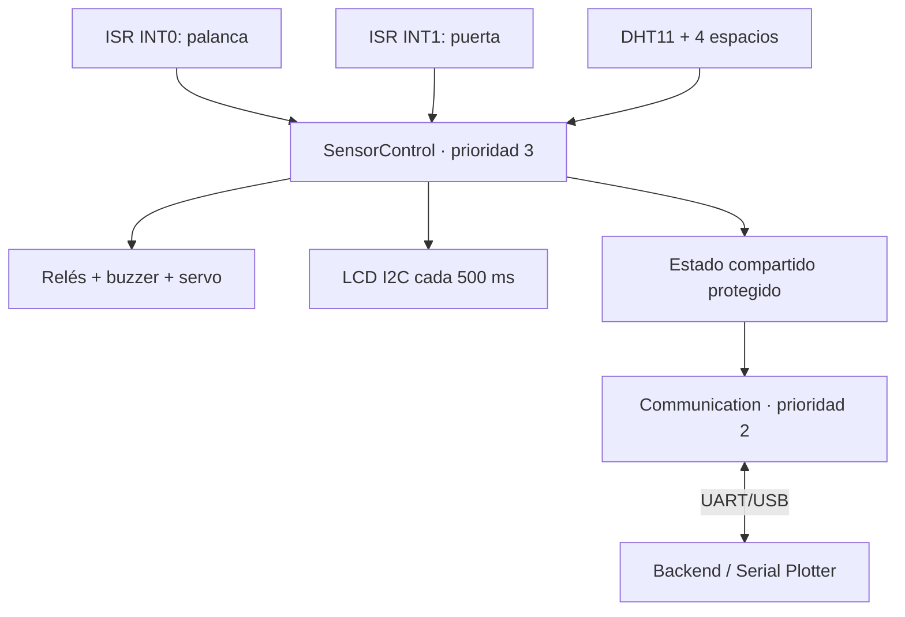

# SmartEgg Firmware — Arduino Uno R3 + FreeRTOS

Firmware del nodo físico requerido por la Práctica 1. Controla el ambiente y la
rotación localmente aunque la computadora se desconecte, muestra el estado en LCD y
publica telemetría por UART/USB para el backend y Arduino Serial Plotter.

## Hardware seleccionado

Las alternativas del PDF se concretaron así:

- Arduino Uno R3 (ATmega328P, 5 V, 2 KB SRAM).
- Sensor DHT11 confirmado para temperatura y humedad.
- LCD 16×2 con backpack I2C PCF8574.
- Bombilla de calefacción de 110 V controlada mediante CH1 del módulo de cuatro relés;
  su sección de red debe ir aislada, encerrada y ser instalada por personal calificado.
- Ventilador de 5 V controlado mediante CH2 del módulo de cuatro relés.
- Servomotor RC para la bandeja, centrado en 90° y rotado ±45°.
- Buzzer **activo** de 5 V; no se usa `tone()`.
- Un final de carrera de puerta y cuatro finales de carrera, uno por espacio.
- Switch de palanca SPDT de tres terminales para habilitar/deshabilitar el sistema.

El DHT11, la dirección LCD `0x27`, el buzzer activo de 5 V y los relés activos en alto
están confirmados. La configuración del hardware está centralizada en `Config.h`.

## Conexiones del Uno R3

| Pin | Componente | Conexión/lógica |
|---|---|---|
| D0 / D1 | USB UART | Reservados; no conectar sensores |
| D2 / INT0 | Palanca ON/OFF | COM a D2, lateral ON a GND y otro lateral libre |
| D3 / INT1 | Final de puerta | Interruptor entre D3 y GND, abierto=`LOW` configurable |
| D4 | DHT11 DATA | Pull-up de 10 kΩ a 5 V si el módulo no lo incluye |
| D5 | Relé calefacción | Entrada de módulo relé, activo en alto |
| D6 | Relé del ventilador | IN2 del módulo de relés, activo en alto |
| D7 | Buzzer activo | Mediante transistor si supera la corriente admitida por pin |
| D8 | Señal del servo | Servo alimentado externamente, tierra común |
| D9–D12 | Espacios 1–4 | Un final de carrera a GND por espacio, `INPUT_PULLUP` |
| D13 | LED de estado | LED integrado; encendido cuando nodo y DHT están sanos |
| A4 / SDA | LCD I2C | SDA |
| A5 / SCL | LCD I2C | SCL |

> Nunca alimente la bombilla, Peltier, ventilador o servo desde un pin del Arduino.
> Use fuentes adecuadas, relés/transistores dimensionados, protección contra cargas
> inductivas y GND común en el lado de baja tensión. Si se usa tensión de red, el montaje
> debe hacerlo una persona calificada con aislamiento y caja cerrada.

## Arquitectura FreeRTOS



Se usan dos tareas preemptivas para respetar los 2 KB de SRAM. Separar una tercera tarea
sólo para LCD impediría reservar stacks seguros junto con las tareas internas de FreeRTOS:

| Tarea | Periodicidad | Responsabilidad |
|---|---:|---|
| `SensorControl` | 50 ms | DHT cada 2 s, espacios cada 100 ms, interrupciones, umbrales, relés, alarma, rotación y LCD cada 500 ms |
| `Communication` | 20 ms / telemetría 2 s | Recibir JSON sin bloqueo y emitir tramas Serial |

INT0 e INT1 sólo levantan banderas `volatile`; nunca llaman LCD, Serial ni lógica pesada
desde una ISR. Las tareas usan `vTaskDelayUntil()`/`vTaskDelay()`, sin esperas bloqueantes.
La biblioteca FreeRTOS de AVR usa el watchdog para su tick, mientras Servo usa su timer;
el buzzer activo evita reservar otro temporizador.

## Comportamiento

- Calefacción: se activa debajo de 37 °C y se apaga con 0.2 °C de histéresis.
- Ventilación: se activa sobre 38 °C y se apaga con 0.2 °C de histéresis.
- Alarma: temperatura fuera de 37–38 °C, humedad fuera de 50–65 % o tres fallos DHT.
- Rotación: alterna +45° y −45° cada 120 segundos, como exige el objetivo del PDF.
- Espacios: los cuatro interruptores producen el conteo ocupado/libre en tiempo real.
- Palanca: la posición conectada a GND enciende el sistema; la posición abierta lo
  deshabilita, apaga los actuadores y centra la bandeja. El arranque respeta su posición.
- Seguridad: comandos manuales nunca fuerzan calor durante sobretemperatura ni apagan
  ventilación/alarma cuando existe una condición crítica.

## Estructura

```text
firmware/
├── CIRCUITO.md             # Conexiones, materiales y montaje seguro
├── CIRCUITO.dot            # Fuente editable del diagrama eléctrico
├── CIRCUITO.png            # Diagrama renderizado
├── CIRCUITO.svg            # Versión vectorial del diagrama
├── CIRCUITO_REALISTA.png   # Vista física del montaje y cableado
├── CIRCUITO_REALISTA.svg   # Fuente vectorial de la vista física
├── SmartEggFirmware/
│   ├── SmartEggFirmware.ino  # setup/loop y arranque seguro
│   ├── Config.h              # pines, polaridades, umbrales, tiempos y stacks
│   ├── SystemModel.h         # contratos de estado/comandos
│   ├── ControlLogic.*        # control ON/OFF, histéresis y seguridad
│   ├── Hardware.*            # Drivers DHT/I2C, relés, servo, buzzer e ISR
│   ├── SerialProtocol.*      # telemetría y parser JSON sin String
│   └── Tasks.*               # tareas FreeRTOS y estado compartido
├── PROTOCOL.md              # Contrato UART/USB con el backend
├── RUBRIC_CHECKLIST.md      # Guion de comprobación de la rúbrica
└── tests/
    ├── control_logic_test.cpp
    └── run_host_tests.sh
```

## Dependencias

Instale desde **Arduino IDE → Library Manager**:

- `FreeRTOS` de Phillip Stevens, 11.1.0-3 o compatible (`Arduino_FreeRTOS.h`).
- `Servo` oficial de Arduino, 1.3.0 o compatible.

Las versiones indican las API contra las que se verificó el código; versiones posteriores
compatibles pueden utilizarse. FreeRTOS debe ser la variante AVR de
[`feilipu/Arduino_FreeRTOS_Library`](https://github.com/feilipu/Arduino_FreeRTOS_Library),
que declara soporte para Uno R3.

El protocolo DHT11/DHT22 y el LCD I2C se manejan con drivers pequeños incluidos en el
sketch. Esto evita los buffers/objetos globales de bibliotecas genéricas y deja SRAM para
los stacks de FreeRTOS. No se requiere `DHT sensor library`, `Wire` ni
`LiquidCrystal_I2C`.

## Compilar y cargar con Arduino IDE

Las rutas siguientes parten del directorio `Practica_1_SmartEgg/`.

1. Instale las dependencias anteriores.
2. Abra `firmware/SmartEggFirmware/SmartEggFirmware.ino`.
3. Seleccione **Tools → Board → Arduino AVR Boards → Arduino Uno**.
4. Seleccione el puerto USB del Uno.
5. Pulse **Verify** y luego **Upload**.
6. Abra Serial Monitor o Serial Plotter a **115200 baud**.

También puede compilarse por terminal:

```bash
arduino-cli compile --fqbn arduino:avr:uno firmware/SmartEggFirmware
```

Verificación realizada con Arduino CLI 1.5.1, `arduino:avr` 1.8.8, FreeRTOS
11.1.0-3 y Servo 1.3.0:

```text
Flash: 19930 / 32256 bytes (61 %)
SRAM global: 944 / 2048 bytes (46 %); 1104 bytes libres para stacks/heap
```

Los stacks de aplicación se reservan en 192 y 160 bytes. Si una asignación falla, el
firmware mantiene relés/buzzer apagados, enciende D13 permanentemente y emite
`MSG:4,ERROR:6,SENSOR:0`; FreeRTOS también conserva su hook de desbordamiento.
Si el LCD no responde en `0x27` o el bus I2C queda trabado, su driver abandona la
operación y permite que el control, las alarmas y la comunicación Serial continúen.

Antes de energizar actuadores, compruebe en `Config.h`:

- `kDhtType = 11`: sensor DHT11 confirmado.
- `kLcdAddress = 0x27`: dirección LCD confirmada.
- `kRelaysActiveLow = false`: relés activos en alto confirmados.
- `kSwitchActiveLevel`: depende de la posición NO/NC elegida.

### Cómo comprobar la polaridad de los relés

Haga primero esta prueba **sin bombilla, ventilador ni tensión de red conectados a
COM/NO/NC**. Alimente sólo el módulo relé a su tensión nominal y comparta GND con el
Arduino. Para una prueba manual, desconecte `IN` del Arduino:

1. Si al unir brevemente `IN` con GND se enciende el indicador o se oye el clic, el
   módulo es activo en bajo y requiere `kRelaysActiveLow = true`.
2. En el módulo confirmado, `IN` con 5 V lo activa: es activo en alto y se configura
   mediante `kRelaysActiveLow = false`.
3. Nunca conecte VCC y GND entre sí ni manipule el lado de potencia energizado.

Al arrancar el firmware ambos canales utilizados deben permanecer apagados. Si alguno se activa al
encender el Uno, desconecte la alimentación de los actuadores y revise la polaridad.

### Cómo identificar el buzzer

El buzzer **activo de 5 V está confirmado**: recibe un nivel fijo y produce un tono por
sí solo. Por eso el firmware lo controla mediante encendido y apagado digital, sin
`tone()`.

Si su corriente no está documentada, conéctelo mediante un transistor de manejo en vez
de alimentarlo directamente desde D7.

## Serial Plotter e integración con backend

La salida normal ya es graficable, sin recompilar:

```text
MSG:1,TEMP:37.52,HUM:58.1,DOOR:0,SLOTS:3,HEATER:0,FAN:0,SERVO:-45,BUZZER:0,POWER:1,SENSOR:1
```

Arduino reconoce las series etiquetadas `TEMP` y `HUM`; el backend reconoce `TEMP`,
`HUM`, `DOOR`, `SLOTS`, `HEATER`, `FAN`, `SERVO` y `BUZZER`. No se imprime `NODE` para
que el puente use `SMARTEGG_DEFAULT_INCUBATOR_CODE=NODE-01` y para mantener todos los
campos numéricos. El protocolo y los comandos están detallados en
[`PROTOCOL.md`](PROTOCOL.md).

El puerto Serial sólo puede abrirse desde un programa a la vez: cierre Serial Plotter
antes de iniciar el backend.

## Pruebas

La lógica independiente de hardware se verifica con un compilador C++11:

```bash
./firmware/tests/run_host_tests.sh
```

Estas pruebas cubren frío, sobretemperatura, humedad, desconexión del DHT, apagado,
prioridad de seguridad sobre comandos manuales y límites del servo. La validación final
requiere el Uno y componentes reales; use
[`RUBRIC_CHECKLIST.md`](RUBRIC_CHECKLIST.md) como guion de demostración.

## Decisiones derivadas del enunciado

- El objetivo medible exige “±45° cada 2 minutos”; se priorizó sobre el mockup frontend
  que mostraba “2 H”.
- La rúbrica acepta FreeRTOS **o** dos interrupciones. Este firmware implementa ambos.
- DHT11, LCD `0x27`, buzzer activo de 5 V y relés activos en alto están confirmados y
  centralizados en la configuración.
