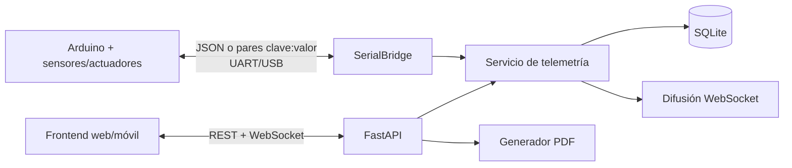

# SmartEgg API

Backend FastAPI para la Práctica 1 **SmartEgg: Incubadora Inteligente IoT**. Recibe la
telemetría ambiental del Arduino por UART/USB, conserva el ciclo de incubación en SQLite,
expone la información al frontend por REST y WebSocket, y genera el informe PDF requerido.

## Cobertura del enunciado

- Registro autenticado del técnico y nombre verificable en el informe.
- Incubadoras con capacidad, espacios ocupados/disponibles y configuración persistente.
- Ficha de identificación de lotes y huevos rotulados, con validación de posiciones.
- Lecturas históricas de temperatura/humedad y estado de sensores.
- Estados y comandos de calefacción, ventilador, servo y buzzer.
- Alarmas automáticas por temperatura, humedad y puerta abierta, con resolución y acuse.
- Rotación manual bidireccional y registro de rotaciones.
- Puente Serial UART/USB preparado para conectar el Arduino real.
- Actualización en tiempo real mediante WebSocket y consultas históricas/estadísticas.
- Descarga PDF con identificación, técnico, lotes, extremos diarios y alarmas.
- OpenAPI, Swagger UI y ReDoc generados por FastAPI.

Los requisitos puramente físicos —sketch C++, FreeRTOS/interrupciones, LCD, circuito,
encapsulado y evidencias— corresponden al firmware/prototipo y quedan fuera de este
backend. La API conserva y refleja sus datos sin sustituir el control de seguridad local
del microcontrolador.

## Arquitectura



```text
server/
├── app/
│   ├── api/              # Routers: auth, nodos, incubación, telemetría, reportes
│   ├── services/         # Ingesta, UART, tiempo real y PDF
│   ├── config.py         # Configuración desde entorno
│   ├── database.py       # Motor y sesiones SQLAlchemy
│   ├── models.py         # Modelo relacional
│   ├── schemas.py        # Contratos y validaciones Pydantic
│   ├── security.py       # Argon2 + JWT
│   └── main.py           # Fábrica de aplicación y ciclo de vida
├── scripts/              # Simulador opcional
├── tests/                # Pruebas funcionales y del protocolo Serial
├── main.py               # Entrada ASGI
├── .env.example
├── pyproject.toml
└── uv.lock
```

### Modelo de datos

| Entidad | Responsabilidad |
|---|---|
| `Technician` | Cuenta autenticada incluida en reportes |
| `Incubator` / `IncubatorConfig` | Nodo, capacidad y umbrales configurables |
| `Lot` / `Egg` | Lotes y ficha individual con posición física |
| `Sensor` / `TelemetryReading` | Estado del sensor e historial ambiental |
| `ActuatorState` | Estado/modo de calefacción, ventilador, servo y buzzer |
| `Alarm` | Eventos críticos, resolución y reconocimiento |
| `RotationEvent` | Historial de giros manuales/automáticos |

## Instalación y configuración

Requiere Python 3.12+ y [`uv`](https://docs.astral.sh/uv/).

```bash
cd Practica_1_SmartEgg/server
uv sync
cp .env.example .env
```

Genere un secreto propio; nunca suba `.env`:

```bash
python -c "import secrets; print(secrets.token_urlsafe(48))"
```

Asigne el resultado a `SMARTEGG_JWT_SECRET`. Si se omite en desarrollo, el servidor crea
uno efímero y los tokens dejan de servir al reiniciar.

Variables principales:

| Variable | Uso | Predeterminado |
|---|---|---|
| `SMARTEGG_DATABASE_URL` | URL SQLAlchemy | `sqlite:///./data/smartegg.db` |
| `SMARTEGG_JWT_SECRET` | Firma de tokens | aleatorio por proceso |
| `SMARTEGG_CORS_ORIGINS` | Orígenes JSON autorizados | `["http://localhost:3000"]` |
| `SMARTEGG_TIMEZONE` | Día/hora del reporte | `America/Guatemala` |
| `SMARTEGG_INITIAL_TECHNICIANS` | Usuarios iniciales en JSON | `[]` |
| `SMARTEGG_INITIAL_INCUBATORS` | Incubadoras iniciales en JSON | `[]` |
| `SMARTEGG_SERIAL_ENABLED` | Activa el lector UART | `false` |
| `SMARTEGG_SERIAL_PORT` | Puerto, p. ej. `/dev/ttyACM0` | vacío |
| `SMARTEGG_SERIAL_BAUDRATE` | Velocidad UART | `115200` |
| `SMARTEGG_DEFAULT_INCUBATOR_CODE` | Nodo usado si UART no envía `NODE` | `NODE-01` |
| `SMARTEGG_REPORT_LOGO_PATH` | PNG/JPG para el informe | vacío |

## Ejecución

Red local (laptop, teléfono y tablet en la misma red):

```bash
uv run fastapi dev --host 0.0.0.0
```

Producción sin recarga:

```bash
uv run fastapi run --host 0.0.0.0
```

- API: `http://<IP_LOCAL>:8000`
- Swagger UI: `http://<IP_LOCAL>:8000/docs`
- ReDoc: `http://<IP_LOCAL>:8000/redoc`
- Salud: `GET /health`

### Inicialización segura

Para crear automáticamente uno o varios técnicos al arrancar, configure la lista en
`server/.env`:

```env
SMARTEGG_INITIAL_TECHNICIANS=[{"username":"ricardo","full_name":"Ricardo","password":"una-clave-segura"}]
```

Cada nombre de usuario se crea solamente si todavía no existe. Los reinicios no cambian
su contraseña ni duplican la cuenta. No suba el archivo `.env` al repositorio.

La incubadora física también puede quedar lista sin llamadas manuales a Swagger:

```env
SMARTEGG_INITIAL_INCUBATORS=[{"code":"NODE-01","name":"Incubadora principal","capacity":4,"serial_number":"ARDUINO-UNO-R3"}]
```

Al crearla se generan su configuración predeterminada y los estados de calefacción,
ventilador, servo y buzzer. Los reinicios no duplican ni reemplazan el nodo existente.

Como alternativa, el primer técnico puede crearse manualmente una única vez:

```bash
curl -X POST http://127.0.0.1:8000/api/v1/auth/bootstrap \
  -H 'Content-Type: application/json' \
  -d '{"username":"tecnico1","full_name":"Nombre del técnico","password":"clave-segura"}'
```

Luego use `POST /api/v1/auth/login` y envíe el token como
`Authorization: Bearer <token>`. La creación de incubadora, lote y huevos se realiza desde
Swagger o los endpoints siguientes.

## Contrato de API

Todos los endpoints funcionales usan el prefijo `/api/v1`. Salvo `bootstrap`, `login` y
el estado de salud, requieren JWT.

| Área | Operaciones principales |
|---|---|
| Auth | `POST /auth/bootstrap`, `POST /auth/login`, `GET /auth/me`, `POST /auth/technicians` |
| Incubadoras | `POST/GET /incubators`, `GET /incubators/{id}/state` |
| Configuración | `GET/PUT /incubators/{id}/config` |
| Lotes | `POST/GET /lots`, `GET/PATCH /lots/{id}` |
| Huevos | `POST/GET /eggs`, `GET/PATCH /eggs/{id}` |
| Ocupación | `GET /incubators/{id}/occupancy` |
| Sensores | `GET /incubators/{id}/sensors`, `PATCH .../sensors/{sensor_id}` |
| Telemetría | `POST /telemetry`, `GET .../telemetry`, `GET .../latest`, `GET .../stats` |
| Actuadores | `GET .../actuators`, `POST .../actuators/{kind}/commands` |
| Rotación | `POST/GET /incubators/{id}/rotations` |
| Alarmas | `GET .../alarms`, `POST .../alarms/{alarm_id}/acknowledge` |
| Reporte | `GET /reports/incubators/{id}/daily.pdf?day=AAAA-MM-DD` |
| Tiempo real | `WS /ws/incubators/{id}?token=<JWT>` |
| Serial | `GET /serial/status` |

El contrato exacto, ejemplos, restricciones y respuestas 422 siempre se mantienen en
`/openapi.json` y Swagger. El endpoint agregado `state` entrega en una petición el nodo,
configuración, última lectura, ocupación, sensores, actuadores y alarmas activas.

## Protocolo Serial UART/USB

Cada mensaje ocupa una línea terminada en `\n`. Se admiten dos representaciones:

```json
{"incubator_code":"NODE-01","temperature_c":37.6,"humidity_pct":58,"door_open":false,"occupied_slots":3,"heater":false,"fan":false,"servo_angle":45,"buzzer":false}
```

```text
NODE:NODE-01,TEMP:37.6,HUM:58,DOOR:0,SLOTS:3,HEATER:0,FAN:0,SERVO:45,BUZZER:0
```

Campos mínimos: temperatura y humedad. Los booleanos aceptan `0/1`, `true/false` u
`on/off`. El puente reconecta automáticamente si el Arduino se desconecta. Los comandos
hacia el microcontrolador se envían como JSON por línea:

```json
{"type":"rotate","angle_degrees":-45}
{"type":"actuator","kind":"fan","enabled":true,"mode":"manual","value":null}
{"type":"config","temperature_min_c":37.0,"temperature_max_c":38.0}
```

El Arduino debe conservar su control ON/OFF y alarmas aun cuando la computadora se
desconecte. El backend vuelve a evaluar los umbrales para mantener consistente la vista y
el historial, pero no reemplaza esa protección local.

## Umbrales y decisión ante contradicciones

La configuración inicial sigue los requisitos explícitos del objetivo y la rúbrica:

- temperatura segura: 37–38 °C;
- humedad segura: 50–65 %;
- rotación: ±45° cada 120 segundos;
- temperatura crítica inicial: 39 °C.

El frontend de referencia muestra “2 H”, pero el objetivo medible del PDF ordena rotación
“cada 2 minutos”; se priorizó el requisito explícito y evaluable. Todos los valores quedan
persistidos y pueden ajustarse mediante `PUT /incubators/{id}/config` sin rediseñar el
backend.

## Simulador y pruebas

Con el servidor iniciado, configure credenciales existentes y ejecute:

```bash
SMARTEGG_SIM_USERNAME=tecnico1 \
SMARTEGG_SIM_PASSWORD=clave-segura \
uv run python scripts/simulate_telemetry.py
```

Pruebas:

```bash
uv run pytest
uv run pytest --cov=app --cov-report=term-missing
```
