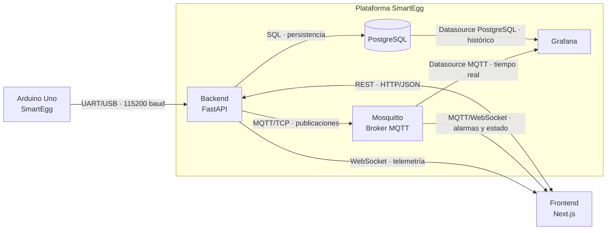

# Proyecto 1 — SmartEgg

SmartEgg es un sistema de incubadora inteligente IoT. Este proyecto reutiliza como base
el frontend, el servidor y el firmware desarrollados para la Práctica 1.

## Estructura

```text
Proyecto_1_SmartEgg/
├── client/       # Aplicación web en Next.js
├── server/       # API REST y WebSocket en FastAPI
├── db/           # Modelo relacional y consultas de PostgreSQL
├── firmware/     # Referencia al firmware reutilizado de la Práctica 1
├── docs/         # Documentación y enunciado
├── grafana/      # Dashboards y configuración de Grafana
├── mqtt/         # Mosquitto, ACL y contrato de topics MQTT
└── docker-compose.yml
```

La base de datos PostgreSQL se ejecuta fuera del servidor como un servicio independiente
y conserva sus datos en el volumen Docker `postgres_data`. El modelo documentado está
en `db/schema.dbml` y las consultas de Grafana en `db/grafana_queries.sql`.

## Arquitectura general



### Conexiones

| Origen | Destino | Conexión | Datos |
|---|---|---|---|
| Arduino | Backend | UART/USB a 115200 baud | Temperatura, humedad, puerta, ocupación y actuadores |
| Backend | PostgreSQL | SQLAlchemy con PostgreSQL | Telemetría, alarmas, configuración, lotes, huevos y operaciones de puerta |
| Backend | Mosquitto | MQTT 3.1.1 por TCP | Telemetría, sensores, actuadores, alarmas y disponibilidad |
| Frontend | Backend | REST por HTTP/JSON | Autenticación, consultas, configuración y registros |
| Backend | Frontend | WebSocket | Telemetría procesada en vivo |
| Mosquitto | Frontend | MQTT sobre WebSocket | Alarmas críticas, estado del nodo y actuadores |
| Mosquitto | Grafana | Datasource MQTT | Paneles de estado en tiempo real |
| PostgreSQL | Grafana | Datasource PostgreSQL de solo lectura | Tendencias, agregados, alarmas y operaciones de puerta |

El backend es el único componente que recibe directamente la trama serial. Cada
lectura válida se persiste en PostgreSQL, se publica en Mosquitto y se transmite a
los clientes WebSocket conectados. El frontend utiliza REST para operaciones bajo
demanda y MQTT sobre WebSocket para eventos del broker. Grafana mantiene dos fuentes:
Mosquitto para el estado actual y PostgreSQL para el historial.

## Ejecución local

### Plataforma completa

```bash
cp .env.example .env
docker compose up -d --build
```

Con este comando levantamos PostgreSQL, Mosquitto, el backend y Grafana. El backend
aplica las migraciones antes de iniciar y queda disponible en `http://localhost:8000`.
Podemos verificar todos los servicios con:

```bash
docker compose ps
curl http://localhost:8000/health
```

Para conectar el Arduino por `/dev/ttyACM0` usamos el archivo adicional:

```bash
docker compose -f docker-compose.yml -f docker-compose.serial.yml up -d --build
```

### Base de datos

```bash
cp .env.example .env
docker compose up -d database
```

### Broker MQTT

```bash
docker compose up -d broker
```

Mosquitto escucha en `1883` para MQTT TCP y en `9001` para MQTT sobre WebSocket.
Consulte `mqtt/README.md` antes de desplegarlo fuera de una red local.

### Grafana

```bash
docker compose up -d grafana
```

Grafana estará disponible en `http://localhost:3001`. Al iniciar cargamos los
datasources de PostgreSQL y MQTT junto con los dashboards del proyecto. Los detalles
están en `grafana/README.md`.

### Servidor

Para ejecutar el servidor sin Docker requiere Python 3.12 o superior y `uv`.

```bash
cd server
uv sync
cp .env.example .env
uv run alembic upgrade head
uv run fastapi dev --host 0.0.0.0
```

La API estará disponible en `http://localhost:8000` y su documentación en
`http://localhost:8000/docs`.

### Cliente

Requiere Node.js y `pnpm`.

```bash
cd client
pnpm install
pnpm dev
```

El frontend estará disponible en `http://localhost:3000`.

## Visualización de datos

El frontend incluye un **Observatorio** interactivo con p5.js: vista isométrica
de la incubadora, capas de temperatura y humedad, estructura desplegable e
inspección de posiciones. El historial utiliza Chart.js con lecturas reales,
filtros por cantidad de muestras y una tabla de valores. Ambas vistas conservan
los temas claro, oscuro y automático.

La elección de librerías, el flujo de datos y el guion del video están en
[client/README.md](client/README.md#visualización-avanzada). Falta grabar el video
demostrativo con el nodo físico y agregar su enlace.

## HTTP vs. MQTT en SmartEgg

SmartEgg utiliza HTTP para operaciones bajo demanda y MQTT para distribución de
eventos en tiempo real.

### Comparación

| Criterio | HTTP | MQTT |
|---|---|---|
| Modelo | Cliente-servidor, petición/respuesta | Publicación/suscripción mediante un broker |
| Inicio de la comunicación | El cliente solicita cada recurso u operación | El broker entrega un mensaje cuando se publica en un topic suscrito |
| Encabezados y tráfico | Incluye método, URI, cabeceras y respuesta HTTP | Usa paquetes de control compactos, un topic y el payload |
| Entrega | El resultado se expresa con códigos de estado; los reintentos dependen del cliente y de si la operación es segura o idempotente | Ofrece QoS 0 (como máximo una vez), QoS 1 (al menos una vez) y QoS 2 (exactamente una vez) |
| Desconexiones | El cliente vuelve a realizar la consulta; una conexión persistente evita abrir una conexión para cada petición | Puede conservar sesión y mensajes, reenviar según el QoS y publicar un Last Will ante una desconexión inesperada |
| Último estado | Puede consultarse nuevamente o almacenarse en caché cuando la semántica lo permite | Un mensaje retained permite entregar el último estado a un nuevo suscriptor |
| Escalabilidad | Es apropiado para operaciones dirigidas a recursos; cada consumidor inicia sus solicitudes | Un mensaje puede distribuirse a varios consumidores sin que el publicador mantenga una conexión con cada uno |
| Consumo en IoT | Las consultas frecuentes y sus cabeceras pueden aumentar tráfico, radio activa y energía | Su menor sobrecarga y la entrega por eventos favorecen telemetría frecuente en enlaces limitados |
| Uso en SmartEgg | Inicio de sesión, configuración, lotes, huevos, reportes e historial | Telemetría, estado del nodo, actuadores y alarmas en tiempo real |

El consumo de cada protocolo depende de la frecuencia, el tamaño del payload, el
QoS, TLS y la calidad del enlace. MQTT mantiene una conexión, intercambia keep-alive
y confirma los mensajes con QoS 1 o 2. En SmartEgg, una publicación puede llegar al
frontend y a Grafana sin que cada consumidor consulte repetidamente al backend.

### Optimizaciones disponibles para HTTP en IoT

Las siguientes técnicas reducen el tráfico o la latencia de HTTP en dispositivos y
redes restringidas:

- `keep-alive`: reutilización de conexiones TCP y TLS.
- `Content-Encoding`: compresión del cuerpo de la petición o respuesta.
- HTTP/2: multiplexación de solicitudes y compresión de campos de cabecera.
- Caché y solicitudes condicionales: reutilización de respuestas que no cambiaron.
- *Batching*: agrupación de lecturas en una sola petición a cambio de mayor latencia.
- CoAP: protocolo web con semántica REST y mensajes pequeños para dispositivos y
  redes restringidas.

### Implementación en SmartEgg

| Flujo | Protocolo | Configuración |
|---|---|---|
| Arduino → backend | UART/USB | Lecturas seriales heredadas de la Práctica 1 |
| Backend → PostgreSQL | Conexión SQL | Persistencia de telemetría, alarmas y registros |
| Backend → Mosquitto | MQTT 3.1.1 | Publicación de telemetría y estado |
| Backend → frontend | HTTP REST | Autenticación, configuración, lotes, huevos, historial y reportes |
| Backend → frontend | WebSocket | Telemetría en vivo |
| Mosquitto → frontend | MQTT sobre WebSocket | Alarmas, disponibilidad y actuadores |
| PostgreSQL → Grafana | SQL | Consultas históricas |
| Mosquitto → Grafana | MQTT | Paneles en tiempo real |

La telemetría periódica se publica con QoS 0 y retained. Una lectura posterior
reemplaza el último valor. Los estados, actuadores y alarmas se publican con QoS 1 y
retained. El topic `smartegg/{id}/status` tiene un Last Will que informa la
desconexión inesperada del backend.

FastAPI expone el contrato REST mediante OpenAPI en `/docs`. Mosquitto mantiene el
contrato de mensajes definido en [mqtt/TOPICS.md](mqtt/TOPICS.md).

### Fuentes consultadas

- [RFC 9110 — HTTP Semantics](https://www.rfc-editor.org/rfc/rfc9110.html)
- [RFC 9111 — HTTP Caching](https://www.rfc-editor.org/rfc/rfc9111.html)
- [RFC 9113 — HTTP/2](https://www.rfc-editor.org/rfc/rfc9113.html)
- [MQTT Version 3.1.1 — OASIS Standard](https://docs.oasis-open.org/mqtt/mqtt/v3.1.1/os/mqtt-v3.1.1-os.html)
- [RFC 7252 — Constrained Application Protocol](https://www.rfc-editor.org/rfc/rfc7252.html)

## Firmware reutilizado

El firmware no se duplicó en este proyecto. Se reutiliza sin cambios el código de
`Practica_1_SmartEgg/firmware`.
