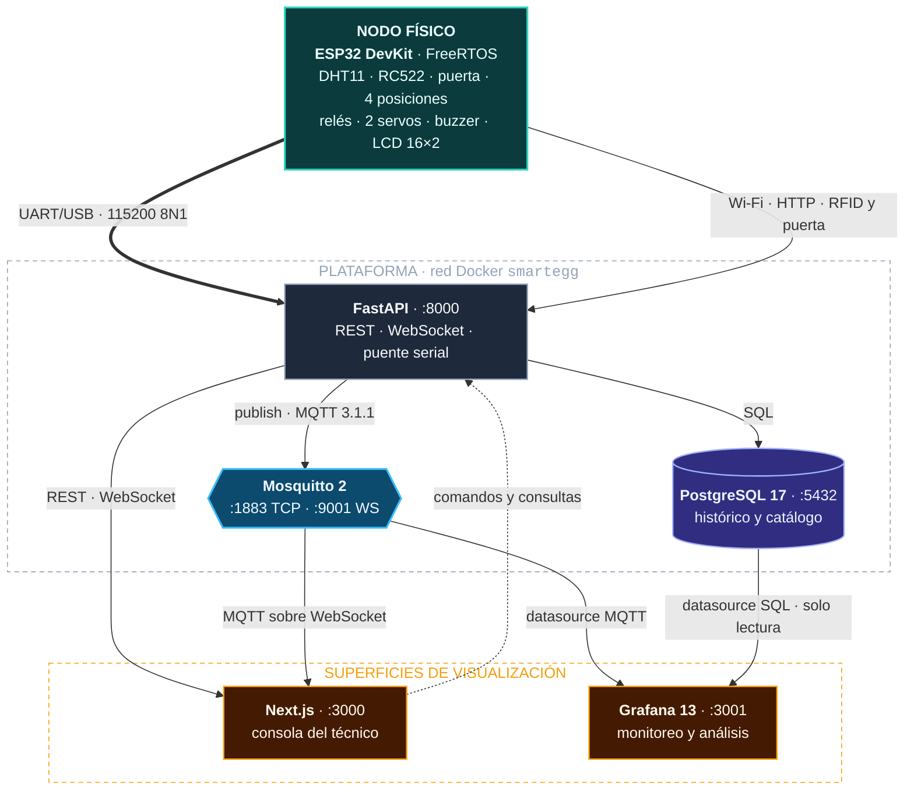
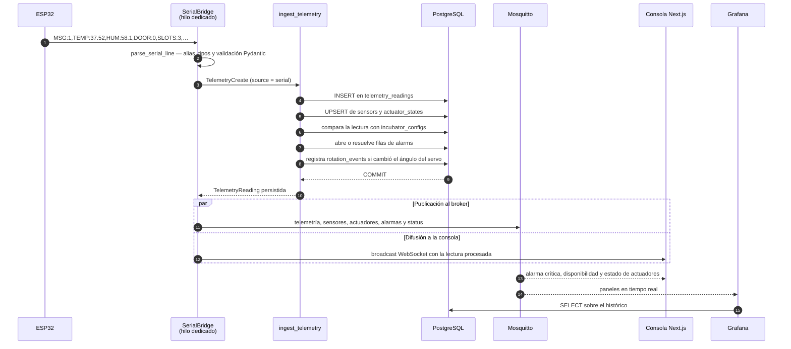
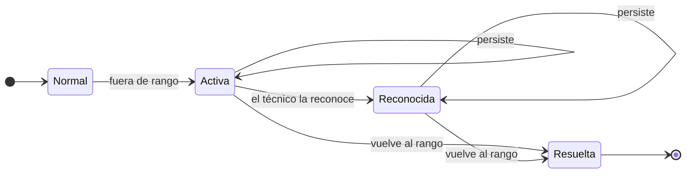
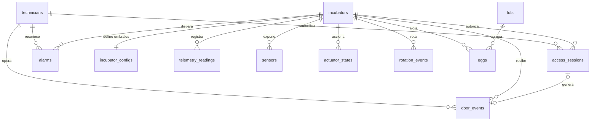
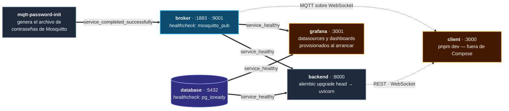
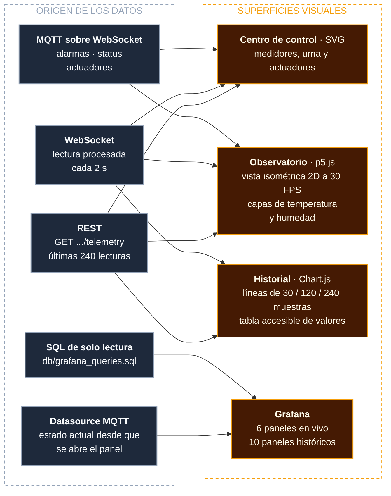
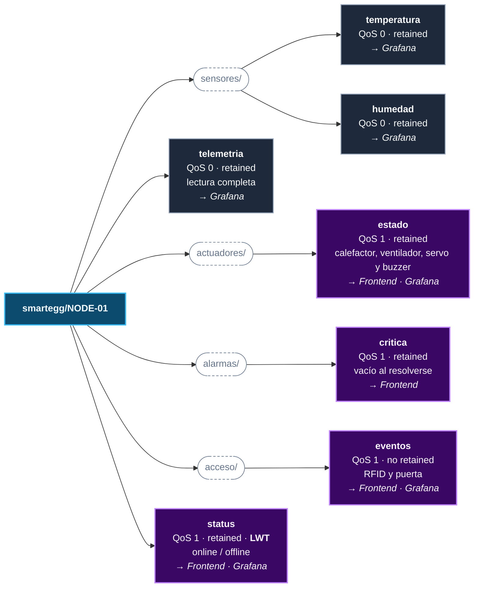

# Proyecto 1 — SmartEgg

SmartEgg es un sistema de incubadora inteligente IoT. Un nodo ESP32 mide el
ambiente de la cámara y acciona sus actuadores; una plataforma en Docker persiste cada
lectura, la publica en un broker MQTT y la distribuye a una consola web y a Grafana.
Este proyecto reutiliza como base el frontend, el servidor y la lógica de control
desarrollados para la Práctica 1.

```bash
cp .env.example .env
docker compose up -d --build      # PostgreSQL + Mosquitto + FastAPI + Grafana
cd client && pnpm install && pnpm dev
```

## Contenido

- [Estructura](#estructura)
- [Arquitectura general](#arquitectura-general)
  - [Conexiones](#conexiones)
  - [Recorrido de una lectura](#recorrido-de-una-lectura)
  - [Ciclo de vida de una alarma](#ciclo-de-vida-de-una-alarma)
- [Modelo de datos](#modelo-de-datos)
- [Ejecución local](#ejecución-local)
- [Visualización de datos](#visualización-de-datos)
- [HTTP vs. MQTT en SmartEgg](#http-vs-mqtt-en-smartegg)
- [Firmware ESP32](#firmware-esp32)
- [Revisión de calificación](#revisión-de-calificación)

## Estructura

```text
Proyecto_1_SmartEgg/
├── client/       # Aplicación web en Next.js — consola, Observatorio e Historial
├── server/       # API REST, WebSocket, puente serial y publicador MQTT en FastAPI
├── db/           # Modelo relacional (schema.dbml) y consultas de Grafana
├── firmware/     # Firmware integrado para ESP32, RC522 y los actuadores
├── docs/         # Documentación y enunciado
├── grafana/      # Dashboards provisionados y datasources
├── mqtt/         # Mosquitto, ACL y contrato de topics MQTT
├── docker-compose.yml         # Plataforma completa
└── docker-compose.serial.yml  # Sobrecarga que expone /dev/ttyACM0 al backend
```

La base de datos PostgreSQL se ejecuta fuera del servidor como un servicio independiente
y conserva sus datos en el volumen Docker `postgres_data`. El modelo documentado está
en `db/schema.dbml` y las consultas de Grafana en `db/grafana_queries.sql`.

## Arquitectura general



> 🟩 nodo físico · ⬛ backend · 🟪 almacenamiento · 🟦 broker · 🟧 superficies de visualización

### Conexiones

| Origen | Destino | Conexión | Datos |
|---|---|---|---|
| ESP32 | Backend | UART/USB a 115200 baud | Temperatura, humedad, puerta, ocupación y actuadores |
| ESP32 | Backend | HTTP por Wi-Fi | UID RFID y eventos del sensor de puerta |
| Backend | PostgreSQL | SQLAlchemy con PostgreSQL | Telemetría, alarmas, configuración, lotes, huevos y operaciones de puerta |
| Backend | Mosquitto | MQTT 3.1.1 por TCP | Telemetría, sensores, actuadores, alarmas y disponibilidad |
| Frontend | Backend | REST por HTTP/JSON | Autenticación, consultas, configuración y registros |
| Backend | Frontend | WebSocket | Telemetría procesada en vivo |
| Mosquitto | Frontend | MQTT sobre WebSocket | Alarmas críticas, estado del nodo y actuadores |
| Mosquitto | Grafana | Datasource MQTT | Paneles de estado en tiempo real |
| PostgreSQL | Grafana | Datasource PostgreSQL de solo lectura | Tendencias, agregados, alarmas y operaciones de puerta |

El backend es el único componente que recibe directamente la trama serial. Cada
lectura válida se persiste en PostgreSQL, se publica en Mosquitto y se transmite a
los clientes WebSocket conectados. El frontend utiliza REST para operaciones bajo
demanda y MQTT sobre WebSocket para eventos del broker. Grafana mantiene dos fuentes:
Mosquitto para el estado actual y PostgreSQL para el historial.

### Recorrido de una lectura

Cada dos segundos el firmware emite una línea de texto plano. Este es el camino
completo desde esa línea hasta las tres superficies que la muestran:



Si la trama no se puede interpretar, el puente la descarta y registra la excepción sin
interrumpir el flujo. `SLOTS` contiene la cantidad confirmada por cuatro
microinterruptores de presión, uno por posición. Cuando el campo no viene en la trama,
el backend deriva la ocupación contando los huevos en estado `incubating`, y siempre
rechaza una ocupación mayor que la capacidad declarada de la incubadora.

### Ciclo de vida de una alarma

El backend no acumula alarmas repetidas: por cada tipo mantiene a lo sumo una fila sin
resolver y la reutiliza mientras la condición persista.



| Transición | Efecto en `alarms` | Publicación MQTT |
|---|---|---|
| Normal → Activa | `INSERT` con `occurred_at`, `kind`, `severity`, `message` y `value` | Mensaje retenido en `alarmas/critica` |
| Activa → Activa | Reutiliza la fila abierta y actualiza `severity`, `message` y `value` | Reemplaza el mensaje retenido |
| Activa → Reconocida | `acknowledged_at` y `acknowledged_by_id` | Sin cambio |
| → Resuelta | `resolved_at` | Mensaje retenido vacío |

Los cinco tipos vigilados son `temperature_low`, `temperature_high`, `humidity_low`,
`humidity_high` y `door_open`. La severidad es `warning` salvo cuando la temperatura
alcanza `critical_temperature_c`, que la eleva a `critical`.

Los umbrales viven en `incubator_configs`, así que se pueden cambiar en caliente desde
`PUT /api/v1/incubators/{id}/config` sin reprogramar el nodo, sin recompilar el firmware
y sin reiniciar ningún servicio.

## Modelo de datos

Doce tablas, todas colgando de `incubators` salvo el catálogo de lotes y el de técnicos.
El esquema se administra con Alembic desde `server/migrations`; `db/schema.dbml`
documenta cada columna e índice.



| Tabla | Qué guarda | Escrita por |
|---|---|---|
| `technicians` | Credenciales, rol y UID RFID del personal | `POST /auth/bootstrap` y `/auth/technicians` |
| `access_sessions` | Sesión RFID, operador, apertura, cierre y causa de finalización | ESP32 mediante `/access` |
| `incubators` | Código, capacidad, número de serie y última señal | Bootstrap y telemetría |
| `incubator_configs` | Rangos de temperatura y humedad, umbral crítico, intervalo y ángulo de rotación | Consola (`PUT /config`) |
| `telemetry_readings` | Una fila por trama recibida, con la línea original en `raw_payload` | Puente serial y `POST /telemetry` |
| `sensors` | Último valor y marca de tiempo por sensor | `ingest_telemetry` (upsert) |
| `actuator_states` | Estado, modo y valor de calefactor, ventilador, servo y buzzer | `ingest_telemetry` y comandos manuales |
| `alarms` | Apertura, severidad, reconocimiento y resolución | `ingest_telemetry` y la consola |
| `rotation_events` | Cada cambio real del ángulo del servo, con dirección y origen | `ingest_telemetry` y rotación manual |
| `lots` | Lote, especie, origen y fechas de incubación | Consola |
| `eggs` | Ficha del huevo, su lote y su posición física | Consola |
| `door_events` | Aperturas de puerta con operador, método de acceso, motivo y conteo de huevos | ESP32 y consola |

`telemetry_readings` y `door_events` llevan índice compuesto por incubadora y fecha,
que es la forma en que Grafana y el historial los consultan.

## Ejecución local

`docker-compose.yml` levanta cuatro servicios más un trabajo de inicialización. El
frontend queda fuera de Compose y se ejecuta con `pnpm`.



| Servicio | Imagen | Puerto local | Variable | Volumen |
|---|---|---:|---|---|
| `database` | `postgres:17-alpine` | 5432 | `POSTGRES_PORT` | `postgres_data` |
| `broker` | `eclipse-mosquitto:2` | 1883 · 9001 | `MQTT_PORT` · `MQTT_WS_PORT` | `mosquitto_data` · `mosquitto_secrets` |
| `backend` | `./server` (build) | 8000 | `BACKEND_PORT` | — |
| `grafana` | `grafana/grafana:13.2.0` | 3001 | `GRAFANA_PORT` | `grafana_data` |
| `client` | fuera de Compose | 3000 | — | — |

### Plataforma completa

```bash
cp .env.example .env
docker compose up -d --build
```

Con este comando levantamos PostgreSQL, Mosquitto, el backend y Grafana. El backend
aplica las migraciones antes de iniciar y queda disponible en `http://localhost:8000`.
Podemos verificar todos los servicios con:

```bash
docker compose ps
curl http://localhost:8000/health
```

Para conectar la ESP32 por `/dev/ttyUSB0` usamos el archivo adicional:

```bash
docker compose -f docker-compose.yml -f docker-compose.serial.yml up -d --build
```

### Base de datos

```bash
cp .env.example .env
docker compose up -d database
```

### Broker MQTT

```bash
docker compose up -d broker
```

Mosquitto escucha en `1883` para MQTT TCP y en `9001` para MQTT sobre WebSocket.
Consulte `mqtt/README.md` antes de desplegarlo fuera de una red local.

### Grafana

```bash
docker compose up -d grafana
```

Grafana estará disponible en `http://localhost:3001`. Al iniciar cargamos los
datasources de PostgreSQL y MQTT junto con los dashboards del proyecto. Los detalles
están en `grafana/README.md`.

### Servidor

Para ejecutar el servidor sin Docker requiere Python 3.12 o superior y `uv`.

```bash
cd server
uv sync
cp .env.example .env
uv run alembic upgrade head
uv run fastapi dev --host 0.0.0.0
```

La API estará disponible en `http://localhost:8000` y su documentación en
`http://localhost:8000/docs`.

### Cliente

Requiere Node.js y `pnpm`.

```bash
cd client
pnpm install
pnpm dev
```

El frontend estará disponible en `http://localhost:3000`.

## Visualización de datos

Los mismos datos se leen en cuatro superficies, cada una con su librería y su origen:



| Superficie | Librería | Qué dibuja | Interacción |
|---|---|---|---|
| Centro de control | SVG propio | Medidor de temperatura, columna de humedad, urna, dial de bandeja y panel de actuadores | Ajuste de consignas y comandos manuales |
| Observatorio | [p5.js](https://p5js.org/reference/) | Vista isométrica 2D de la incubadora, con estructura desplegable y posiciones inspeccionables | Separar capas, alternar temperatura/humedad, seleccionar posición y pausar el movimiento |
| Historial | [Chart.js](https://www.chartjs.org/docs/latest/) | Líneas de temperatura y humedad sobre lecturas reales | Elegir magnitud, ventana de 30/120/240 muestras y consultar valores al pasar el cursor |
| Grafana | Paneles nativos | Estado actual desde MQTT y tendencias, alarmas y operaciones de puerta desde PostgreSQL | Rango temporal y variables del dashboard |

En el Observatorio la temperatura modifica el color, la humedad determina la cantidad de
partículas, el ventilador activa su circulación y el ángulo del servo inclina la
bandeja. Son representaciones ilustrativas del estado, no una simulación física ni un
mapa térmico. Sin lecturas mostramos un estado de espera y al perder la conexión
detenemos el flujo animado.

Las cuatro superficies conservan los temas claro, oscuro y automático, y respetan
`prefers-reduced-motion`. Los promedios del Historial corresponden a las lecturas
disponibles, no a un período fijo de 24 horas.

La elección de librerías, el flujo de datos y el guion del video están en
[client/README.md](client/README.md#visualización-avanzada). Falta grabar el video
demostrativo con el nodo físico y agregar su enlace.

## HTTP vs. MQTT en SmartEgg

SmartEgg utiliza HTTP para operaciones bajo demanda y MQTT para distribución de
eventos en tiempo real.

### Comparación

| Criterio | HTTP | MQTT |
|---|---|---|
| Modelo | Cliente-servidor, petición/respuesta | Publicación/suscripción mediante un broker |
| Inicio de la comunicación | El cliente solicita cada recurso u operación | El broker entrega un mensaje cuando se publica en un topic suscrito |
| Encabezados y tráfico | Incluye método, URI, cabeceras y respuesta HTTP | Usa paquetes de control compactos, un topic y el payload |
| Entrega | El resultado se expresa con códigos de estado; los reintentos dependen del cliente y de si la operación es segura o idempotente | Ofrece QoS 0 (como máximo una vez), QoS 1 (al menos una vez) y QoS 2 (exactamente una vez) |
| Desconexiones | El cliente vuelve a realizar la consulta; una conexión persistente evita abrir una conexión para cada petición | Puede conservar sesión y mensajes, reenviar según el QoS y publicar un Last Will ante una desconexión inesperada |
| Último estado | Puede consultarse nuevamente o almacenarse en caché cuando la semántica lo permite | Un mensaje retained permite entregar el último estado a un nuevo suscriptor |
| Escalabilidad | Es apropiado para operaciones dirigidas a recursos; cada consumidor inicia sus solicitudes | Un mensaje puede distribuirse a varios consumidores sin que el publicador mantenga una conexión con cada uno |
| Consumo en IoT | Las consultas frecuentes y sus cabeceras pueden aumentar tráfico, radio activa y energía | Su menor sobrecarga y la entrega por eventos favorecen telemetría frecuente en enlaces limitados |
| Uso en SmartEgg | Inicio de sesión, configuración, lotes, huevos, reportes e historial | Telemetría, estado del nodo, actuadores y alarmas en tiempo real |

El consumo de cada protocolo depende de la frecuencia, el tamaño del payload, el
QoS, TLS y la calidad del enlace. MQTT mantiene una conexión, intercambia keep-alive
y confirma los mensajes con QoS 1 o 2. En SmartEgg, una publicación puede llegar al
frontend y a Grafana sin que cada consumidor consulte repetidamente al backend.

### Optimizaciones disponibles para HTTP en IoT

Las siguientes técnicas reducen el tráfico o la latencia de HTTP en dispositivos y
redes restringidas:

- `keep-alive`: reutilización de conexiones TCP y TLS.
- `Content-Encoding`: compresión del cuerpo de la petición o respuesta.
- HTTP/2: multiplexación de solicitudes y compresión de campos de cabecera.
- Caché y solicitudes condicionales: reutilización de respuestas que no cambiaron.
- *Batching*: agrupación de lecturas en una sola petición a cambio de mayor latencia.
- CoAP: protocolo web con semántica REST y mensajes pequeños para dispositivos y
  redes restringidas.

### Implementación en SmartEgg

| Flujo | Protocolo | Configuración |
|---|---|---|
| ESP32 → backend | UART/USB | Telemetría basada en el protocolo de la Práctica 1 |
| ESP32 → backend | HTTP | Autorización RFID y apertura/cierre de puerta |
| Backend → PostgreSQL | Conexión SQL | Persistencia de telemetría, alarmas y registros |
| Backend → Mosquitto | MQTT 3.1.1 | Publicación de telemetría y estado |
| Backend → frontend | HTTP REST | Autenticación, configuración, lotes, huevos, historial y reportes |
| Backend → frontend | WebSocket | Telemetría en vivo |
| Mosquitto → frontend | MQTT sobre WebSocket | Alarmas, disponibilidad y actuadores |
| PostgreSQL → Grafana | SQL | Consultas históricas |
| Mosquitto → Grafana | MQTT | Paneles en tiempo real |

### Contrato de topics

Todo el árbol cuelga del prefijo `smartegg/{id}`, donde `{id}` es el código de la
incubadora. El ejemplo usa `NODE-01`, que es el valor predeterminado del firmware.



> ⬛ QoS 0 · retained — telemetría periódica · 🟪 QoS 1 — estados y eventos

La telemetría periódica se publica con QoS 0 y retained. Una lectura posterior
reemplaza el último valor. Los estados, actuadores y alarmas se publican con QoS 1 y
retained. El topic `smartegg/{id}/status` tiene un Last Will que informa la
desconexión inesperada del backend.

FastAPI expone el contrato REST mediante OpenAPI en `/docs`. Mosquitto mantiene el
contrato de mensajes definido en [mqtt/TOPICS.md](mqtt/TOPICS.md).

### Fuentes consultadas

- [RFC 9110 — HTTP Semantics](https://www.rfc-editor.org/rfc/rfc9110.html)
- [RFC 9111 — HTTP Caching](https://www.rfc-editor.org/rfc/rfc9111.html)
- [RFC 9113 — HTTP/2](https://www.rfc-editor.org/rfc/rfc9113.html)
- [MQTT Version 3.1.1 — OASIS Standard](https://docs.oasis-open.org/mqtt/mqtt/v3.1.1/os/mqtt-v3.1.1-os.html)
- [RFC 7252 — Constrained Application Protocol](https://www.rfc-editor.org/rfc/rfc7252.html)

## Firmware ESP32

El firmware reutiliza la lógica de control de
[`Practica_1_SmartEgg/firmware`](../Practica_1_SmartEgg/firmware/) y la adapta a una
ESP32 DevKit. El nodo integra el RC522, el servo de acceso y las tareas FreeRTOS junto a
los sensores y actuadores de la incubadora. La telemetría conserva una trama JSON por
línea a 115200 8N1:

```text
{"incubator_code":"NODE-01","temperature_c":37.52,"humidity_pct":58.1,"door_open":false,"occupied_slots":3,"heater":false,"fan":false,"servo_angle":-45,"buzzer":false}
```

El acceso RFID se envía por HTTP y el backend devuelve el ángulo del servo. El mapa de
pines, las bibliotecas y la configuración están en [firmware/README.md](firmware/README.md).

## Revisión de calificación

La hoja de calificación de la Práctica 1 está guardada en
[`docs/calificacion/Hoja_Calificacion_Practica1_SmartEgg.pdf`](docs/calificacion/Hoja_Calificacion_Practica1_SmartEgg.pdf).
La revisión punto por punto, las evidencias disponibles y los pendientes para optar a
la nota máxima están en
[`docs/calificacion/REVISION_PRACTICA_1.md`](docs/calificacion/REVISION_PRACTICA_1.md).
