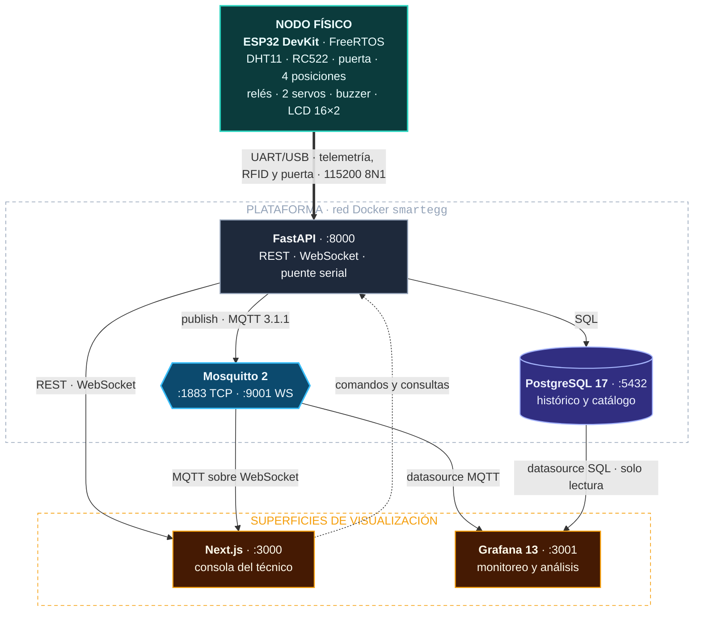
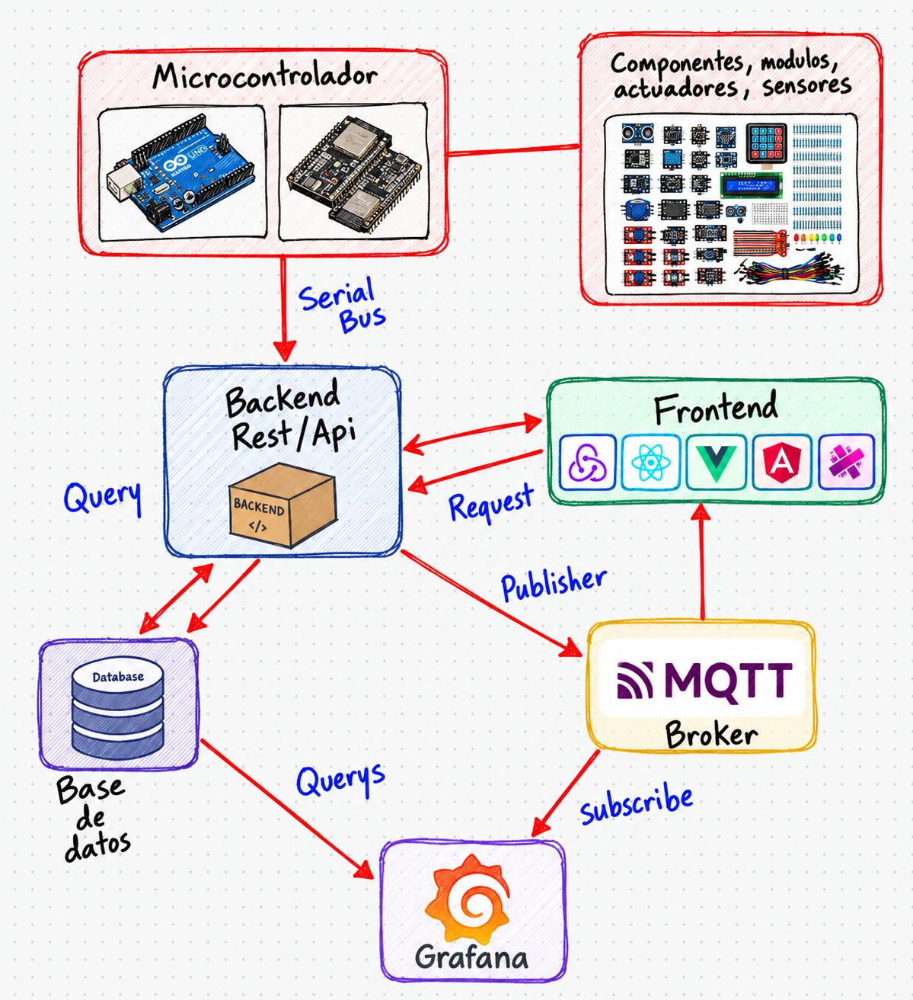
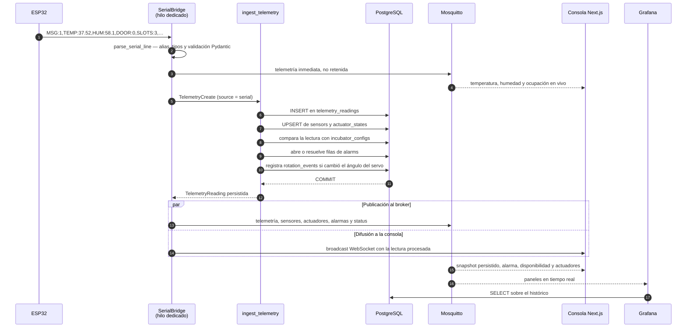
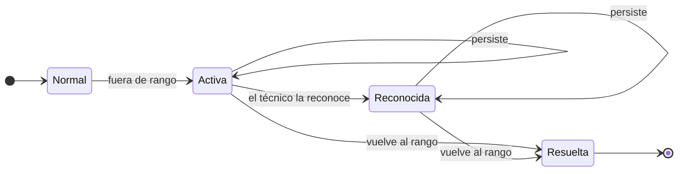
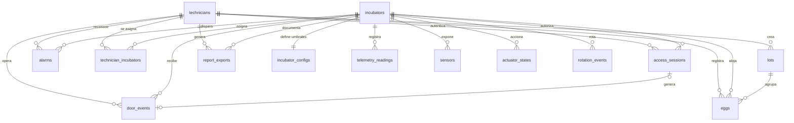
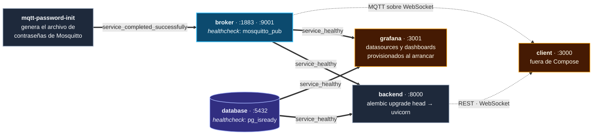
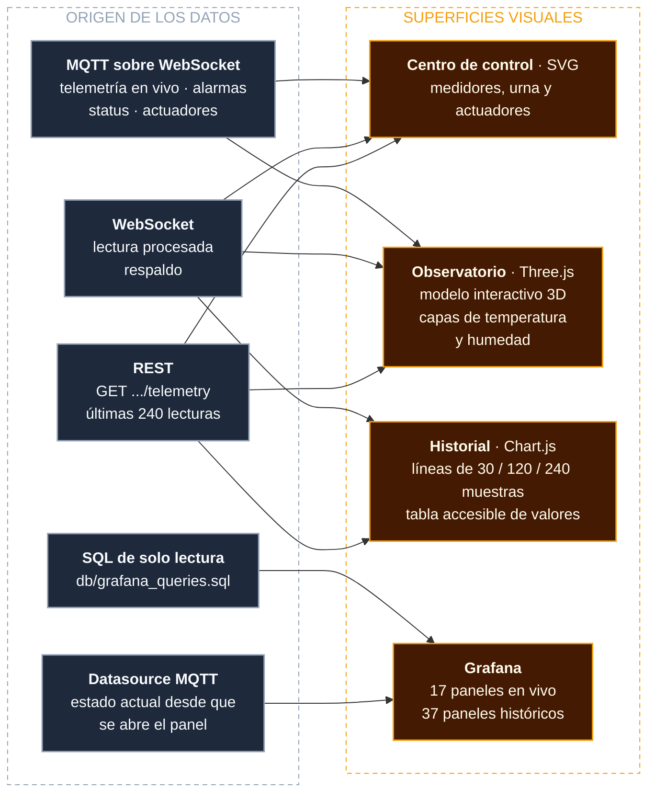
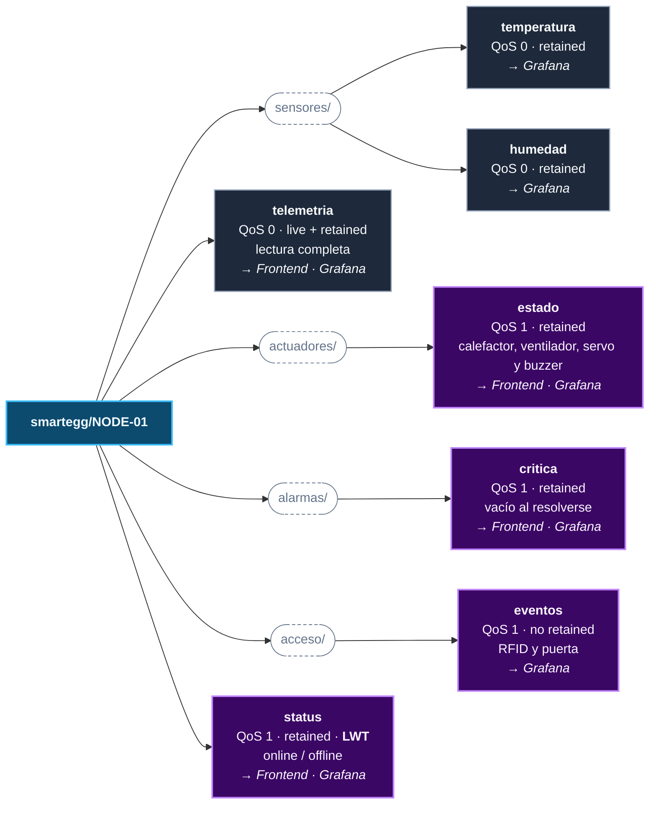

# Proyecto 1 — SmartEgg

Desarrollamos SmartEgg como una incubadora inteligente IoT a partir de la
Práctica 1. Migramos el nodo a una ESP32 que mide el ambiente, controla los
actuadores y lee tarjetas RFID. Integramos FastAPI para recibir las tramas por
USB y guardar las lecturas en PostgreSQL; Mosquitto distribuye los eventos y
Next.js y Grafana presentan la operación en vivo y el historial.

Organizamos la plataforma con Docker Compose y mantuvimos el cliente web fuera
de los contenedores. La API expone su documentación en `:8000/docs`, la consola
web utiliza `:3000` y Grafana `:3001`. Las instrucciones reproducibles de cada
componente están en sus respectivos README; aquí describimos lo que construimos
y cómo se relaciona.

## Contenido

- [Estructura](#estructura)
- [Arquitectura general](#arquitectura-general)
  - [Boceto conceptual](#boceto-conceptual)
  - [Conexiones](#conexiones)
  - [Recorrido de una lectura](#recorrido-de-una-lectura)
  - [Ciclo de vida de una alarma](#ciclo-de-vida-de-una-alarma)
- [Modelo de datos](#modelo-de-datos)
- [Despliegue y operación](#despliegue-y-operación)
  - [Cuentas y permisos](#cuentas-y-permisos)
  - [Pruebas y evidencias](#pruebas-y-evidencias)
- [Visualización de datos](#visualización-de-datos)
- [HTTP vs. MQTT en SmartEgg](#http-vs-mqtt-en-smartegg)
- [Firmware ESP32](#firmware-esp32)
- [Documentación y evaluación](#documentación-y-evaluación)

## Estructura

```text
Proyecto_1_SmartEgg/
├── client/       # Aplicación web en Next.js — consola, Observatorio e Historial
├── server/       # API REST, WebSocket, puente serial y publicador MQTT en FastAPI
├── db/           # Modelo relacional (schema.dbml) y consultas de Grafana
├── firmware/     # Firmware integrado para ESP32, RC522 y los actuadores
├── docs/         # Documentación y enunciado
├── grafana/      # Dashboards provisionados y datasources
├── mqtt/         # Mosquitto, ACL y contrato de topics MQTT
├── scripts/      # Reconexión del backend al puerto USB de la ESP32
├── docker-compose.yml         # Plataforma completa
└── docker-compose.serial.yml  # Sobrecarga que expone SERIAL_DEVICE al backend
```

Usamos PostgreSQL como servicio independiente y conservamos sus datos en el
volumen Docker `postgres_data`. También integramos una conexión opcional a
PostgreSQL de Neon; su datasource de Grafana se configura por separado. El
modelo está en `db/schema.dbml` y las consultas de Grafana en
`db/grafana_queries.sql`.

## Arquitectura general



> 🟩 nodo físico · ⬛ backend · 🟪 almacenamiento · 🟦 broker · 🟧 superficies de visualización

### Boceto conceptual

También conservamos el boceto con el que representamos el flujo general entre
microcontrolador, API, base de datos, broker, interfaz y Grafana. Incluye la
placa de la Práctica 1 y logotipos ilustrativos de frontend; el diagrama técnico
anterior muestra los componentes que usamos finalmente en el Proyecto 1.



### Conexiones

| Origen | Destino | Conexión | Datos |
|---|---|---|---|
| ESP32 | Backend | UART/USB a 115200 baud | Temperatura, humedad, puerta, ocupación, actuadores, UID RFID y autorización del servo |
| Backend | PostgreSQL | SQLAlchemy con PostgreSQL | Telemetría, alarmas, configuración, lotes, huevos y operaciones de puerta |
| Backend | Mosquitto | MQTT 3.1.1 por TCP | Telemetría, sensores, actuadores, alarmas y disponibilidad |
| Frontend | Backend | REST por HTTP/JSON | Autenticación, consultas, configuración y registros |
| Backend | Frontend | WebSocket | Telemetría procesada como respaldo y eventos de acceso |
| Mosquitto | Frontend | MQTT sobre WebSocket | Telemetría en vivo, alarmas críticas, estado del nodo y actuadores |
| Mosquitto | Grafana | Datasource MQTT | Paneles de estado en tiempo real |
| PostgreSQL | Grafana | Datasource PostgreSQL de solo lectura | Tendencias, agregados, alarmas y operaciones de puerta |

El backend es el único componente que recibe directamente la trama serial. Publica
cada lectura serial válida en Mosquitto en cuanto la recibe; en paralelo la persiste
en PostgreSQL y luego publica el snapshot completo y lo transmite a los clientes
WebSocket conectados. El frontend utiliza REST para operaciones bajo demanda y
MQTT sobre WebSocket para lecturas y eventos del broker. Grafana mantiene dos fuentes:
Mosquitto para el estado actual y PostgreSQL para el historial.

### Recorrido de una lectura

El firmware emite una línea de texto plano cuando cambia el estado y, como respaldo,
cada 2 segundos. Este es el camino
completo desde esa línea hasta las tres superficies que la muestran:



Si la trama no se puede interpretar, el puente la descarta y registra la excepción sin
interrumpir el flujo. `SLOTS` contiene la cantidad confirmada por cuatro
microinterruptores de presión, uno por posición. Cuando el campo no viene en la trama,
el backend deriva la ocupación contando los huevos en estado `incubating`, y siempre
rechaza una ocupación mayor que la capacidad declarada de la incubadora.

### Ciclo de vida de una alarma

El backend no acumula alarmas repetidas: por cada tipo mantiene a lo sumo una fila sin
resolver y la reutiliza mientras la condición persista.



| Transición | Efecto en `alarms` | Publicación MQTT |
|---|---|---|
| Normal → Activa | `INSERT` con `occurred_at`, `kind`, `severity`, `message` y `value` | Sólo si la severidad es `critical` se publica JSON retenido en `alarmas/critica`; una advertencia no genera un mensaje de alarma MQTT. |
| Activa → Activa | Reutiliza la fila abierta y actualiza `severity`, `message` y `value` | En cada lectura se vuelve a publicar la alarma crítica activa, si existe. |
| Activa → Reconocida | `acknowledged_at` y `acknowledged_by_id` | El reconocimiento no cambia por sí solo el payload MQTT. |
| → Resuelta | `resolved_at` | Cuando no queda ninguna alarma crítica activa, el backend publica payload vacío retenido para despejar el topic. |

Los cinco tipos vigilados son `temperature_low`, `temperature_high`, `humidity_low`,
`humidity_high` y `door_open`. La severidad es `warning` salvo cuando la temperatura
alcanza `critical_temperature_c`, que la eleva a `critical`.

Los umbrales viven en `incubator_configs`, así que se pueden cambiar en caliente desde
`PUT /api/v1/incubators/{id}/config` sin reprogramar el nodo, sin recompilar el firmware
y sin reiniciar ningún servicio.

## Modelo de datos

Catorce tablas, con asignaciones explícitas entre técnicos e incubadoras y auditoría de
propiedad e informes.
El esquema se administra con Alembic desde `server/migrations`; `db/schema.dbml`
documenta cada columna e índice.



| Tabla | Qué guarda | Escrita por |
|---|---|---|
| `technicians` | Credenciales, rol y UID RFID del personal | `POST /auth/bootstrap` y `/auth/technicians` |
| `technician_incubators` | Nodos autorizados para cada operador | Administrador (`PUT /auth/technicians/{id}/incubators`) |
| `access_sessions` | Sesión RFID, operador, apertura, cierre y causa de finalización | ESP32 mediante `/access` |
| `incubators` | Código, capacidad, número de serie y última señal | Bootstrap y telemetría |
| `incubator_configs` | Rangos de temperatura y humedad, umbral crítico, intervalo y ángulo de rotación | Consola (`PUT /config`) |
| `telemetry_readings` | Una fila por trama recibida, con la línea original en `raw_payload` | Puente serial y `POST /telemetry` |
| `sensors` | Último valor y marca de tiempo por sensor | `ingest_telemetry` (upsert) |
| `actuator_states` | Estado, modo y valor de calefactor, ventilador, servo y buzzer | `ingest_telemetry` y comandos manuales |
| `alarms` | Apertura, severidad, reconocimiento y resolución | `ingest_telemetry` y la consola |
| `rotation_events` | Cada cambio real del ángulo del servo, con dirección y origen | `ingest_telemetry` y rotación manual |
| `lots` | Lote, especie, origen y fechas de incubación | Consola |
| `eggs` | Ficha del huevo, su lote y su posición física | Consola |
| `door_events` | Aperturas de puerta con operador, método de acceso, motivo y conteo de huevos | ESP32 y consola |
| `report_exports` | Quién generó cada PDF, alcance, operador y fecha | Endpoint de informes |

`telemetry_readings` y `door_events` llevan índice compuesto por incubadora y fecha,
que es la forma en que Grafana y el historial los consultan.

## Despliegue y operación

Distribuimos la plataforma en cuatro servicios de Compose y un trabajo que
prepara las contraseñas de Mosquitto. El frontend se ejecuta fuera de Compose
con pnpm. El backend espera la disponibilidad de PostgreSQL y del broker,
aplica las migraciones Alembic y después inicia FastAPI.



| Servicio | Imagen | Puerto local | Variable | Volumen |
|---|---|---:|---|---|
| `database` | `postgres:17-alpine` | 5432 | `POSTGRES_PORT` | `postgres_data` |
| `broker` | `eclipse-mosquitto:2` | 1883 · 9001 | `MQTT_PORT` · `MQTT_WS_PORT` | `mosquitto_data` · `mosquitto_secrets` |
| `backend` | `./server` (build) | 8000 | `BACKEND_PORT` | — |
| `grafana` | `grafana/grafana:13.2.0` | 3001 | `GRAFANA_PORT` | `grafana_data` |
| `client` | fuera de Compose | 3000 | — | — |

### Plataforma completa

Preparamos `.env.example` como plantilla de contraseñas y claves, y mantuvimos
los valores reales fuera de Git. Compose reúne PostgreSQL, Mosquitto, FastAPI y
Grafana; el cliente Next.js se ejecuta por separado. El acceso desde el navegador
usa una cuenta MQTT limitada y una clave de quiosco que coincide con la del
backend. La API expone `/health` para comprobar su disponibilidad.

La conexión serial permanece desactivada en el Compose base. Para el prototipo
físico añadimos `docker-compose.serial.yml`, que entrega al backend el dispositivo
indicado en `SERIAL_DEVICE` y opera a 115200 baudios. Elegimos la ruta estable
`/dev/serial/by-id/` del adaptador CP2102 para evitar cambios entre `ttyUSB0` y
`ttyUSB1`. También creamos `scripts/start-hardware.sh`: espera la aparición del
dispositivo hasta 30 segundos y recrea solo el backend después de una
reconexión o reinicio del equipo.

### Reproducción del despliegue

Estos son los comandos con los que levantamos y verificamos la plataforma desde
`Proyecto_1_SmartEgg` (sin publicar los secretos de `.env`):

```bash
test -f .env || cp .env.example .env  # primera vez; sustituir las claves de ejemplo
docker compose config --quiet
docker compose up -d --build
docker compose ps
curl -fsS http://localhost:8000/health
```

La consola web se ejecuta en otra terminal:

```bash
cd client
test -f .env.local || cp .env.example .env.local  # primera vez; ajustar quiosco/MQTT
pnpm install
pnpm dev
```

Para la ESP32 usamos `SERIAL_DEVICE` en `.env`, el archivo serial de Compose
y `./scripts/start-hardware.sh` tras cada reconexión. El puerto serial no puede
permanecer abierto simultáneamente en el monitor y en el backend. Si se usa
Neon, `DATABASE_URL` selecciona la base del backend y la configuración del
datasource de Grafana debe apuntar explícitamente a la misma base y rama.

### Base de datos

El backend utiliza PostgreSQL local cuando `DATABASE_URL` está vacía. Integramos
también el proyecto de Neon mediante esa misma variable, sin sustituir SQLAlchemy
ni Alembic. El archivo `neon.ts` describe únicamente la configuración de Neon;
la aplicación continúa siendo Python.

Neon entrega una URL agrupada y otra directa. Como el contenedor ejecuta Alembic
en su arranque y utiliza una sola conexión para migraciones y aplicación,
documentamos la URL directa para esta configuración; la dirección con `-pooler`
queda reservada para un despliegue que separe ambos procesos. El backend
normaliza `postgresql://` a `postgresql+psycopg://`.

El contenedor PostgreSQL local sigue levantándose aunque FastAPI apunte a Neon;
no replica ni respalda los datos remotos. Grafana conserva por defecto su
datasource local `database:5432`: para consultar Neon requiere una conexión a
la misma base y rama, SSL y un usuario de lectura creado allí. El usuario
`grafana_reader` del script `db/init/` pertenece solo a PostgreSQL local.

### Broker MQTT

Configuramos Mosquitto en `1883` para MQTT TCP y en `9001` para MQTT sobre
WebSocket. La ACL separa al publicador backend de las cuentas de solo lectura
del frontend y Grafana. El contrato de mensajes y el alcance de cada cuenta
quedaron documentados en [mqtt/README.md](mqtt/README.md).

### Grafana

Provisionamos Grafana en `:3001` con dos datasources: MQTT para el estado en vivo
y PostgreSQL para el historial. Sus dashboards contienen 17 paneles en tiempo
real y 37 paneles históricos. La descripción de las consultas y variables está
en [grafana/README.md](grafana/README.md).

### Servidor

Construimos la API con Python 3.12, FastAPI, SQLAlchemy y Alembic. Expone REST,
WebSocket, Swagger en `:8000/docs` y un puente serial que procesa telemetría,
RFID y eventos de puerta. El [README del servidor](server/README.md) contiene
su configuración y sus pruebas.

### Cliente

Desarrollamos la consola con Next.js y pnpm. La servimos en `:3000` y la
conectamos a la API por REST/WebSocket y al broker por MQTT sobre WebSocket.
El [README del cliente](client/README.md) describe su configuración y las
pantallas.

### Cuentas y permisos

Definimos únicamente dos roles. El `admin` administra usuarios, asignaciones,
incubadoras y configuración; el `operator` trabaja en sus incubadoras asignadas,
registra lotes, huevos y operaciones, y es el único rol autorizado para abrir
la puerta con RFID. El alta inicial admite un administrador por bootstrap o
mediante `INITIAL_TECHNICIANS`. Las cuentas ya existentes no se sobrescriben al
reiniciar el backend. Asociamos cada tarjeta al campo `rfid_uid` del operador,
normalizado como hexadecimal sin espacios. Las contraseñas y UID reales
permanecen fuera de este documento y de Git.

Para el navegador usamos una cuenta MQTT limitada a lectura; las variables
`NEXT_PUBLIC_*` son visibles en el cliente y no contienen credenciales del
backend. Incluimos un modo demostración de desarrollo para recorrer la interfaz
sin hardware; sus datos temporales no representan lecturas físicas. Su alcance
está descrito en [client/README.md](client/README.md).

### Pruebas y evidencias

Incluimos pruebas automatizadas del servidor y pruebas de la lógica y las
animaciones del firmware que se ejecutan en el equipo sin conectar la ESP32.
Documentamos por separado la [prueba física](docs/PRUEBA_FISICA.md) del RC522,
la cerradura, el final de carrera y las posiciones de huevos. El puerto serial
es exclusivo: un monitor abierto y el backend no pueden leerlo al mismo tiempo.

## Visualización de datos

Los mismos datos se leen en cuatro superficies, cada una con su librería y su origen:



| Superficie | Librería | Qué dibuja | Interacción |
|---|---|---|---|
| Centro de control | SVG propio | Medidor de temperatura, columna de humedad, urna, dial de bandeja y panel de actuadores | Ajuste de consignas y comandos manuales |
| Observatorio | [Three.js](https://threejs.org/docs/) | Modelo 3D de la incubadora, con gabinete y posiciones inspeccionables | Girar y acercar la cámara, abrir el gabinete visualmente, alternar temperatura/humedad y seleccionar posiciones |
| Historial | [Chart.js](https://www.chartjs.org/docs/latest/) | Líneas de temperatura y humedad sobre lecturas reales | Elegir magnitud, ventana de 30/120/240 muestras y consultar valores al pasar el cursor |
| Grafana | Paneles nativos | Estado actual desde MQTT y tendencias, alarmas y operaciones de puerta desde PostgreSQL | Rango temporal y variables del dashboard |

En el Observatorio el color distingue la capa elegida o una alarma crítica; la humedad determina la cantidad de
partículas, el ventilador activa su circulación y el ángulo del servo inclina la
bandeja. Son representaciones ilustrativas del estado, no una simulación física ni un
mapa térmico. Sin lecturas mostramos un estado de espera y al perder la conexión
detenemos el flujo animado.

Las tres vistas del cliente conservan los temas claro, oscuro y automático, y
respetan `prefers-reduced-motion`. La consola reproduce una alarma audible ante
una alarma crítica y permite silenciarla o probarla desde su control lateral.
Grafana se configura y tematiza por separado. Los promedios del Historial
corresponden a las lecturas disponibles, no a un período fijo de 24 horas.

La elección de librerías y el flujo de datos se explican en
[client/README.md](client/README.md#visualización-avanzada). El
[video demostrativo](docs/evidencias/smartegg-observatorio-3d.mp4) muestra el
Observatorio de Three.js junto con el prototipo físico. El
[guion](docs/GUION_VIDEO.md) describe las tomas y el recorrido de los datos.

## HTTP vs. MQTT en SmartEgg

SmartEgg utiliza HTTP para operaciones bajo demanda y MQTT para distribución de
eventos en tiempo real.

### Comparación

| Criterio | HTTP | MQTT |
|---|---|---|
| Modelo | Cliente-servidor, petición/respuesta | Publicación/suscripción mediante un broker |
| Inicio de la comunicación | El cliente solicita cada recurso u operación | El broker entrega un mensaje cuando se publica en un topic suscrito |
| Encabezados y tráfico | Incluye método, URI, cabeceras y respuesta HTTP | Usa paquetes de control compactos, un topic y el payload |
| Entrega | El resultado se expresa con códigos de estado; los reintentos dependen del cliente y de si la operación es segura o idempotente | Ofrece QoS 0 (como máximo una vez), QoS 1 (al menos una vez) y QoS 2 (exactamente una vez) |
| Desconexiones | El cliente vuelve a realizar la consulta; una conexión persistente evita abrir una conexión para cada petición | Puede conservar sesión y mensajes, reenviar según el QoS y publicar un Last Will ante una desconexión inesperada |
| Último estado | Puede consultarse nuevamente o almacenarse en caché cuando la semántica lo permite | Un mensaje retained permite entregar el último estado a un nuevo suscriptor |
| Escalabilidad | Es apropiado para operaciones dirigidas a recursos; cada consumidor inicia sus solicitudes | Un mensaje puede distribuirse a varios consumidores sin que el publicador mantenga una conexión con cada uno |
| Consumo en IoT | Las consultas frecuentes y sus cabeceras pueden aumentar tráfico, radio activa y energía | Su menor sobrecarga y la entrega por eventos favorecen telemetría frecuente en enlaces limitados |
| Uso en SmartEgg | Inicio de sesión, configuración, lotes, huevos, reportes e historial | Telemetría, estado del nodo, actuadores y alarmas en tiempo real |

El consumo de cada protocolo depende de la frecuencia, el tamaño del payload, el
QoS, TLS y la calidad del enlace. MQTT mantiene una conexión, intercambia keep-alive
y confirma los mensajes con QoS 1 o 2. En SmartEgg, una publicación puede llegar al
frontend y a Grafana sin que cada consumidor consulte repetidamente al backend.

### Optimizaciones disponibles para HTTP en IoT

Las siguientes técnicas reducen el tráfico o la latencia de HTTP en dispositivos y
redes restringidas:

- `keep-alive`: reutilización de conexiones TCP y TLS.
- `Content-Encoding`: compresión del cuerpo de la petición o respuesta.
- HTTP/2: multiplexación de solicitudes y compresión de campos de cabecera.
- Caché y solicitudes condicionales: reutilización de respuestas que no cambiaron.
- *Batching*: agrupación de lecturas en una sola petición a cambio de mayor latencia.
- CoAP: protocolo web con semántica REST y mensajes pequeños para dispositivos y
  redes restringidas.

### Implementación en SmartEgg

| Flujo | Protocolo | Configuración |
|---|---|---|
| ESP32 ↔ backend | UART/USB | Telemetría, UID RFID, eventos de puerta y autorización del servo |
| Backend → PostgreSQL | Conexión SQL | Persistencia de telemetría, alarmas y registros |
| Backend → Mosquitto | MQTT 3.1.1 | Publicación de telemetría y estado |
| Backend → frontend | HTTP REST | Autenticación, configuración, lotes, huevos, historial y reportes |
| Backend → frontend | WebSocket | Lecturas procesadas como respaldo y eventos de acceso |
| Mosquitto → frontend | MQTT sobre WebSocket | Telemetría en vivo, alarmas, disponibilidad y actuadores |
| PostgreSQL → Grafana | SQL | Consultas históricas |
| Mosquitto → Grafana | MQTT | Paneles en tiempo real |

### Contrato de topics

Todo el árbol cuelga del prefijo `smartegg/{id}`, donde `{id}` es el código de la
incubadora. El ejemplo usa `NODE-01`, que es el valor predeterminado del firmware.



> ⬛ QoS 0 · retained — telemetría periódica · 🟪 QoS 1 — estados y eventos

| Topic completo (`{id}` = código del nodo) | Publicador | Suscriptor(es) | QoS | Retained |
|---|---|---|---:|---|
| `smartegg/{id}/sensores/temperatura` | Backend | Grafana | 0 | Sí |
| `smartegg/{id}/sensores/humedad` | Backend | Grafana | 0 | Sí |
| `smartegg/{id}/telemetria` | Backend | Frontend, Grafana | 0 | Sí, tras persistir; adelanto en vivo no retenido |
| `smartegg/{id}/actuadores/estado` | Backend | Frontend, Grafana | 1 | Sí |
| `smartegg/{id}/alarmas/critica` | Backend | Frontend, Grafana | 1 | Sí; vacío al resolverse |
| `smartegg/{id}/acceso/eventos` | Backend | Grafana | 1 | No |
| `smartegg/{id}/status` | Backend; Mosquitto publica el LWT | Frontend, Grafana | 1 | Sí |

La cuenta MQTT del frontend sólo lee telemetría, alarma crítica, status y actuadores;
los eventos de acceso llegan a la consola por el WebSocket de FastAPI. El
healthcheck del broker usa aparte `smartegg/healthcheck` (publicador: chequeo
de Compose; QoS 1; no retained; sin suscriptores de aplicación).
La prueba manual publica `{"test":"publish-subscribe"}` en
`smartegg/diagnostico/manual` (QoS 1, no retained); sólo el cliente de prueba
se suscribe, y ese mensaje no representa telemetría del nodo.
El backend registra el `status`/LWT sólo para `DEFAULT_INCUBATOR_CODE`
(`NODE-01` de forma predeterminada), aunque la telemetría y el acceso usan
el código de cada nodo recibido.

Los payloads que publica `server/app/services/mqtt.py` tienen esta forma; los
ejemplos de acceso provienen también de `server/app/services/serial_access.py`
y `server/app/api/access.py`:

| Topic | Ejemplo de payload JSON |
|---|---|
| `sensores/temperatura` | `{"value":37.6,"unit":"celsius","recorded_at":"2026-09-04T18:30:00Z"}` |
| `sensores/humedad` | `{"value":58.2,"unit":"percent","recorded_at":"2026-09-04T18:30:00Z"}` |
| `telemetria` | `{"temperature_c":37.6,"humidity_pct":58.2,"door_open":false,"system_enabled":true,"sensor_ok":true,"occupied_slots":3,"available_slots":1,"recorded_at":"2026-09-04T18:30:00Z"}` |
| `actuadores/estado` | `{"heater":false,"fan":true,"servo_angle":45,"buzzer":false,"recorded_at":"2026-09-04T18:30:00Z"}` |
| `alarmas/critica` | `{"kind":"temperature_high","severity":"critical","message":"Sobrecalentamiento detectado","value":39.5,"occurred_at":"2026-09-04T18:30:00Z"}` |
| `acceso/eventos` | `{"event":"door_closed","session_id":12,"operator_id":1,"method":"rfid","recorded_at":"2026-09-04T18:30:00Z"}` |
| `status` | `{"status":"online","recorded_at":"2026-09-04T18:30:00Z"}` |

`telemetria` puede llevar `null` en `door_open`, `system_enabled` o `sensor_ok`;
el adelanto serial omite `available_slots` y no es retenido. El snapshot
persistido incluye ese campo y sí se retiene. `servo_angle` también puede ser
`null`. El backend publica **cero bytes**, no JSON, en `alarmas/critica` cuando ya no
hay alarma crítica. `status` tiene un Last Will retenido con
`{"status":"offline","reason":"unexpected_disconnect"}` que Mosquitto
emite al caer abruptamente la conexión. Un cierre normal publica otro mensaje
con `reason: "graceful_shutdown"` y marca temporal. Los eventos de acceso no
se retienen; sus variantes `rejected`, `access_cancelled` e
`invalid_session` se detallan en [mqtt/TOPICS.md](mqtt/TOPICS.md).

FastAPI expone el contrato REST mediante OpenAPI en `/docs`. Mosquitto mantiene el
contrato de mensajes definido en [mqtt/TOPICS.md](mqtt/TOPICS.md).

### Fuentes consultadas

- [RFC 9110 — HTTP Semantics](https://www.rfc-editor.org/rfc/rfc9110.html)
- [RFC 9111 — HTTP Caching](https://www.rfc-editor.org/rfc/rfc9111.html)
- [RFC 9113 — HTTP/2](https://www.rfc-editor.org/rfc/rfc9113.html)
- [MQTT Version 3.1.1 — OASIS Standard](https://docs.oasis-open.org/mqtt/mqtt/v3.1.1/os/mqtt-v3.1.1-os.html)
- [RFC 7252 — Constrained Application Protocol](https://www.rfc-editor.org/rfc/rfc7252.html)

## Firmware ESP32

Adaptamos la lógica de control de
[`Practica_1_SmartEgg/firmware`](../Practica_1_SmartEgg/firmware/) a una ESP32
DevKit con ESP-IDF y FreeRTOS. Controlamos el RC522 directamente por SPI (sin
`MFRC522` de Arduino) e integramos dos servos: bandeja y cerradura. Enviamos
telemetría como campos `CLAVE:valor` separados por comas, una línea por trama
a 115200 8N1:

```text
MSG:1,TEMP:37.52,HUM:58.1,DOOR:0,SLOTS:3,HEATER:0,FAN:0,SERVO:-45,BUZZER:0,POWER:1,SENSOR:1
```

Conservamos en el backend la compatibilidad con JSON de otros emisores, aunque
nuestro firmware utiliza esta trama de texto. El UID RFID viaja por el mismo
puerto UART/USB como `RFID:A1B2C3D4` (ejemplo ficticio); el backend valida la
tarjeta y responde con la autorización, el nombre del operador y el ángulo del
servo. Diseñamos animaciones para la LCD 16×2 durante la lectura, el acceso
permitido o denegado y los errores. Reunimos esas pantallas en
[firmware/preview-animaciones.html](firmware/preview-animaciones.html).
El nodo físico no usa Wi-Fi ni HTTP. Pines, montaje, carga y pruebas están en
[firmware/README.md](firmware/README.md).

## Documentación y evaluación

- [Documento técnico](docs/DOCUMENTO_TECNICO.md) y [manual de usuario](docs/MANUAL_USUARIO.md).
- [Enunciado del Proyecto 1](docs/enunciado/Proyecto_1_2S2026.pdf).
- [Hoja de calificación de SmartEgg](docs/Hoja_Calificacion_Proyecto2_Fase2_SmartEgg.pdf).
- [Hoja de calificación de la Práctica 1](docs/calificacion/Hoja_Calificacion_Practica1_SmartEgg.pdf), antecedente reutilizado por este proyecto.
- [Guía de montaje](firmware/MONTAJE_PASO_A_PASO.md), [prueba física](docs/PRUEBA_FISICA.md) y [guion del video](docs/GUION_VIDEO.md).
- [Evidencias y pendientes verificables](docs/evidencias/README.md). Incluyen capturas del frontend y Grafana y el [video demostrativo del Observatorio](docs/evidencias/smartegg-observatorio-3d.mp4). La prueba física completa se documenta por separado.
