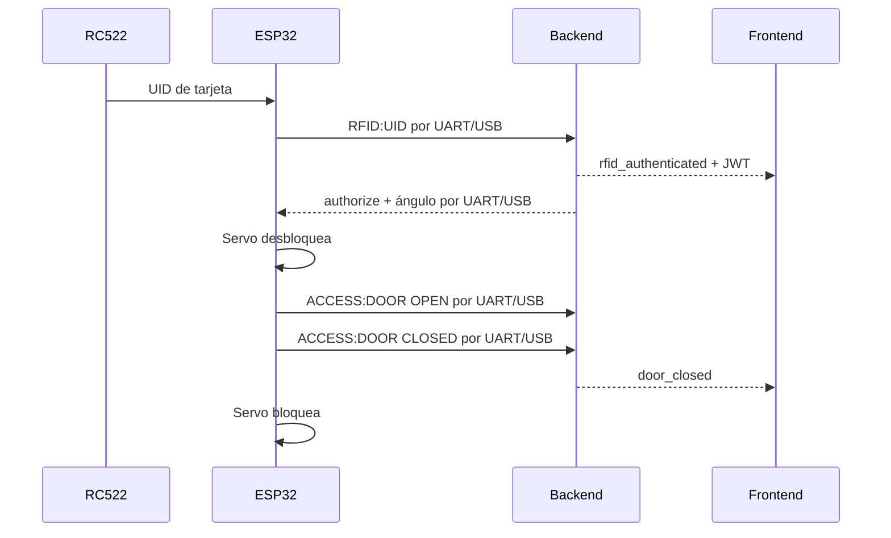

# Firmware ESP32

El nodo de Proyecto 1 conserva la arquitectura modular y la lógica de control de la
Práctica 1, adaptadas a una ESP32 DevKit con ESP-IDF y FreeRTOS nativos. No requiere
el framework ni bibliotecas de Arduino. La misma placa controla la incubadora, lee el
RC522, mueve el servo de acceso y envía los eventos de puerta al backend.

## Arquitectura del firmware

El programa no concentra la aplicación en `loop()`. Crea dos tareas FreeRTOS fijadas a
núcleos distintos:

| Tarea | Núcleo | Prioridad | Responsabilidad |
|---|---:|---:|---|
| `SensorControl` | 1 | 3 | DHT11, posiciones, interruptores, relés, buzzer, bandeja y LCD |
| `Communication` | 0 | 2 | Protocolo serial, telemetría, RC522 y cerradura |

`SensorControl` mantiene la histéresis y las protecciones de la Práctica 1, invalida el
sensor después de tres lecturas fallidas y ejecuta la rotación periódica sin bloquear.
Los comandos y el estado compartido se intercambian mediante regiones críticas aptas
para los dos núcleos del ESP32.

```text
SmartEggESP32/
├── Main.cpp            # app_main y creación de tareas
├── Config.h            # Pines, tiempos, prioridades y tamaños de pila
├── SystemModel.h       # Estado, configuración, comandos y eventos
├── ControlLogic.*      # Control ambiental comprobable fuera del hardware
├── Hardware.*          # GPIO, DHT11, I²C, LCD, PWM e interrupciones
├── Display.*           # Pantallas y animaciones heredadas
├── SerialProtocol.*    # Comandos JSON y telemetría UART
├── RfidReader.*        # Control directo del RC522 mediante SPI
├── AccessControl.*     # RFID, servo y sesión de acceso por UART/USB
└── Tasks.*             # Planificación y sincronización FreeRTOS
```

## Componentes

Para realizar el cableado físico terminal por terminal, consulte la
[guía de montaje paso a paso](MONTAJE_PASO_A_PASO.md).

- ESP32 DevKit V1.
- RFID RC522 y tarjetas MIFARE.
- Dos servos con alimentación externa de 5 V: bandeja y cerradura.
- DHT11, LCD 16×2 I²C, final de carrera para la puerta y cuatro microinterruptores de presión
  con palanca.
- Dos canales de relé, buzzer activo y switch general.

## Pines

| GPIO | Componente |
|---:|---|
| 5 | RC522 SDA/SS |
| 18 | RC522 SCK |
| 19 | RC522 MISO |
| 23 | RC522 MOSI |
| 4 | RC522 RST |
| 21 / 22 | LCD SDA / SCL |
| 15 | DHT11 |
| 26 / 27 | Relé de calefacción / ventilador |
| 14 | Buzzer activo |
| 25 | Servo de bandeja |
| 33 | Servo de acceso |
| 16 | Final de carrera de puerta |
| 17 | Switch general |
| 32 / 34 / 35 / 36 | Microinterruptores de presión 1–4 |

GPIO 34, 35 y 36 no incluyen pull-up interno. Cada microinterruptor usa una resistencia
externa de 10 kΩ a 3.3 V y su contacto normalmente abierto cierra contra GND al recibir
presión. El firmware confirma dos lecturas consecutivas antes de cambiar la ocupación.

El final de carrera de la puerta se conecta con `COM` a GND, `NO` a GPIO 16 y `NC` sin
conectar. GPIO 16 usa el pull-up interno del ESP32: al cerrar la puerta, esta presiona la
palanca y la entrada cambia a `LOW`; al abrirla, la palanca se libera y la entrada vuelve
a `HIGH`. La interrupción en ambos flancos permite detectar tanto la apertura como el
cierre.

| Estado físico | Entrada | Posición |
|---|---|---|
| Palanca libre | HIGH | Vacía |
| Palanca presionada | LOW | Ocupada |

El huevo descansa sobre un soporte móvil que acciona la palanca; el interruptor no debe
presionar directamente el cascarón. El RC522 se alimenta con 3.3 V. Los servos usan una
fuente externa de 5 V con GND común.

## Compilar y grabar la ESP32

Los comandos de esta sección se ejecutan **desde `Proyecto_1_SmartEgg`**, la carpeta
que contiene `firmware/` y `docker-compose.yml`. El proyecto está configurado para
una ESP32 DevKit (`esp32dev`) con ESP-IDF; no se abre ni se compila con Arduino IDE.

### 1. Preparar la herramienta

Se necesita `uvx` (incluido con `uv`) y un cable USB **de datos**. Los comandos
`uvx platformio ...` ejecutan PlatformIO Core; no hace falta instalar las librerías
de Arduino. En la primera ejecución, PlatformIO puede descargar la plataforma y
las herramientas necesarias, por lo que se requiere conexión a Internet.

### 2. Compilar sin conectar la placa

```bash
uvx platformio run -d firmware
```

Si termina con `SUCCESS`, el archivo listo para grabar queda en
`firmware/.pio/build/esp32dev/firmware.bin`. Este paso solo compila: **no modifica
la ESP32**.

### 3. Grabar el firmware

Conecte la ESP32 por USB y cierre cualquier monitor serial o backend que esté
usando su puerto. Después ejecute:

```bash
uvx platformio run -d firmware -t upload
```

PlatformIO compila si hace falta, detecta el puerto y graba el programa. Si hay
varios dispositivos seriales o no detecta el correcto, indique el puerto
explícitamente; por ejemplo:

```bash
uvx platformio run -d firmware -t upload --upload-port /dev/ttyUSB0
```

Sustituya `/dev/ttyUSB0` por el puerto real de su ESP32. En Linux puede verlo con
`ls -l /dev/serial/by-id/`; también puede usar directamente esa ruta estable con
`--upload-port`. Si aparece un error de permisos, compruebe que su usuario tenga
acceso al puerto serial. Si la carga no inicia, pruebe mantener presionado **BOOT**
al comenzar la conexión y soltarlo cuando empiece la transferencia.

### 4. Comprobar la salida serial

```bash
uvx platformio run -d firmware -t monitor
```

El monitor usa **115200 baudios**, configurados en `platformio.ini`. Para cerrar
el monitor pulse `Ctrl+C`. Si no encuentra el puerto automáticamente, use
`--monitor-port /dev/ttyUSB0` (cambiando la ruta por la de su placa). Cierre el
monitor antes de iniciar el backend: ambos necesitan el mismo puerto USB.

El UID hexadecimal que reporta el nodo se asigna como `rfid_uid` al Operador 1 u
Operador 2 desde la API. El lector admite UID ISO/IEC 14443A de 4, 7 y 10 bytes.

La lógica ambiental se puede probar en el equipo sin conectar la placa:

```bash
firmware/tests/run_host_tests.sh
```

## Galería del LCD sin cargar la ESP32

Abra [preview-animaciones.html](preview-animaciones.html) en un navegador. El visor
funciona sin servidor ni dependencias: dibuja el LCD 16×2 con caracteres de matriz
5×8. Incluye el arranque, pantalla operativa, sistema apagado, fallas y todas las
respuestas RFID del firmware, con datos de ejemplo ajustables para los sensores,
actuadores y nombre del operador. Solo muestra los estados implementados; no incluye
propuestas alternativas.
Es una maqueta visual; para comprobar los caracteres reales del firmware sin grabar
la placa, use [la simulación de Wokwi](wokwi/README.md).

## Flujo RFID



El ESP32 espera hasta 15 segundos la autorización del backend para tolerar el arranque
en frío de la base de datos Neon. El servo vuelve a la posición bloqueada si la puerta
no se abre durante 15 segundos después de recibir la autorización.
La telemetría, el UID RFID y los eventos de puerta utilizan exclusivamente UART/USB a
115200 baud; el ESP32 no usa Wi-Fi ni HTTP.
El nodo emite una trama de telemetría apenas cambia una lectura, la ocupación o un
actuador, además del envío periódico cada 2 segundos. Esto permite que el backend
publique el cambio por MQTT sin esperar al siguiente ciclo ni al guardado histórico.

Durante el flujo RFID, el LCD 16×2 reemplaza temporalmente la pantalla ambiental con
mensajes animados y luego vuelve por sí solo a la vista anterior:

| Estado | Mensaje en el LCD | Animación |
|---|---|---|
| Tarjeta detectada | `TARJETA LEIDA` / `VERIFICANDO` | El huevo eclosiona una vez y el pollito espera la respuesta |
| Autorizada | `BIENVENIDO` / nombre; luego `ACCESO PERMITIDO` / `> ABRA LA PUERTA` | El pollito saluda con el ala antes de mostrar la instrucción |
| Rechazada | `ACCESO DENEGADO` / `NO AUTORIZADO` | Escudo con cruz y texto que se revela una vez, sin parpadeos |
| Backend sin respuesta | `SIN RESPUESTA` / `INTENTE DE NUEVO` | Reloj de arena animado |
| RC522 no inicializado | `ERROR LECTOR` / `REVISE RC522` | Signos de alerta intermitentes |

Las animaciones no introducen esperas bloqueantes: avanzan con el ciclo normal de
refresco del LCD mientras las tareas de control y comunicación continúan ejecutándose.
El dibujo temporal del pollito reutiliza la ranura del huevo y la restaura al volver
a la pantalla ambiental. Durante el saludo, los nombres de más de 16 caracteres
se desplazan una sola vez para mostrar el final sin cortarlo.
Al apagar el sistema, el indicador `. o O` se sustituye por un símbolo de energía
animado. El escudo y el reloj de arena reutilizan temporalmente la ranura de la
campana, que se restaura al volver a la pantalla normal.
