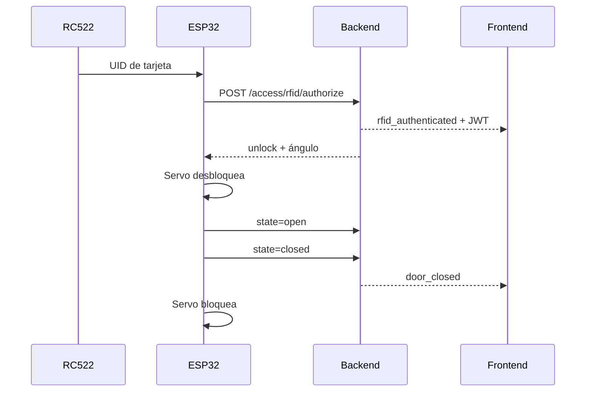

# Firmware ESP32

El nodo de Proyecto 1 reutiliza el control ambiental de la Práctica 1 y lo adapta a una
ESP32 DevKit. La misma placa controla la incubadora, lee el RC522, mueve el servo de
acceso y envía los eventos de puerta al backend.

## Componentes

- ESP32 DevKit V1.
- RFID RC522 y tarjetas MIFARE.
- Dos servos con alimentación externa de 5 V: bandeja y cerradura.
- DHT11, LCD 16×2 I²C, sensor de puerta y cuatro microinterruptores de presión
  con palanca.
- Dos canales de relé, buzzer activo y switch general.

## Pines

| GPIO | Componente |
|---:|---|
| 5 | RC522 SDA/SS |
| 18 | RC522 SCK |
| 19 | RC522 MISO |
| 23 | RC522 MOSI |
| 4 | RC522 RST |
| 21 / 22 | LCD SDA / SCL |
| 13 | DHT11 |
| 26 / 27 | Relé de calefacción / ventilador |
| 14 | Buzzer activo |
| 25 | Servo de bandeja |
| 33 | Servo de acceso |
| 16 | Sensor de puerta |
| 17 | Switch general |
| 32 / 34 / 35 / 36 | Microinterruptores de presión 1–4 |

GPIO 34, 35 y 36 no incluyen pull-up interno. Cada microinterruptor usa una resistencia
externa de 10 kΩ a 3.3 V y su contacto normalmente abierto cierra contra GND al recibir
presión. El firmware confirma dos lecturas consecutivas antes de cambiar la ocupación.

| Estado físico | Entrada | Posición |
|---|---|---|
| Palanca libre | HIGH | Vacía |
| Palanca presionada | LOW | Ocupada |

El huevo descansa sobre un soporte móvil que acciona la palanca; el interruptor no debe
presionar directamente el cascarón. El RC522 se alimenta con 3.3 V. Los servos usan una
fuente externa de 5 V con GND común.

## Preparación

1. Instalar las bibliotecas `ArduinoJson`, `DHT sensor library`, `ESP32Servo`,
   `LiquidCrystal_I2C` y `MFRC522` desde el Library Manager.
2. Copiar `SmartEggESP32/secrets.example.h` como `SmartEggESP32/secrets.h`.
3. Colocar el SSID, contraseña Wi-Fi, URL local del backend y `DEVICE_API_KEY`.
4. Seleccionar **ESP32 Dev Module** y cargar `SmartEggESP32.ino`.

El UID de cada tarjeta se obtiene primero con el ejemplo
`Archivo > Ejemplos > MFRC522 > DumpInfo`. Ese valor se asigna como `rfid_uid` al
Operador 1 u Operador 2 desde la API.

La compilación reproducible también está definida en `platformio.ini`:

```bash
uvx platformio run -d firmware
```

## Flujo RFID



El servo vuelve a la posición bloqueada si la puerta no se abre durante 15 segundos.
La telemetría ambiental conserva el protocolo UART/USB de la Práctica 1 a 115200 baud.
