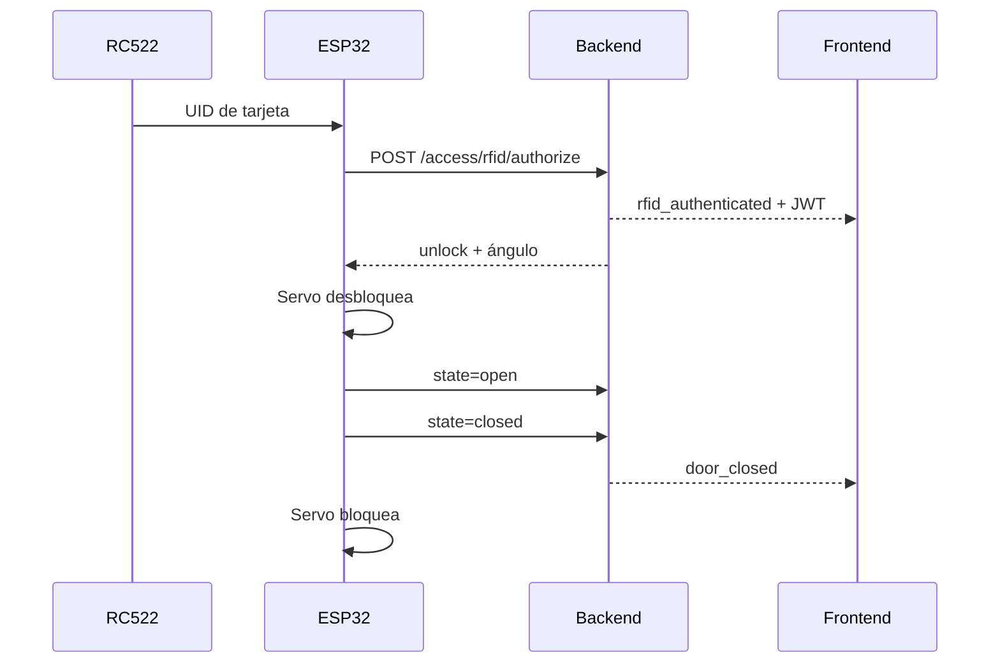

# Firmware ESP32

El nodo de Proyecto 1 conserva la arquitectura modular y la lógica de control de la
Práctica 1, adaptadas a una ESP32 DevKit con ESP-IDF y FreeRTOS nativos. No requiere
el framework ni bibliotecas de Arduino. La misma placa controla la incubadora, lee el
RC522, mueve el servo de acceso y envía los eventos de puerta al backend.

## Arquitectura del firmware

El programa no concentra la aplicación en `loop()`. Crea dos tareas FreeRTOS fijadas a
núcleos distintos:

| Tarea | Núcleo | Prioridad | Responsabilidad |
|---|---:|---:|---|
| `SensorControl` | 1 | 3 | DHT11, posiciones, interruptores, relés, buzzer, bandeja y LCD |
| `Communication` | 0 | 2 | Protocolo serial, telemetría, Wi-Fi, RC522, HTTP y cerradura |

`SensorControl` mantiene la histéresis y las protecciones de la Práctica 1, invalida el
sensor después de tres lecturas fallidas y ejecuta la rotación periódica sin bloquear.
Los comandos y el estado compartido se intercambian mediante regiones críticas aptas
para los dos núcleos del ESP32.

```text
SmartEggESP32/
├── Main.cpp            # app_main y creación de tareas
├── Config.h            # Pines, tiempos, prioridades y tamaños de pila
├── SystemModel.h       # Estado, configuración, comandos y eventos
├── ControlLogic.*      # Control ambiental comprobable fuera del hardware
├── Hardware.*          # GPIO, DHT11, I²C, LCD, PWM e interrupciones
├── Display.*           # Pantallas y animaciones heredadas
├── SerialProtocol.*    # Comandos JSON y telemetría UART
├── RfidReader.*        # Control directo del RC522 mediante SPI
├── AccessControl.*     # Wi-Fi, HTTP y sesión de acceso
└── Tasks.*             # Planificación y sincronización FreeRTOS
```

## Componentes

- ESP32 DevKit V1.
- RFID RC522 y tarjetas MIFARE.
- Dos servos con alimentación externa de 5 V: bandeja y cerradura.
- DHT11, LCD 16×2 I²C, final de carrera para la puerta y cuatro microinterruptores de presión
  con palanca.
- Dos canales de relé, buzzer activo y switch general.

## Pines

| GPIO | Componente |
|---:|---|
| 5 | RC522 SDA/SS |
| 18 | RC522 SCK |
| 19 | RC522 MISO |
| 23 | RC522 MOSI |
| 4 | RC522 RST |
| 21 / 22 | LCD SDA / SCL |
| 13 | DHT11 |
| 26 / 27 | Relé de calefacción / ventilador |
| 14 | Buzzer activo |
| 25 | Servo de bandeja |
| 33 | Servo de acceso |
| 16 | Final de carrera de puerta |
| 17 | Switch general |
| 32 / 34 / 35 / 36 | Microinterruptores de presión 1–4 |

GPIO 34, 35 y 36 no incluyen pull-up interno. Cada microinterruptor usa una resistencia
externa de 10 kΩ a 3.3 V y su contacto normalmente abierto cierra contra GND al recibir
presión. El firmware confirma dos lecturas consecutivas antes de cambiar la ocupación.

El final de carrera de la puerta se conecta con `COM` a GND, `NO` a GPIO 16 y `NC` sin
conectar. GPIO 16 usa el pull-up interno del ESP32: al cerrar la puerta, esta presiona la
palanca y la entrada cambia a `LOW`; al abrirla, la palanca se libera y la entrada vuelve
a `HIGH`. La interrupción en ambos flancos permite detectar tanto la apertura como el
cierre.

| Estado físico | Entrada | Posición |
|---|---|---|
| Palanca libre | HIGH | Vacía |
| Palanca presionada | LOW | Ocupada |

El huevo descansa sobre un soporte móvil que acciona la palanca; el interruptor no debe
presionar directamente el cascarón. El RC522 se alimenta con 3.3 V. Los servos usan una
fuente externa de 5 V con GND común.

## Preparación

1. Instalar PlatformIO Core.
2. Copiar `SmartEggESP32/secrets.example.h` como `SmartEggESP32/secrets.h`.
3. Colocar el SSID, contraseña Wi-Fi, URL local del backend y `DEVICE_API_KEY`.
4. Compilar y cargar desde la raíz del repositorio:

```bash
uvx platformio run -d Proyecto_1_SmartEgg/firmware
uvx platformio run -d Proyecto_1_SmartEgg/firmware -t upload
uvx platformio run -d Proyecto_1_SmartEgg/firmware -t monitor
```

El UID hexadecimal que reporta el nodo se asigna como `rfid_uid` al Operador 1 u
Operador 2 desde la API. El lector admite UID ISO/IEC 14443A de 4, 7 y 10 bytes.

La lógica ambiental se puede probar en el equipo sin conectar la placa:

```bash
firmware/tests/run_host_tests.sh
```

## Flujo RFID



El servo vuelve a la posición bloqueada si la puerta no se abre durante 15 segundos.
La telemetría ambiental conserva el protocolo UART/USB de la Práctica 1 a 115200 baud.
