# Proyecto 2 — SmartEgg: Incubadora Inteligente IoT (Fase 3)

**Grupo 3** · Arquitectura de Computadores y Ensambladores 2, sección A ·
Facultad de Ingeniería, USAC · Segundo semestre 2026.

En la Fase 3 extendimos la incubadora SmartEgg de la Fase 2 con tres capas de
inteligencia sobre la infraestructura IoT que ya teníamos:

1. **Detección de anomalías con machine learning.** Un Local Outlier Factor
   entrenado con el histórico real de la Fase 2 califica cada lectura que llega
   por MQTT y publica una alerta cuando la telemetría deja de parecerse a la
   operación normal.
2. **Visión por computadora con IA.** Una cámara apunta a la bandeja; OpenCV
   preprocesa cada fotograma y un clasificador MobileNetV2 entrenado con nuestro
   propio dataset decide entre `huevo`, `objeto` y `vacio`. Si confirma un objeto
   extraño, **suena la alarma y se bloquea todo el sistema**: la ESP32, la página
   web y los comandos.
3. **Migración a la nube.** El stack completo (broker MQTT, backend, base de
   datos, módulo ML, módulo de visión y Grafana) corre con Docker Compose en una
   máquina virtual Linux, y MQTT es el **único** canal de control de sensores y
   actuadores.

A eso se suma un **sistema de gestión del consumo eléctrico** con estimación en
tiempo real, límite diario, horarios, temporizador, tablero en Grafana y alertas
de consumo anómalo.

Enunciado: [`docs/enunciado/Proyecto_2_2S2026.pdf`](docs/enunciado/Proyecto_2_2S2026.pdf) ·
Hoja de calificación: [`docs/Hoja_Calificacion_Proyecto2_Fase2_SmartEgg.pdf`](docs/Hoja_Calificacion_Proyecto2_Fase2_SmartEgg.pdf).

## Entregables para la calificación

Acceso directo a lo que el enunciado exige para optar a la calificación y a cada
sección obligatoria de la documentación:

| Entregable | Dónde está |
|---|---|
| **Bitácora de desarrollo** | [Bitácora](#bitácora-de-desarrollo) |
| **Notebooks de ML** | Anomalías: [`ml/anomalias/entrenar_anomalias.ipynb`](ml/anomalias/entrenar_anomalias.ipynb) · Visión: [`ml/vision/entrenar_vision.ipynb`](ml/vision/entrenar_vision.ipynb) |
| **Manual técnico** | [Manual técnico](#manual-técnico) |
| **Manual de usuario** | [Manual de usuario](#manual-de-usuario) |
| **Modelo entidad-relación** | [§10 Base de datos](#modelo-entidad-relación) |
| **Scripts de consultas a la base de datos** | [`db/consultas_calificacion.sql`](db/consultas_calificacion.sql) · [§10](#scripts-de-consulta-para-la-calificación) |
| **Documentación de la API (Swagger/OpenAPI)** | [§11](#11-documentación-de-la-api) · [captura de Swagger](docs/evidencias/api/api-swagger.png) · `http://100.63.122.66:8000/docs` |
| **Valor disruptivo** | [§8 Bloqueo inteligente por visión](#8-valor-disruptivo-bloqueo-inteligente-por-visión) |
| **Infraestructura en la nube (AWS)** | [§4](#4-infraestructura-en-la-nube) · [capturas de AWS](#despliegue-en-aws) · Grafana: <http://100.63.122.66:3001> |
| **Evidencias de funcionamiento** | [Evidencias](#evidencias-de-funcionamiento) · [`docs/evidencias/`](docs/evidencias/) · [Capturas de Grafana](docs/evidencias/grafana/) |
| **Dashboards de Grafana exportados (JSON)** | [`grafana/dashboards/`](grafana/dashboards/) |
| **Video de presentación** | _Enlace pendiente: agregar aquí el enlace al video_ |

## Contenido

- [Entregables para la calificación](#entregables-para-la-calificación)
- [Objetivos de la Fase 3](#objetivos-de-la-fase-3)
- [Cumplimiento del enunciado](#cumplimiento-del-enunciado)
- [Estructura del repositorio](#estructura-del-repositorio)
- **[Manual técnico](#manual-técnico)**
  - [1. Descripción de la solución](#1-descripción-de-la-solución)
  - [2. Capas del framework IoT](#2-capas-del-framework-iot)
  - [3. Arquitectura del sistema extendido](#3-arquitectura-del-sistema-extendido)
  - [4. Infraestructura en la nube](#4-infraestructura-en-la-nube)
  - [5. Broker MQTT](#5-broker-mqtt)
  - [6. Pipeline de ML: detección de anomalías](#6-pipeline-de-ml-detección-de-anomalías)
  - [7. Módulo de visión por computadora](#7-módulo-de-visión-por-computadora)
  - [8. Valor disruptivo: bloqueo inteligente por visión](#8-valor-disruptivo-bloqueo-inteligente-por-visión)
  - [9. Gestión inteligente del consumo eléctrico](#9-gestión-inteligente-del-consumo-eléctrico)
  - [10. Base de datos](#10-base-de-datos)
  - [11. Documentación de la API](#11-documentación-de-la-api)
  - [12. Dashboards de monitoreo](#12-dashboards-de-monitoreo)
  - [13. Orquestación con Docker](#13-orquestación-con-docker)
  - [14. HTTP vs. MQTT en SmartEgg](#14-http-vs-mqtt-en-smartegg)
  - [15. Hardware y firmware](#15-hardware-y-firmware)
  - [16. Pruebas automatizadas](#16-pruebas-automatizadas)
- **[Manual de usuario](#manual-de-usuario)**
- [Evidencias de funcionamiento](#evidencias-de-funcionamiento)
- [Bitácora de desarrollo](#bitácora-de-desarrollo)
- [Entregables](#entregables)
- [Integrantes](#integrantes)

## Objetivos de la Fase 3

| Criterio | Objetivo en SmartEgg |
|---|---|
| **Específico** | Ampliar SmartEgg con (1) un modelo de ML que detecta anomalías en la telemetría, (2) visión computacional con OpenCV que verifica el contenido de la bandeja y (3) el stack Docker completo en la nube con Grafana y alertas automáticas. |
| **Medible** | Anomalías evaluadas con precisión, recall, F1, ROC-AUC y matriz de confusión; visión evaluada con exactitud, F1 macro, recall por clase y matriz de confusión; Grafana con datos en tiempo real y una regla de alerta activa. |
| **Alcanzable** | Telemetría histórica de la Fase 2 (7 899 lecturas), 800 fotos propias, scikit-learn, PyTorch (solo entrenamiento), OpenCV `cv2.dnn`, Docker Compose y una VM Linux. |
| **Realista** | Pasar de una incubadora que solo reacciona a umbrales a una que aprende del histórico, ve su interior y se supervisa de forma remota. |
| **A tiempo** | Del 19 al 24 de octubre de 2026, con demostración en vivo y pitch de 5 minutos. |

## Cumplimiento del enunciado

### Requisitos para optar a la calificación (sección 8.1)

| Requisito | Cómo lo cumplimos | Dónde verificarlo |
|---|---|---|
| Modelo de ML funcional e integrado | LOF entrenado y evaluado; el servicio `anomalias` califica cada lectura de `telemetria` y publica `ml/anomalia`; el backend abre la alarma `ml_anomaly` | [§6](#6-pipeline-de-ml-detección-de-anomalías), [`anomalias/`](anomalias/), [`ml/anomalias/`](ml/anomalias/) |
| Módulo de visión computacional operativo | El gateway publica una foto por segundo; el servicio `vision` la clasifica con OpenCV + ONNX y publica `vision/resultado` | [§7](#7-módulo-de-visión-por-computadora), [`vision/`](vision/), [`ml/vision/`](ml/vision/) |
| Stack desplegado en la nube | EC2 `smartegg-fase3` en AWS con los 7 servicios de `docker-compose.yml`; IP elástica `100.63.122.66` | [§4](#4-infraestructura-en-la-nube), [capturas de AWS](#despliegue-en-aws) |
| Dashboard de Grafana con alertas | Cuatro dashboards provisionados (tiempo real, histórico, centro de control y consumo) y la regla *Consumo eléctrico anómalo o límite superado* | [§12](#12-dashboards-de-monitoreo), [`grafana/`](grafana/) |
| Evidencias del desarrollo | Capturas, fotografías, métricas y video | [Evidencias](#evidencias-de-funcionamiento) |
| Repositorio del proyecto | Código por módulo y trabajo progresivo por commits | [Estructura](#estructura-del-repositorio), [Bitácora](#bitácora-de-desarrollo) |
| Documentación obligatoria | Documento técnico, notebooks de ML, manual de usuario y bitácora | [Manual técnico](#manual-técnico), [Manual de usuario](#manual-de-usuario), [Bitácora](#bitácora-de-desarrollo) |

### Requisitos técnicos (sección 4)

| Requisito | Implementación |
|---|---|
| Servidor IaaS (EC2) | VM Ubuntu con Docker y Docker Compose; ver [§4](#4-infraestructura-en-la-nube) |
| Base de datos relacional | PostgreSQL 17 en contenedor con volumen persistente en la misma VM (opción a); `DATABASE_URL` permite usar un PostgreSQL gestionado |
| Broker MQTT en Internet, único medio de control | Mosquitto con usuarios y ACL; los actuadores, la rotación, la configuración y el consumo se controlan por `comandos/*` ([§5](#5-broker-mqtt)) |
| ML: visión huevo vs. objeto | Clases `huevo`, `objeto`, `vacio`; dataset propio de 800 fotos reales con distintas iluminaciones ([§7](#7-módulo-de-visión-por-computadora)) |
| OpenCV para captura y preprocesamiento | `cv2.imdecode` + `cv2.dnn.blobFromImage` + `cv2.dnn.readNetFromONNX` en [`vision/vision_service.py`](vision/vision_service.py) |
| Consumo eléctrico | Estimación en tiempo real, límite, horarios, temporizador, tablero y alertas ([§9](#9-gestión-inteligente-del-consumo-eléctrico)) |
| Dashboard con Grafana | [§12.1](#121-grafana) |
| Interfaz visual interactiva | Consola web con Observatorio interactivo e Historial ([§12.2](#122-consola-web-interactiva)) |
| Buzzer y señal luminosa para el bloqueo | Buzzer + LED rojo en GPIO 13 + pantalla de bloqueo en la LCD ([§15](#15-hardware-y-firmware)) |
| Actuadores de al menos 3 categorías | Calefacción (foco), ventilación, volteo de huevos (servo), señalización (buzzer, LED, LCD) y cerradura (servo) |
### Hoja de calificación

Mantenemos los puntos evaluados en la hoja de la Fase 2, ahora sobre el stack de la Fase 3:

| Sección de la hoja | Dónde está documentado |
|---|---|
| 1. Continuidad y capa física | [§15](#15-hardware-y-firmware), [`firmware/README.md`](firmware/README.md) |
| 2. Backend y cliente MQTT | [§3](#3-arquitectura-del-sistema-extendido), [manejo de fallas](#manejo-de-fallas-de-conexión), [logs](#registro-de-eventos-logs), [§11](#11-documentación-de-la-api), [`server/README.md`](server/README.md) |
| 3. Broker MQTT: topics, JSON, QoS, retained, LWT y demo pub/sub | [§5](#5-broker-mqtt), [`mqtt/TOPICS.md`](mqtt/TOPICS.md) |
| 4. Base de datos: modelo E-R, localización y registros | [§10](#10-base-de-datos), [`db/consultas_calificacion.sql`](db/consultas_calificacion.sql) |
| 5. Frontend, roles y alarmas en tiempo real | [Manual de usuario](#manual-de-usuario), [`client/README.md`](client/README.md) |
| 6. Grafana en tiempo real e histórico | [§12.1](#121-grafana), [`grafana/README.md`](grafana/README.md) |
| 7. Visualización avanzada y justificación del framework | [§12.2](#122-consola-web-interactiva) |
| 8. HTTP vs. MQTT | [§14](#14-http-vs-mqtt-en-smartegg) |
| 9. Orquestación con Docker | [§13](#13-orquestación-con-docker) |
| 10. Documentación y capturas de commits | Este README, [Evidencias](#evidencias-de-funcionamiento) |

## Estructura del repositorio

```text
Proyecto_2_SmartEgg/
├── firmware/      # ESP32 + FreeRTOS: sensores, actuadores, RFID, LCD y estado de bloqueo
├── gateway/       # Puente USB ↔ MQTT en la laptop; también publica las fotos de la cámara
├── server/        # Backend FastAPI: ingesta, reglas, alarmas, bloqueo, consumo y reportes
├── anomalias/     # Servicio MQTT que califica la telemetría con el modelo LOF
├── vision/        # Servicio MQTT que clasifica las fotos con OpenCV + ONNX
├── ml/
│   ├── anomalias/ # Notebook, datos exportados, modelo .joblib y resultados
│   └── vision/    # Notebook, modelo .onnx y resultados
├── dataset/       # 800 fotos propias: huevo/ (260), objeto/ (290), vacio/ (250)
├── client/        # Consola web Next.js (MQTT sobre WebSocket)
├── grafana/       # Imagen propia, dashboards JSON, datasources y regla de alerta
├── mqtt/          # Mosquitto, ACL y contrato de topics
├── db/            # Modelo (schema.dbml), consultas de Grafana y de calificación
├── scripts/       # Captura guiada del dataset y reconexión del USB
├── docs/          # Enunciado, hoja de calificación, documentos y evidencias
├── docker-compose.yml         # Stack de la nube
└── docker-compose.serial.yml  # Variante con el USB conectado directamente al backend
```

---

# Manual técnico

## 1. Descripción de la solución

SmartEgg es una incubadora física de cuatro posiciones controlada por una ESP32
con FreeRTOS. La ESP32 mide temperatura y humedad (DHT11), detecta la ocupación
de cada posición, el estado de la puerta y las tarjetas RFID, y gobierna el
foco, el ventilador, el servo de la bandeja, el servo de la cerradura, el buzzer,
el LED de bloqueo y la LCD. El control por umbrales de la Práctica 1 sigue
corriendo en el microcontrolador: la nube nunca reemplaza la seguridad local.

La ESP32 no usa Wi-Fi. Está conectada por USB a una laptop donde corre el
**gateway**, que reenvía cada línea serial al broker de la nube y escribe en el
serial los comandos que publica el backend. El mismo gateway toma una foto por
segundo de la cámara (un celular con IP Webcam, por USB) y la publica en MQTT.

En la nube, el **backend** FastAPI interpreta las tramas, guarda lecturas,
alarmas, accesos, consumo y puntajes en PostgreSQL, y publica el estado en
Mosquitto. Dos servicios de inteligencia se suscriben al broker: **anomalías**
(LOF sobre la telemetría) y **visión** (clasificador de fotos). Sus resultados
vuelven al broker, el backend los convierte en alarmas o en el bloqueo del nodo,
y Grafana y la consola web los muestran en tiempo real.

Respecto de la Fase 2 cambiamos tres cosas:

| Fase 2 | Fase 3 |
|---|---|
| El backend abría el USB directamente | El gateway publica el USB en `gateway/rx` y recibe comandos en `gateway/tx` |
| Los actuadores se controlaban por REST | Se controlan solo por MQTT (`comandos/actuador`, `rotar`, `config`, `energia`); la API REST quedó para consultas y administración |
| Solo reglas fijas por umbral | Reglas fijas + modelo de anomalías + visión con bloqueo + gestión del consumo |

## 2. Capas del framework IoT

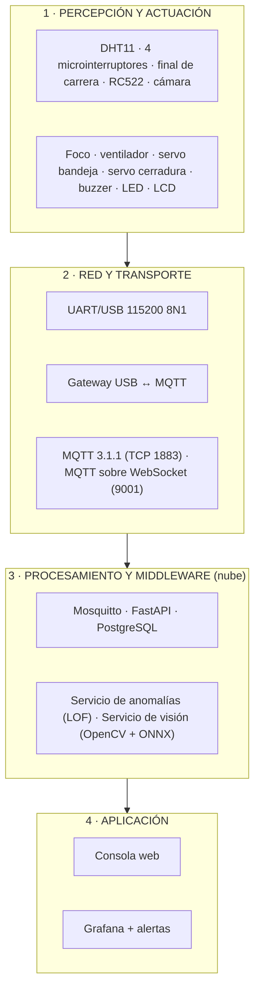

| Capa | Componentes | Responsabilidad |
|---|---|---|
| **Percepción** | DHT11, microinterruptores de posición, final de carrera de la puerta, lector RC522, cámara del celular | Medir el ambiente, detectar huevos y puerta, identificar al operador y fotografiar la bandeja |
| **Actuación** | Relés del foco y del ventilador, servo de la bandeja, servo de la cerradura, buzzer, LED rojo, LCD 16×2 | Calentar, ventilar, voltear, abrir la puerta, alarmar y señalizar el bloqueo |
| **Red / transporte** | UART/USB, gateway, Mosquitto (MQTT TCP y WebSocket) | Llevar tramas y fotos a la nube y devolver comandos al nodo |
| **Procesamiento / middleware** | Backend FastAPI, PostgreSQL, servicios de anomalías y de visión | Validar, persistir, correlacionar, inferir y decidir alarmas y bloqueos |
| **Aplicación** | Consola web, Grafana | Monitorear, operar con roles, interpretar alertas y consultar el histórico |

## 3. Arquitectura del sistema extendido

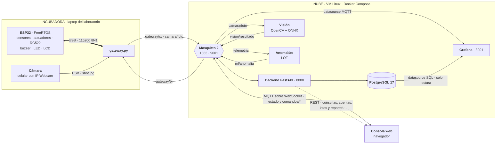

### Recorrido de una lectura

1. La ESP32 emite `MSG:1,TEMP:37.52,HUM:58.1,DOOR:0,SLOTS:3,HEATER:0,FAN:0,SERVO:-45,BUZZER:0,POWER:1,SENSOR:1,LOCK:0`.
2. El gateway la publica sin interpretarla en `smartegg/NODE-01/gateway/rx` (QoS 1).
3. El backend la interpreta, publica un adelanto en `telemetria`, la guarda en
   `telemetry_readings`, evalúa los umbrales de `incubator_configs`, abre o
   resuelve alarmas, estima el consumo y publica `sensores/*`, `telemetria`
   (retenida), `actuadores/estado`, `alarmas/critica`, `energia` y `sistema/estado`.
4. El servicio de anomalías califica la lectura y publica `ml/anomalia`; el
   backend guarda el puntaje en `anomaly_scores`.
5. Grafana y la consola reciben todo por MQTT; los paneles históricos consultan PostgreSQL.

### Recorrido de un comando

1. Un cliente MQTT publica `{"kind":"fan","enabled":true,"mode":"manual"}` en
   `comandos/actuador`. La consola publica de la misma forma en `comandos/config`
   (setpoints) y `comandos/energia` (límite, horarios y temporizador).
2. El backend valida el payload con Pydantic, rechaza el comando si el sistema
   está bloqueado, lo registra en `actuator_states` y publica en `gateway/tx`
   `{"type":"actuator","kind":"fan","enabled":true,"mode":"manual"}`.
3. El gateway lo escribe en el serial; la ESP32 lo aplica respetando sus límites
   de seguridad.
4. El backend responde en `comandos/resultado` con `ok` y `delivered`.

### Manejo de fallas de conexión

| Falla | Qué hace el sistema | Dónde |
|---|---|---|
| El backend pierde el broker | paho-mqtt reconecta solo (`connect_async` + `loop_start`); Mosquitto publica el LWT `{"status":"offline","reason":"unexpected_disconnect"}` en `status`; cada publicación fallida queda en el log | `server/app/services/mqtt.py` |
| El gateway pierde el broker | Reintenta cada 1 a 10 s y encola hasta 200 tramas, que salen al reconectar; el límite evita acumular telemetría vieja | `gateway/gateway.py` |
| Se desconecta el USB de la ESP32 | `gateway/status` pasa a `serial: "disconnected"`; el gateway reintenta abrir el puerto y descarta los comandos que lleguen mientras tanto, para no ejecutar órdenes viejas al reconectar | `gateway/gateway.py` |
| USB directo (modo `serial`) | El puente reintenta abrir el puerto cada 3 s (`serial_reconnect_seconds`); `GET /api/v1/serial/status` informa el estado | `server/app/services/serial_bridge.py` |
| Llega una trama inválida | Se descarta y se registra en el log sin cortar la lectura | `server/app/main.py` |
| El gateway está caído | Su LWT marca `gateway/status` como `offline`; los comandos responden `delivered: false` | `server/app/services/commands.py` |
| Cae el servicio de visión o de anomalías | Su LWT publica `{"status":"offline"}` en `vision/estado` o `ml/estado` y Grafana lo muestra en la portada | `vision/`, `anomalias/` |
| Se cae un contenedor | Compose lo reinicia (`restart: unless-stopped`); el backend y Grafana arrancan solo cuando la base y el broker pasan su healthcheck | `docker-compose.yml` |

Mientras tanto, el firmware sigue controlando la temperatura por umbrales:
ninguna falla de red deja al nodo sin control local.

### Registro de eventos (logs)

El backend registra con `logging` de Python y los mensajes se consultan con
`docker compose logs -f backend` en la EC2. Entre otros, registra:

| Nivel | Evento |
|---|---|
| INFO | Conexión al broker (`Connected to MQTT broker at …`) y suscripción al gateway (`Listening to the SmartEgg gateway on …`) |
| INFO | Cada evento de acceso RFID procesado, con su resultado y su duración en ms |
| INFO | Desbloqueo con tarjeta (`Authorized card unlocked …`) y cada regla de consumo aplicada |
| INFO | Cuentas e incubadoras iniciales creadas al arrancar |
| WARNING | Objeto confirmado por visión y orden de bloqueo enviada (`Foreign object confirmed on …; lock sent`) |
| WARNING | Desconexión inesperada del broker, publicación fallida y regla de consumo no entregada |
| ERROR | El broker rechaza la conexión del backend o de alguno de sus oyentes (comandos, visión, anomalías) |
| ERROR / traza | Trama serial o evento de acceso rechazado, comando MQTT que no se pudo aplicar, resultado de anomalías inválido |

Los servicios `gateway`, `vision` y `anomalias` registran igual su conexión,
sus reintentos y cada resultado con la opción `-v`.

## 4. Infraestructura en la nube

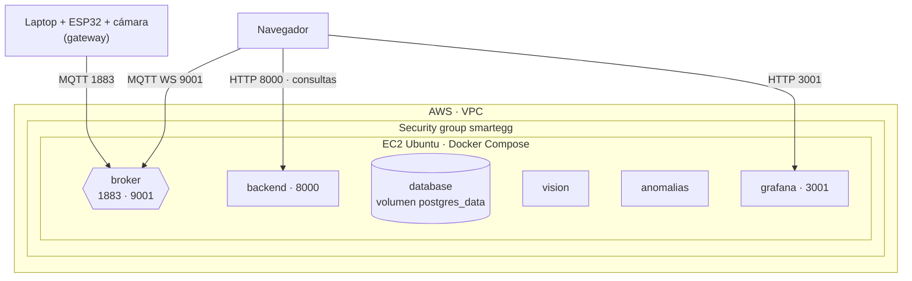

### Instancia desplegada

| Dato | Valor |
|---|---|
| Proveedor y región | AWS, `us-east-1c` (Norte de Virginia) |
| Instancia | `smartegg-fase3` · `i-048526fe56ba8e80b` · `t3.medium` · Linux (Ubuntu) |
| IP elástica pública | `100.63.122.66` |
| Grupo de seguridad | `smartegg-sg` (`sg-0ddba2d63823bee39`) |
| Carpeta del stack | `/opt/smartegg` |
| Grafana | <http://100.63.122.66:3001> |
| Swagger | <http://100.63.122.66:8000/docs> |

| `docker compose ps` en la EC2 | Instancia en la consola de AWS |
|---|---|
| 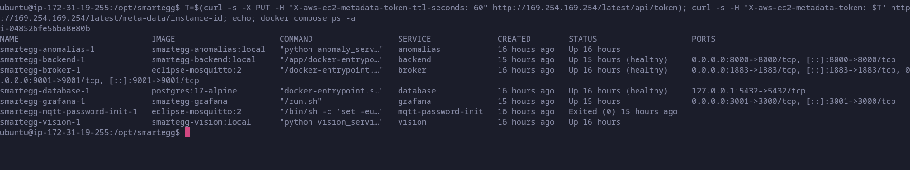 | 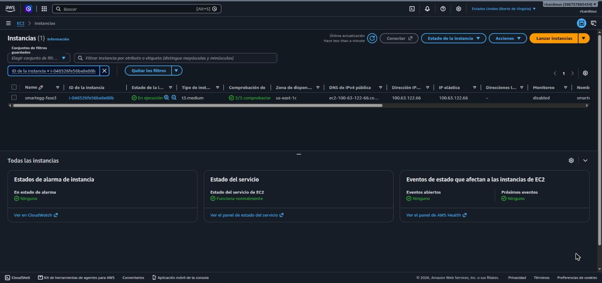 |

Las capturas completas están en [Evidencias](#despliegue-en-aws).

### Servicios en la VM

| Servicio | Imagen | Puerto publicado | Función |
|---|---|---:|---|
| `broker` | `eclipse-mosquitto:2` | 1883, 9001 | MQTT TCP para gateway y servicios; MQTT sobre WebSocket para el navegador |
| `database` | `postgres:17-alpine` | 5432 (solo administración) | Persistencia, volumen `postgres_data` |
| `backend` | `./server` | 8000 | Reglas, persistencia, bloqueo, consumo, REST de consulta y Swagger |
| `vision` | `./vision` | — | Clasificación de fotos; solo habla con el broker |
| `anomalias` | `./anomalias` | — | Calificación de la telemetría; solo habla con el broker |
| `grafana` | `./grafana` (basada en `grafana/grafana:13.2.0`) | 3001 | Dashboards y alertas |
| `mqtt-password-init` | `eclipse-mosquitto:2` | — | Genera las seis cuentas MQTT y termina |

### Base de datos: opción elegida

Elegimos la **opción a) PostgreSQL en un contenedor de la misma VM con volumen
persistente**:

- El esquema lo administra Alembic al arrancar el backend, igual que en la Fase 2;
  no hay que mantener una instancia gestionada aparte.
- El volumen `postgres_data` sobrevive a reinicios y recreación de contenedores.
- Grafana y el backend hablan con la base por la red interna `smartegg`, sin
  exponerla a Internet.
- Para el tamaño del proyecto (una incubadora, una lectura cada ~2.6 s) una
  instancia pequeña basta; el enunciado recomienda la instancia más pequeña que
  soporte Docker.

Si se prefiere un servicio gestionado (RDS, Azure Database o Neon), basta con
definir `DATABASE_URL` en `.env`; el backend la usa en lugar del contenedor, y
`GRAFANA_POSTGRES_*` apunta Grafana a la misma base. El histórico de la Fase 2
con el que entrenamos el modelo se exportó desde Neon con
[`ml/anomalias/exportar_telemetria.py`](ml/anomalias/exportar_telemetria.py).

### Puertos del grupo de seguridad

Reglas de entrada de `smartegg-sg` (7 reglas; ver
[captura](docs/evidencias/nube/06-consola-grupo-seguridad.jpg)):

| Puerto | Protocolo | Origen | Para qué |
|---:|---|---|---|
| 22 | TCP | 3 orígenes de administración (dos /32 y un /16 del proveedor) | SSH |
| 1883 | TCP | 0.0.0.0/0 | MQTT del gateway (con usuario y contraseña) |
| 9001 | TCP | 0.0.0.0/0 | MQTT sobre WebSocket para la consola web |
| 3001 | TCP | 0.0.0.0/0 | Grafana (lectura anónima; editar requiere inicio de sesión) |
| 8000 | TCP | 0.0.0.0/0 | API de consulta y Swagger |

PostgreSQL (5432) **no** se abre: Compose lo publica solo en `127.0.0.1:5432`
dentro de la VM y se administra por SSH con
`docker compose exec database psql`. Mosquitto exige usuario y contraseña en
todas las conexiones y cada cuenta tiene una ACL mínima. Para TLS dejamos
[`mqtt/config/mosquitto-tls.conf.example`](mqtt/config/mosquitto-tls.conf.example).

### Despliegue paso a paso

```bash
# 1. En la VM Ubuntu
sudo apt update && sudo apt install -y docker.io docker-compose-v2 git
sudo usermod -aG docker $USER && newgrp docker

# 2. Código y secretos
git clone https://github.com/ricardious/AYC2_G3.git
cd AYC2_G3/Proyecto_2_SmartEgg
cp .env.example .env        # cambiar todas las contraseñas y claves

# 3. Stack completo
docker compose config --quiet
docker compose up -d --build
docker compose ps
curl -fsS http://localhost:8000/health
```

En la laptop de la incubadora:

```bash
adb forward tcp:8080 tcp:8080             # cámara del celular por USB
cd Proyecto_2_SmartEgg/gateway
cp .env.example .env                       # MQTT_HOST=100.63.122.66
uv run gateway.py
```

La consola web se configura con la IP pública de la VM en `client/.env.local`
(`NEXT_PUBLIC_MQTT_URL=ws://100.63.122.66:9001`, `NEXT_PUBLIC_API_URL=http://100.63.122.66:8000`).
Grafana queda en `http://100.63.122.66:3001`. En nuestra instancia el stack vive en
`/opt/smartegg`.

## 5. Broker MQTT

Mosquitto es el único canal de control: la consola publica comandos, el backend
los valida y los reenvía al gateway, y ninguna API REST acciona sensores ni
actuadores. El contrato completo con todas las variantes está en
[`mqtt/TOPICS.md`](mqtt/TOPICS.md).

### Cuentas y ACL

| Cuenta | Usada por | Permisos principales |
|---|---|---|
| `smartegg` | Backend | Lectura y escritura en `smartegg/#`; es la única cuenta que escribe el estado y `gateway/tx` |
| `smartegg-gateway` | Gateway | Publica `gateway/rx`, `gateway/status` y `camara/foto`; lee `gateway/tx` |
| `smartegg-vision` | Servicio de visión | Lee `camara/foto`; publica `vision/resultado` y `vision/estado` |
| `smartegg-ml` | Servicio de anomalías | Lee `telemetria`; publica `ml/anomalia` y `ml/estado` |
| `smartegg-frontend` | Consola web | Lee telemetría, alarmas, estados, visión, anomalías, energía y la foto; solo escribe en `comandos/actuador`, `rotar`, `config` y `energia` (no puede escribir en `gateway/tx`) |
| `smartegg-grafana` | Grafana | Solo lectura de `smartegg/#` |

Las reglas exactas están en [`mqtt/config/acl`](mqtt/config/acl).

### Topics

Todo cuelga de `smartegg/{id}`, donde `{id}` es el código de la incubadora (`NODE-01`).

| Topic | Publicador | Suscriptor(es) | QoS | Retained |
|---|---|---|---:|:---:|
| `smartegg/{id}/sensores/temperatura` | Backend | Grafana | 0 | Sí |
| `smartegg/{id}/sensores/humedad` | Backend | Grafana | 0 | Sí |
| `smartegg/{id}/telemetria` | Backend | Frontend, Grafana, Anomalías | 0 | Sí la persistida; no el adelanto en vivo |
| `smartegg/{id}/actuadores/estado` | Backend | Frontend, Grafana | 1 | Sí |
| `smartegg/{id}/alarmas/critica` | Backend | Frontend, Grafana | 1 | Sí; vacío al resolverse |
| `smartegg/{id}/acceso/eventos` | Backend | Grafana | 1 | No |
| `smartegg/{id}/status` | Backend / **LWT** | Frontend, Grafana | 1 | Sí |
| `smartegg/{id}/gateway/rx` | Gateway | Backend | 1 | No |
| `smartegg/{id}/gateway/tx` | Backend | Gateway | 1 | No |
| `smartegg/{id}/gateway/status` | Gateway / **LWT** | Backend, Frontend | 1 | Sí |
| `smartegg/{id}/comandos/actuador` | Frontend | Backend | 1 | No |
| `smartegg/{id}/comandos/rotar` | Frontend | Backend | 1 | No |
| `smartegg/{id}/comandos/config` | Frontend | Backend | 1 | No |
| `smartegg/{id}/comandos/energia` | Frontend | Backend | 1 | No |
| `smartegg/{id}/comandos/resultado` | Backend | Frontend | 1 | No |
| `smartegg/{id}/camara/foto` | Gateway | Visión, Frontend | 0 | No |
| `smartegg/{id}/vision/resultado` | Visión | Backend, Frontend, Grafana | 0 | Sí |
| `smartegg/vision/estado` | Visión / **LWT** | Frontend, Grafana | 1 | Sí |
| `smartegg/{id}/ml/anomalia` | Anomalías | Backend, Frontend, Grafana | 0 | Sí |
| `smartegg/ml/estado` | Anomalías / **LWT** | Frontend, Grafana | 1 | Sí |
| `smartegg/{id}/energia` | Backend | Frontend, Grafana | 0 | Sí |
| `smartegg/{id}/sistema/estado` | Backend | Frontend, Grafana | 1 | Sí |

**Criterio de QoS.** Usamos QoS 0 para flujos periódicos donde una muestra nueva
reemplaza a la perdida (sensores, telemetría, fotos, resultados de los modelos,
energía) y QoS 1 para estados, eventos, alarmas y comandos, que no pueden
perderse. El topic de alarmas usa QoS 1.

**Retained.** `status`, `actuadores/estado`, `alarmas/critica`, `sistema/estado`,
`telemetria` y los resultados de los modelos se retienen: un suscriptor nuevo
recibe el último estado sin esperar otra publicación.

**LWT.** El backend, el gateway, la visión y las anomalías registran un Last Will
al conectarse. Si alguno cae de forma abrupta, Mosquitto publica por él
`{"status":"offline","reason":"unexpected_disconnect"}` (o `{"status":"offline"}`
en los servicios de ML) y Grafana y la consola muestran la caída sin polling.

### Payloads JSON

| Topic | Ejemplo |
|---|---|
| `sensores/temperatura` | `{"value":37.6,"unit":"celsius","recorded_at":"2026-10-23T18:30:00Z"}` |
| `sensores/humedad` | `{"value":58.2,"unit":"percent","recorded_at":"2026-10-23T18:30:00Z"}` |
| `telemetria` | `{"temperature_c":37.6,"humidity_pct":58.2,"door_open":false,"system_enabled":true,"sensor_ok":true,"system_locked":false,"occupied_slots":3,"available_slots":1,"recorded_at":"2026-10-23T18:30:00Z"}` |
| `actuadores/estado` | `{"heater":false,"fan":true,"servo_angle":45,"buzzer":false,"recorded_at":"2026-10-23T18:30:00Z"}` |
| `alarmas/critica` | `{"kind":"object_detected","severity":"critical","message":"Objeto extraño detectado: sistema bloqueado","value":null,"occurred_at":"2026-10-23T22:15:04Z"}` |
| `acceso/eventos` | `{"event":"door_closed","session_id":12,"operator_id":1,"method":"rfid","recorded_at":"2026-10-23T18:10:00Z"}` |
| `status` | `{"status":"online","recorded_at":"2026-10-23T18:30:00Z"}` |
| `gateway/rx` | `MSG:1,TEMP:37.52,HUM:58.1,DOOR:0,SLOTS:3,HEATER:0,FAN:1,SERVO:-45,BUZZER:0,POWER:1,SENSOR:1` (texto plano) |
| `gateway/tx` | `{"type":"actuator","kind":"fan","enabled":true,"mode":"manual","value":null}` |
| `gateway/status` | `{"status":"online","serial":"connected","port":"/dev/ttyUSB0","camera":"ok","recorded_at":"2026-10-23T18:40:34Z"}` |
| `comandos/actuador` | `{"kind":"heater","enabled":false,"mode":"automatic","request_id":"k3x9-a1"}` |
| `comandos/rotar` | `{"angle_degrees":30,"direction":"left"}` |
| `comandos/config` | `{"temperature_min_c":37.2,"temperature_max_c":38.1,"humidity_min_pct":52,"humidity_max_pct":62,"critical_temperature_c":39.5}` |
| `comandos/energia` | `{"daily_limit_wh":800,"limit_action":"heater_off","timer":{"device":"fan","state":"on","minutes":15}}` |
| `comandos/resultado` | `{"command":"actuador","request_id":"k3x9-a1","ok":true,"delivered":true,"recorded_at":"2026-10-23T18:40:52Z"}` |
| `camara/foto` | JPEG binario (~50 KB a 640×480) |
| `vision/resultado` | `{"clase":"objeto","confianza":0.9132,"probabilidades":{"huevo":0.0521,"objeto":0.9132,"vacio":0.0347},"votos_objeto":4,"prob_objeto_media":0.7412,"ventana":5,"objeto_detectado":true,"inferencia_ms":18.4,"recorded_at":"2026-10-23T22:15:03Z"}` |
| `ml/anomalia` | `{"puntaje":8.4127,"umbral":1.1672,"anomalia":true,"alerta":true,"causa":"temperatura fuera de lo normal","caracteristicas":{"temperatura":44.0,"vel_temp":6.52,"vel_hum":0.0,"ruido_temp":0.21},"lectura_at":"…","recorded_at":"…"}` |
| `energia` | `{"potencia_w":41.41,"desglose_w":{"foco":40.0,"ventilador":0.0,"otros":1.41},"energia_hoy_wh":512.3,"costo_hoy_q":0.7736,"promedio_1h_w":31.2,"limite_wh":800.0,"uso_limite_pct":64.0,…}` |
| `sistema/estado` | `{"state":"locked","locked":true,"reason":"object_detected","recorded_at":"2026-10-23T22:15:04Z"}` |

### Demostración publish/subscribe

```bash
# Escuchar todo el árbol de SmartEgg en la nube
mosquitto_sub -h 100.63.122.66 -p 1883 -u smartegg-grafana -P '<clave>' -t 'smartegg/#' -v

# Comprobar retained: un suscriptor nuevo recibe el último estado al instante
mosquitto_sub -h 100.63.122.66 -p 1883 -u smartegg-grafana -P '<clave>' -t 'smartegg/NODE-01/sistema/estado' -C 1

# Comprobar LWT: matar el gateway (kill -9) y observar gateway/status → offline
```

También usamos MQTT Explorer; ver las capturas en [Evidencias](#evidencias-de-funcionamiento).

## 6. Pipeline de ML: detección de anomalías

Notebook: [`ml/anomalias/entrenar_anomalias.ipynb`](ml/anomalias/entrenar_anomalias.ipynb) ·
script equivalente: [`ml/anomalias/smartegg_anomalias.py`](ml/anomalias/smartegg_anomalias.py) ·
servicio: [`anomalias/anomaly_service.py`](anomalias/anomaly_service.py).

### Paso 1 · Extracción y exploración

[`exportar_telemetria.py`](ml/anomalias/exportar_telemetria.py) descargó de la base
de la Fase 2 **7 899 lecturas** de `NODE-01` (18 de septiembre al 2 de octubre)
a [`datos/telemetria_fase2.csv`](ml/anomalias/datos/telemetria_fase2.csv). El
notebook revisa estadísticas descriptivas, distribuciones, nulos, duplicados,
huecos entre sesiones y las fallas reales del sensor (`SENSOR:0`, 0 % de humedad).

### Paso 2 · Preprocesamiento y características

Elegimos un enfoque **no supervisado**: entrenamos solo con operación normal.
Cada lectura se describe con el último minuto del mismo nodo:

| Característica | Qué mide |
|---|---|
| `temperatura` | Temperatura actual (°C) |
| `vel_temp` | Cambio de temperatura en el último minuto (°C/min) |
| `vel_hum` | Cambio de humedad en el último minuto (%/min) |
| `ruido_temp` | Salto medio entre lecturas seguidas (°C) |

El mismo `FeatureBuilder` se usa en el entrenamiento y en el servicio en vivo,
así que las características nunca se desalinean. Las variables se estandarizan
dentro del pipeline de scikit-learn.

### Paso 3 · Entrenamiento y evaluación

Para evaluar, insertamos fallas simuladas en el día de prueba (picos de
temperatura, calentamiento descontrolado, foco encendido con temperatura
bajando, caída de humedad y sensor desconectado) y hicimos validación cruzada
dejando un grupo de días fuera (4 particiones). El umbral es el percentil 99.9
del puntaje en operación normal y la alerta exige **3 lecturas anómalas seguidas**.

| Modelo | Precisión | Recall | F1 | ROC-AUC | Falsos positivos | Alertas falsas/h |
|---|---:|---:|---:|---:|---:|---:|
| **Local Outlier Factor** (elegido) | 0.84 | 0.28 | 0.42 | 0.77 | 1.3 % | 6.6 |
| Isolation Forest | 0.92 | 0.07 | 0.13 | 0.81 | 0.2 % | 0.0 |
| One-Class SVM | 0.77 | 0.55 | 0.64 | 0.82 | 4.1 % | 28.9 |
| Reglas fijas de la Fase 2 | 0.23 | 0.90 | 0.36 | — | 73.9 % | — |

| Falla simulada | Eventos detectados |
|---|---:|
| Pico de temperatura (+6 °C en 2 lecturas) | 45 / 47 |
| Caída brusca de humedad (−25 %) | 7 / 7 |
| Sensor desconectado (0 °C y 0 %) | 4 / 4 |
| Calentamiento descontrolado (+0.5 °C por lectura) | 16 / 47 |
| Foco encendido y la temperatura baja | 3 / 18 |

**Por qué LOF.** Es el punto medio: detecta casi todos los picos, caídas de
humedad y sensores desconectados con 1.3 % de falsos positivos. Isolation Forest
casi no alerta y One-Class SVM llena la consola de alarmas falsas. El recall
global es bajo porque el calentamiento descontrolado se parece al calentamiento
normal del histórico; ese caso lo cubre la regla fija del backend
(`critical_temperature_c`), así que modelo y reglas se complementan.

| Matriz de confusión | Validación cruzada |
|---|---|
| 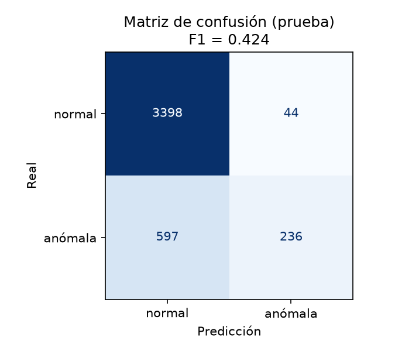 | 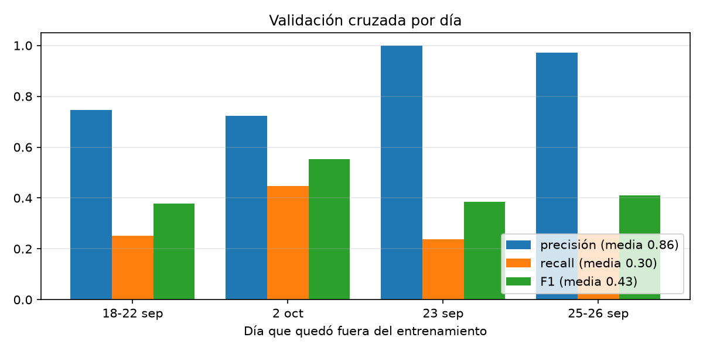 |

El modelo final se entrenó con 6 802 lecturas normales y se guardó en
[`ml/anomalias/modelo/smartegg_anomalias.joblib`](ml/anomalias/modelo/) (umbral 1.1672).

### Paso 4 · Integración al pipeline MQTT/backend

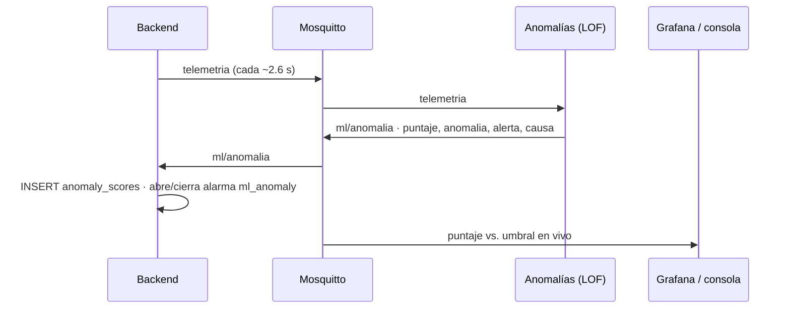

El servicio necesita 20 s de historial antes de calificar, reinicia la ventana
tras un hueco de 2 minutos e ignora la lectura retenida y la copia duplicada de
cada lectura. `ML_ALERT_NEEDED` y `ML_ALERT_WINDOW` ajustan la regla sin reentrenar.

## 7. Módulo de visión por computadora

Notebook: [`ml/vision/entrenar_vision.ipynb`](ml/vision/entrenar_vision.ipynb) ·
script: [`ml/vision/smartegg_vision.py`](ml/vision/smartegg_vision.py) ·
servicio: [`vision/vision_service.py`](vision/vision_service.py) ·
prueba con fotos: [`ml/vision/predecir.py`](ml/vision/predecir.py).

### Cámara

La ESP32-CAM quedó descartada porque su sensor OV3660 no entregaba imágenes. Usamos
un celular Android con **IP Webcam** conectado por USB a la laptop
(`adb forward tcp:8080 tcp:8080`), apuntando al interior de la bandeja. El
gateway descarga `shot.jpg` una vez por segundo a 640×480 (~50 KB), descarta
respuestas que no son JPEG o pesan más de 1 MB, y la publica en `camara/foto`
con QoS 0 para no acumular fotos viejas.

Secuencia real de 6 fotos que el gateway tomó y publicó, una por segundo
(24-10-2026, 15:06:55 a 15:07:01), con cuatro huevos en la bandeja; en la última
el foco está apagado:

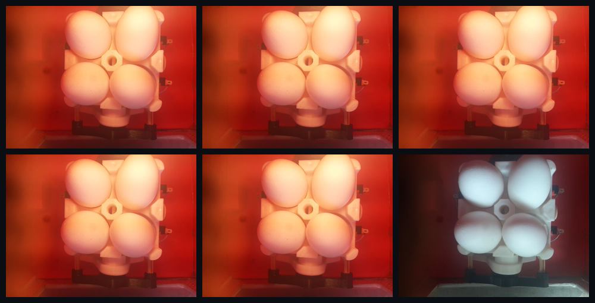

### Dataset propio

| Clase | Fotos | Contenido |
|---|---:|---|
| `huevo` | 260 | Bandeja con uno a cuatro huevos en distintas posiciones |
| `objeto` | 290 | Objetos que no son huevos: tapitas, borradores, monedas, llaves, canicas y combinaciones de objetos pequeños |
| `vacio` | 250 | Bandeja sin nada |

Todas son fotos reales de nuestra incubadora, tomadas con
[`scripts/capturar_dataset.py`](scripts/capturar_dataset.py) en cuatro
condiciones de luz: foco encendido con el cuarto a oscuras (muy rojizo), foco y
luz del cuarto encendidos, solo luz del cuarto y penumbra. El nombre de
cada archivo lleva la hora de captura; el entrenamiento agrupa las fotos por
tanda para que fotos casi iguales no queden a la vez en entrenamiento y prueba.

### Modelo y evaluación

Transfer learning sobre **MobileNetV2** preentrenado en ImageNet, exportado a
ONNX con la normalización y el `softmax` incluidos. Validación cruzada por
tandas, 5 particiones, 800 fotos:

| Métrica | Media ± desviación |
|---|---:|
| Exactitud | 0.892 ± 0.039 |
| F1 macro | 0.890 ± 0.043 |
| Recall `huevo` | 0.966 ± 0.052 |
| Recall `objeto` | 0.744 ± 0.135 |
| Recall `vacio` | 0.984 ± 0.032 |
| Precisión `objeto` | 0.952 ± 0.046 |

| Matriz de confusión | Errores de la validación |
|---|---|
| 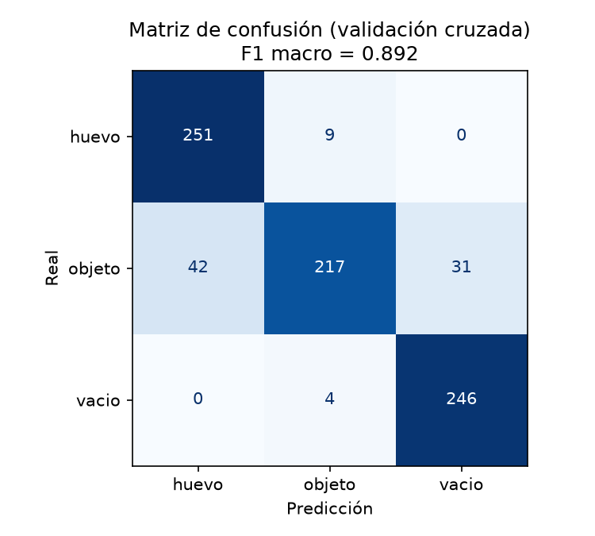 | 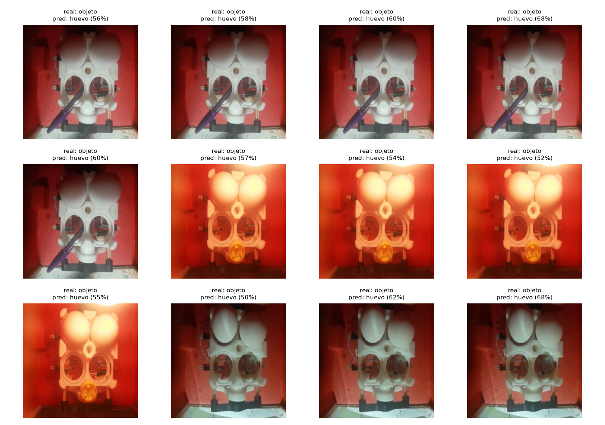 |

Ejemplos de fotos reales de la bandeja clasificadas con el mismo código OpenCV
del servicio (`cv2.imdecode` → `blobFromImage` → `cv2.dnn`):

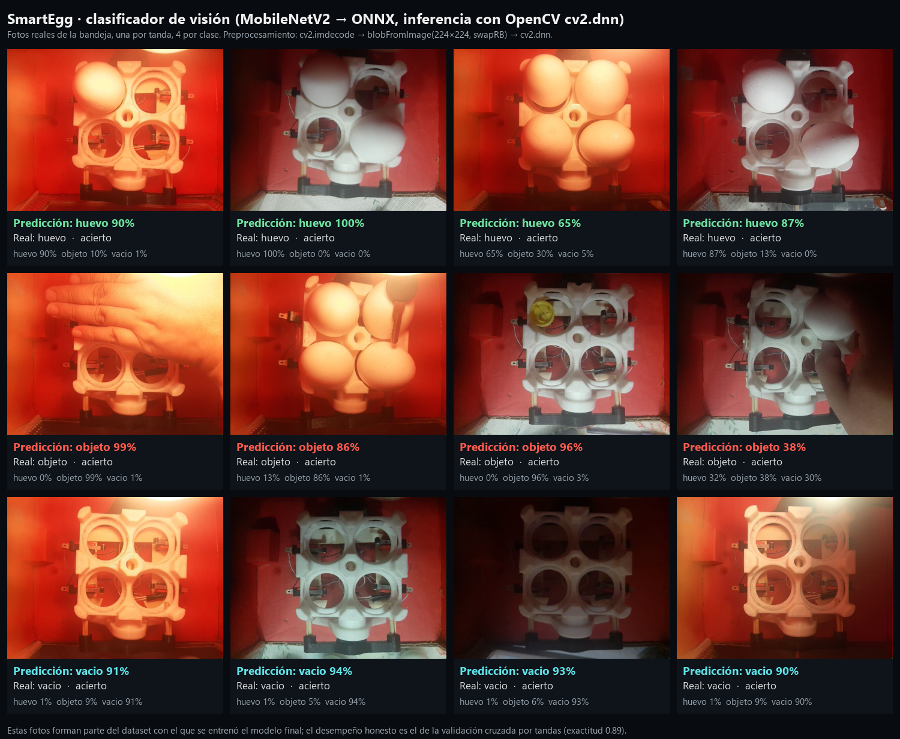

Las fotos de la lámina forman parte del dataset con el que se entrenó el modelo
final, así que su desempeño honesto es el de la validación cruzada. La última
foto de objeto (38 %) es un caso dudoso: por eso el bloqueo usa la media de 5 fotos.

La precisión de `objeto` (0.95) es la métrica que protege contra bloqueos
falsos; el recall de `objeto` (0.74 por foto) se compensa con la ventana de 5
fotos descrita abajo. El reporte completo está en
[`ml/vision/resultados/reporte.txt`](ml/vision/resultados/reporte.txt).

### Procesamiento con OpenCV

```python
img = cv2.imdecode(np.frombuffer(jpeg, np.uint8), cv2.IMREAD_COLOR)   # JPEG del broker
blob = cv2.dnn.blobFromImage(img, 1.0, (224, 224), swapRB=True, crop=False)
net = cv2.dnn.readNetFromONNX("smartegg_vision.onnx")
net.setInput(blob)
probabilidades = net.forward()[0]           # huevo, objeto, vacio
```

El servicio no necesita PyTorch: OpenCV decodifica, redimensiona, convierte BGR→RGB
e infiere con `cv2.dnn` (~20 ms por foto en CPU).

### Regla de confirmación

Una sola foto no bloquea. El servicio guarda las últimas 5 fotos del nodo y
confirma el objeto cuando la **probabilidad media de `objeto` llega al 65 %**
(`VISION_MIN_PROBABILITY`). Primero contábamos 3 de 5 votos, pero en la prueba
en vivo una bandeja con huevos oscilaba entre 45 % y 55 % de `objeto` y
terminaba bloqueando sin motivo; con el promedio esa escena se queda cerca del
50 %. Un objeto claro (≥ 90 %) bloquea a la cuarta foto, unos 4 s después de
colocarlo.

## 8. Valor disruptivo: bloqueo inteligente por visión

### Qué hace

Si el operador inicia el ciclo y la cámara confirma algo que no es un huevo, el
sistema **se bloquea por completo** hasta que una persona autorizada lo atiende:

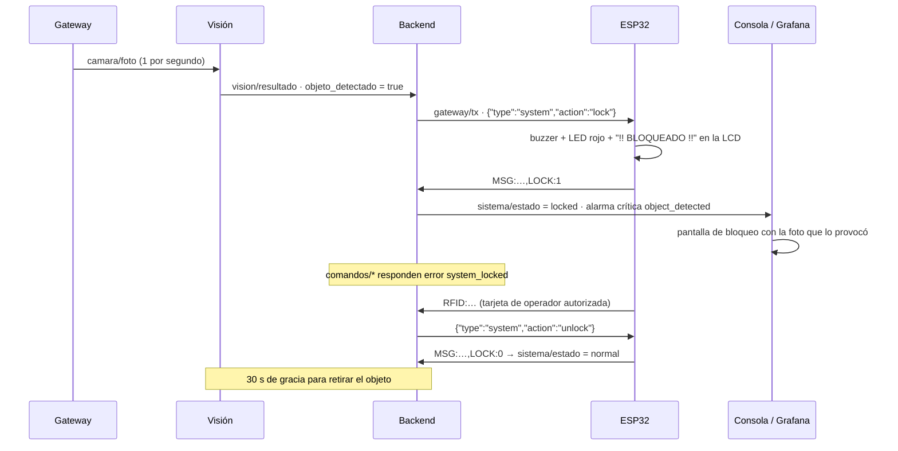

- **ESP32:** el buzzer suena de forma continua, se enciende el LED rojo de
  GPIO 13 y la LCD muestra `!! BLOQUEADO !!` alternando `OBJETO DETECTADO` y
  `PASE SU TARJETA`. Rechaza los comandos manuales (`MSG:4,ERROR:7`), pero el
  control automático de temperatura y la rotación periódica siguen activos para
  no dañar los huevos.
- **Página web:** cubre todas las pantallas con la superposición de bloqueo,
  muestra la última foto y desde cuándo está bloqueado, y deshabilita los controles.
- **Backend:** rechaza cualquier `comandos/*` con `error: "system_locked"`, no
  aplica reglas de consumo y registra la alarma crítica `object_detected`.
- **Grafana:** el Centro de control cambia el escudo verde por un candado rojo
  y la línea de tiempo histórica marca el tramo bloqueado.
- **Desbloqueo:** solo con una tarjeta RFID de operador autorizado. Queda
  registrado en `acceso/eventos` (`system_unlocked`) con el operador y la sesión.
  Durante el bloqueo el lector acepta la tarjeta **aunque la puerta siga abierta**
  y haya una sesión en curso: es el caso normal, porque el objeto se detecta con el
  operador frente a la bandeja. El backend cierra la sesión anterior como
  `replaced` y conserva su apertura en `door_events`.

| Pantalla de bloqueo de la página | Alerta en el Centro de control |
|---|---|
| 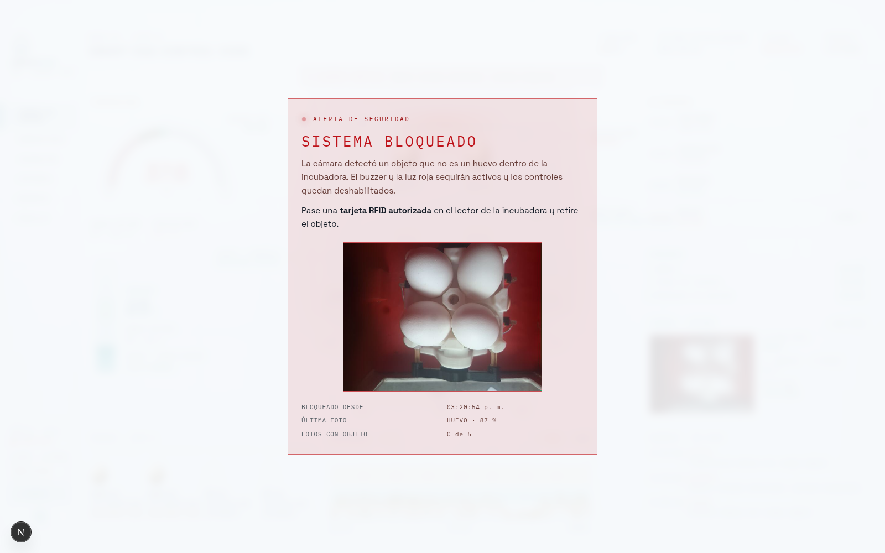 | 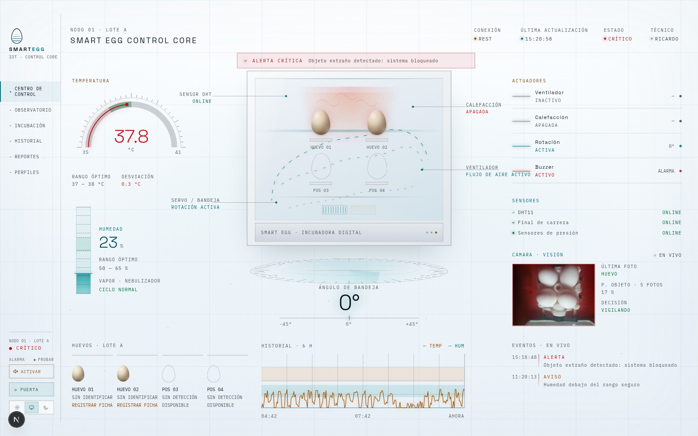 |

En la primera captura la página quedó bloqueada desde las 15:20:54 y ya no
acepta controles. La última foto ya es *huevo* porque se retiró el objeto: el
sistema sigue bloqueado hasta que pase una tarjeta autorizada. En la segunda,
el Centro de control muestra la alerta crítica `object_detected` y el evento
en *Eventos · en vivo*.

### Por qué es disruptivo

Las incubadoras comerciales solo vigilan temperatura y humedad: no saben **qué**
hay dentro. Un objeto extraño (una herramienta olvidada, un huevo roto, un
recipiente) puede contaminar el lote, bloquear el volteo o dañar el mecanismo,
y nadie lo detecta hasta abrir la puerta. SmartEgg convierte la cámara en un
sensor de seguridad:

- **Previene en lugar de reaccionar:** el ciclo se detiene antes de que el volteo
  o el calor dañen el lote.
- **Es auditable:** el bloqueo y el desbloqueo quedan ligados a una foto, una
  alarma y un operador identificado por RFID.
- **Es robusto ante falsos positivos:** la ventana de 5 fotos y el umbral
  promedio evitan bloqueos por una sola foto ambigua, y el periodo de gracia
  deja retirar el objeto sin que vuelva a bloquear.
- **Es barato:** reutiliza un celular como cámara y corre la inferencia en la
  nube con OpenCV, sin hardware de IA dedicado.

## 9. Gestión inteligente del consumo eléctrico

La incubadora no tiene sensor de corriente; el backend **estima** la potencia de
cada lectura con el estado real del foco, el ventilador y el buzzer que reporta
la ESP32 y la potencia nominal de cada componente. La justificación completa de
cada valor está en [`docs/CONSUMO_ELECTRICO.md`](docs/CONSUMO_ELECTRICO.md).

| Componente | Origen del valor | Potencia |
|---|---|---:|
| Foco incandescente | Etiqueta 120 V · 40 W | 40 W |
| Ventilador | 12 V · 0.15 A conectado a 5 V: 1.8 W × (5/12)² | 0.31 W |
| Electrónica fija (ESP32, LCD, RC522, servos en reposo) | Hojas de datos | 1.06 W |
| Bobina de relé activa | Módulo típico, 70 mA a 5 V | 0.35 W |
| Buzzer | 30 mA a 5 V | 0.15 W |

Con los ciclos reales de la Fase 2 (foco encendido el 74.9 % del tiempo) la
incubadora consume **≈ 31.4 W en promedio, 0.75 kWh al día** y unos
**Q23.90 por un ciclo de 21 días** con la tarifa no social de EEGSA (Q1.51/kWh).

| Función | Funcionamiento | Valor por defecto |
|---|---|---|
| Monitoreo en tiempo real | Potencia por componente, energía y costo del día en `energia` y `energy_samples` | — |
| Límite de consumo | Alarma `energy_limit` al pasar el límite diario; opcionalmente apaga el foco hasta medianoche | 800 Wh, solo alerta |
| Horarios | Franjas diarias que fuerzan el foco o el ventilador | Ninguno |
| Temporizador | Enciende o apaga un dispositivo por N minutos y vuelve a automático | Ninguno |
| Consumo anómalo | Alarma `energy_anomaly`: foco encendido con temperatura máxima, consumo con el sistema apagado o promedio de 1 h mayor a 37 W | Activo |

Todo se configura por MQTT (`comandos/energia`) desde el panel de la consola, y
la seguridad del firmware sigue mandando sobre cualquier regla.

## 10. Base de datos

| Dato | Valor |
|---|---|
| Motor | PostgreSQL 17 (`postgres:17-alpine`) |
| Host / puerto | Servicio `database` de Compose, `database:5432` en la red `smartegg`; `localhost:5432` dentro de la VM |
| Base | `smartegg` (`POSTGRES_DB`) |
| Usuarios | `smartegg` (backend, dueño del esquema) · `grafana_reader` (solo lectura) |
| Persistencia | Volumen Docker `postgres_data` |
| Esquema | Migraciones Alembic en [`server/migrations`](server/migrations); documentación en [`db/schema.dbml`](db/schema.dbml) |

### Modelo entidad-relación

```mermaid
erDiagram
    technicians  ||--o{ technician_incubators : "se asigna"
    technicians  ||--o{ access_sessions    : "autentica"
    technicians  ||--o{ door_events        : "opera"
    technicians  ||--o{ alarms             : "reconoce"
    technicians  ||--o{ lots               : "crea"
    technicians  ||--o{ eggs               : "registra"
    technicians  ||--o{ report_exports     : "genera"

    incubators   ||--|| incubator_configs  : "define umbrales"
    incubators   ||--|| energy_configs     : "define consumo"
    incubators   ||--o{ technician_incubators : "asigna"
    incubators   ||--o{ telemetry_readings : "registra"
    incubators   ||--o{ sensors            : "expone"
    incubators   ||--o{ actuator_states    : "acciona"
    incubators   ||--o{ alarms             : "dispara"
    incubators   ||--o{ rotation_events    : "rota"
    incubators   ||--o{ door_events        : "recibe"
    incubators   ||--o{ access_sessions    : "autoriza"
    incubators   ||--o{ eggs               : "aloja"
    incubators   ||--o{ anomaly_scores     : "califica"
    incubators   ||--o{ energy_samples     : "consume"
    incubators   ||--o{ report_exports     : "documenta"

    lots         ||--o{ eggs               : "agrupa"
    access_sessions |o--o| door_events     : "genera"

    telemetry_readings {
        int id PK
        int incubator_id FK
        float temperature_c
        float humidity_pct
        bool door_open
        bool system_locked
        int occupied_slots
        string source
        timestamptz recorded_at
    }
    anomaly_scores {
        int id PK
        int incubator_id FK
        float score
        float threshold
        bool anomalous
        bool alert
        string cause
        timestamptz recorded_at
    }
    energy_samples {
        int id PK
        int incubator_id FK
        float power_w
        float energy_today_wh
        float cost_today_q
        string anomaly_rule
        timestamptz recorded_at
    }
    alarms {
        int id PK
        int incubator_id FK
        string kind
        string severity
        timestamptz occurred_at
        timestamptz resolved_at
    }
```

| Tabla | Qué guarda |
|---|---|
| `technicians` | Operadores y administrador: nombre, edad, género, rol, UID RFID y contraseña con hash |
| `technician_incubators` | Incubadoras asignadas a cada operador |
| `incubators` | Código, capacidad, número de serie y última señal |
| `incubator_configs` | Rangos de temperatura y humedad, umbral crítico y rotación |
| `telemetry_readings` | Una fila por trama, con `system_locked` y la línea original |
| `sensors` · `actuator_states` | Último valor de cada sensor y estado de cada actuador |
| `alarms` | Tipo, severidad, inicio, reconocimiento y resolución; incluye `object_detected`, `ml_anomaly`, `energy_limit` y `energy_anomaly` |
| `rotation_events` | Cada giro de la bandeja |
| `lots` · `eggs` | Lote, ficha del huevo, fecha de ingreso, posición y nodo |
| `door_events` · `access_sessions` | Aperturas con día, hora, operador, tipo y conteo de huevos; sesiones RFID |
| `anomaly_scores` | **Nuevo:** puntaje del modelo para cada lectura calificada |
| `energy_configs` · `energy_samples` | **Nuevo:** potencias, tarifa, límite, horarios y temporizador; muestra de consumo por lectura |
| `report_exports` | Quién generó cada PDF y con qué alcance |

### Scripts de consulta para la calificación

Todas las consultas que usamos en la verificación en vivo están en
[`db/consultas_calificacion.sql`](db/consultas_calificacion.sql): localización
de la base, tablas, operadores, lotes y huevos, aperturas de puerta, lecturas,
alarmas, bloqueos, puntajes del modelo y consumo. Se ejecutan en la VM con:

```bash
docker compose exec -T database psql -U smartegg -d smartegg < db/consultas_calificacion.sql
```

o una por una en una sesión interactiva:

```bash
docker compose exec database psql -U smartegg -d smartegg
```

```sql
-- Localizar la base
SELECT version(), current_database(), current_user, inet_server_addr(), inet_server_port();

-- Operadores (id, nombre, edad, género)
SELECT id, username, full_name, age, gender, role FROM technicians ORDER BY id;

-- Últimas lecturas con el estado de bloqueo
SELECT recorded_at, temperature_c, humidity_pct, door_open, system_locked
FROM telemetry_readings ORDER BY recorded_at DESC LIMIT 20;

-- Alarmas de la Fase 3
SELECT kind, severity, occurred_at, resolved_at FROM alarms
WHERE kind IN ('object_detected', 'ml_anomaly', 'energy_limit', 'energy_anomaly')
ORDER BY occurred_at DESC;

-- Salida del modelo de anomalías
SELECT recorded_at, score, threshold, anomalous, alert, cause
FROM anomaly_scores ORDER BY recorded_at DESC LIMIT 20;
```

Las consultas de los paneles de Grafana están en [`db/grafana_queries.sql`](db/grafana_queries.sql).

## 11. Documentación de la API

FastAPI genera la documentación **OpenAPI/Swagger** automáticamente:

| Recurso | URL |
|---|---|
| Swagger UI | `http://100.63.122.66:8000/docs` |
| ReDoc | `http://100.63.122.66:8000/redoc` |
| Esquema OpenAPI | `http://100.63.122.66:8000/openapi.json` |

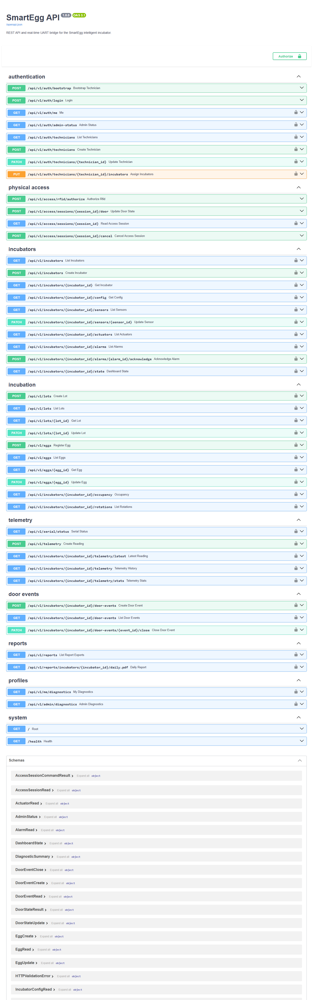

Captura del Swagger UI del backend desplegado (24-10-2026). Ningún endpoint
acciona actuadores.

Por la restricción del enunciado, **la API no controla sensores ni actuadores**:
solo consulta y administra. Los endpoints que antes cambiaban actuadores,
rotación y configuración se eliminaron y su función pasó a `comandos/*` por MQTT.

| Área | Endpoints | Uso |
|---|---|---|
| Autenticación | `POST /auth/login`, `GET /auth/me`, `GET/POST/PATCH /auth/technicians`, `PUT /auth/technicians/{id}/incubators` | Cuentas, roles y asignaciones |
| Acceso RFID | `POST /access/rfid/authorize`, `POST /access/sessions/{id}/door`, `POST /access/sessions/{id}/cancel` | Autorización de la cerradura (clave de dispositivo) |
| Incubadoras | `GET /incubators`, `GET /incubators/{id}/state`, `GET .../config`, `GET .../occupancy` | Estado y configuración actual |
| Lotes y huevos | `POST/GET /lots`, `PATCH /lots/{id}`, `POST/GET /eggs`, `PATCH /eggs/{id}` | Fichas de identificación |
| Telemetría | `GET .../telemetry`, `GET .../latest`, `GET .../stats` | Histórico de lecturas |
| Actuadores y rotación | `GET .../actuators`, `GET .../rotations` | Solo lectura |
| Alarmas | `GET .../alarms`, `POST .../alarms/{id}/acknowledge` | Historial y reconocimiento |
| Puerta | `POST/GET .../door-events`, `PATCH .../door-events/{id}/close` | Registro de aperturas |
| Perfiles e informes | `GET /me/diagnostics`, `GET /admin/diagnostics`, `GET /reports/incubators/{id}/daily.pdf` | Diagnósticos por rol y PDF |
| Salud | `GET /health`, `GET /serial/status` | Disponibilidad del backend y del gateway |

Todas usan el prefijo `/api/v1`, JWT (`Authorization: Bearer`) y códigos HTTP
200, 201, 400, 401, 403, 404, 409 y 422 según el caso. El detalle está en
[`server/README.md`](server/README.md#contrato-de-api).

## 12. Dashboards de monitoreo

### 12.1 Grafana

Grafana corre como imagen propia ([`grafana/Dockerfile`](grafana/Dockerfile)) con
la identidad visual de SmartEgg, plugins con versión fija y dos datasources
provisionados: **MQTT** (tiempo real) y **PostgreSQL** (histórico). Los
dashboards están versionados como JSON en [`grafana/dashboards/`](grafana/dashboards/).

| Dashboard | Fuente | Contenido |
|---|---|---|
| **Centro de control** (portada) | MQTT + SQL | Estado del nodo, sistema normal/bloqueado, puerta y actuadores; gauges de temperatura y humedad; **resultado de visión** (clase, confianza, probabilidades y ventana); **puntaje de anomalías** contra el umbral; escudo o candado de bloqueo; historial de bloqueos y de puntajes |
| **Tiempo real** | MQTT | Temperatura, humedad, puerta, ocupación, actuadores, ángulo de la bandeja, alarma crítica y eventos de acceso |
| **Histórico** | PostgreSQL | Promedios, tiempo en rango óptimo, zonas térmicas, ocupación, rotaciones, lotes y huevos, aperturas por operador y alarmas |
| **Consumo eléctrico** | PostgreSQL | Potencia actual, energía y costo del día, uso del límite, promedio de 1 h, potencia por componente, energía por día y alarmas de consumo |

**Alerta activa.** La regla *Consumo eléctrico anómalo o límite superado*
([`grafana/provisioning/alerting/smartegg-consumo.yml`](grafana/provisioning/alerting/smartegg-consumo.yml))
se evalúa cada minuto y pasa a *firing* cuando lleva 1 minuto abierta una alarma
`energy_anomaly` o `energy_limit`. Se ve en *Alerting → Alert rules*, carpeta SmartEgg.

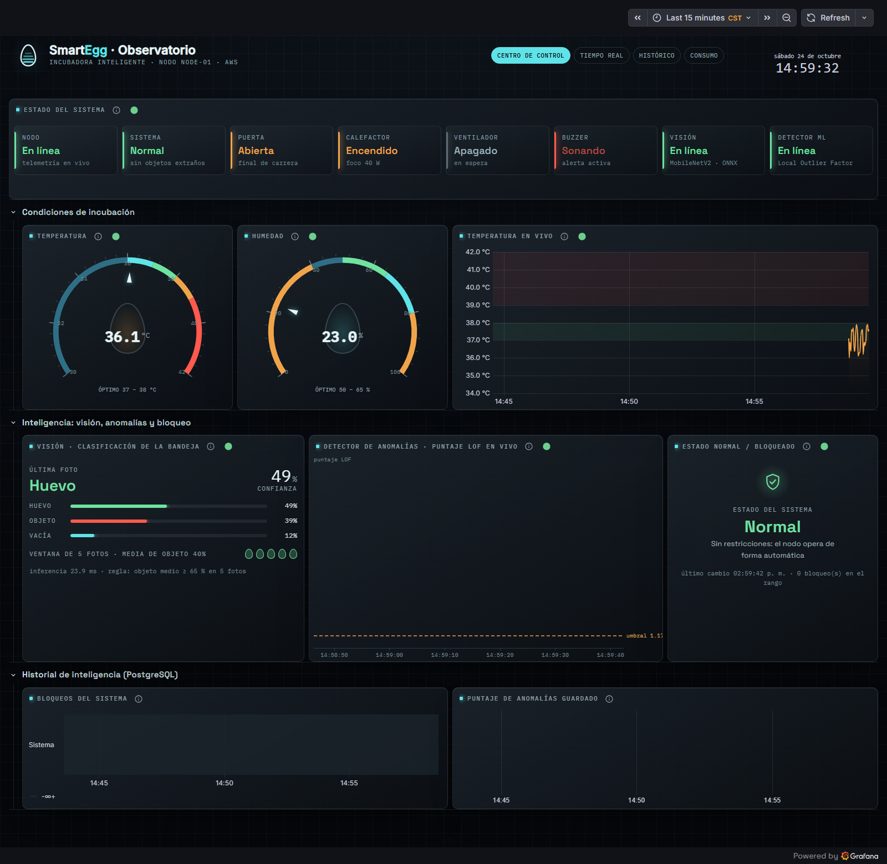

Capturas de los cuatro tableros y de la regla de alerta:
[Centro de control](docs/evidencias/grafana/grafana-centro-control.png) ·
[Tiempo real](docs/evidencias/grafana/grafana-tiempo-real.png) ·
[Histórico](docs/evidencias/grafana/grafana-historico.png) ·
[Consumo eléctrico](docs/evidencias/grafana/grafana-consumo.png) ·
[Regla de alerta](docs/evidencias/grafana/grafana-regla-alerta.png).
El detalle de cada panel está en [`grafana/README.md`](grafana/README.md).

### 12.2 Consola web interactiva

La consola ([`client/`](client/)) se conecta al broker por **MQTT sobre
WebSocket** para recibir el estado y publicar comandos, y usa la API solo para
consultas, cuentas y reportes.

| Vista | Librería | Qué muestra |
|---|---|---|
| Centro de control | SVG propio | Medidores, urna, dial de bandeja, panel de actuadores, **panel Cámara · Visión** y **panel de consumo eléctrico** |
| Observatorio | [Three.js](https://threejs.org/docs/) | Modelo 3D interactivo de la incubadora: capas de temperatura/humedad, ventilador, ángulo de la bandeja y posiciones |
| Historial | [Apache ECharts](https://echarts.apache.org/) | Pulso del microclima, espacio de fase, cronología de alarmas, bandeja y tiempo en rango |
| Pantalla de bloqueo | React | Superposición con la foto que provocó el bloqueo |

| Centro de control | Observatorio (Three.js) |
|---|---|
|  | 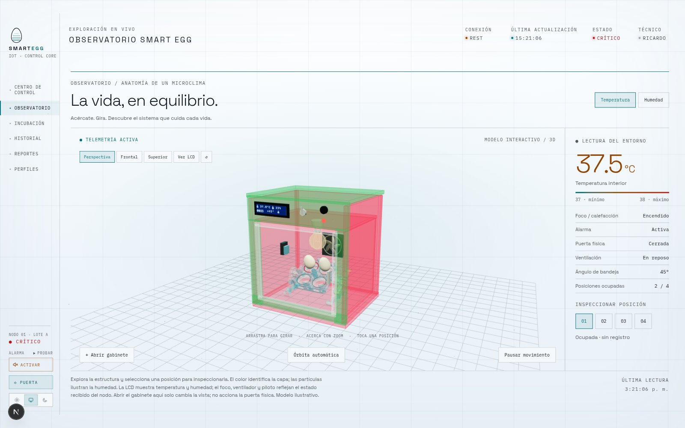 |

| Historial (ECharts) | Panel Cámara · Visión |
|---|---|
| 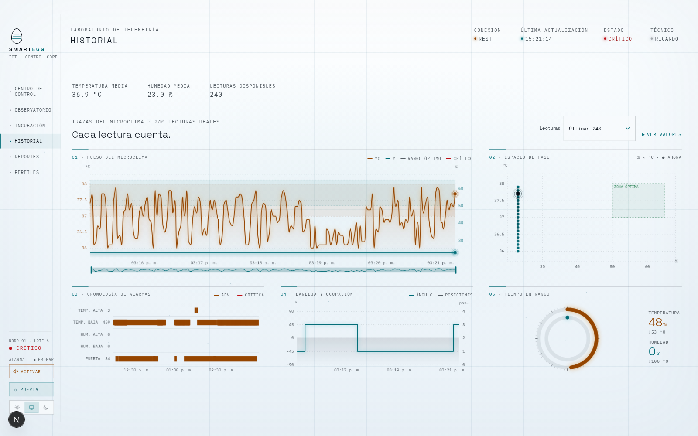 | 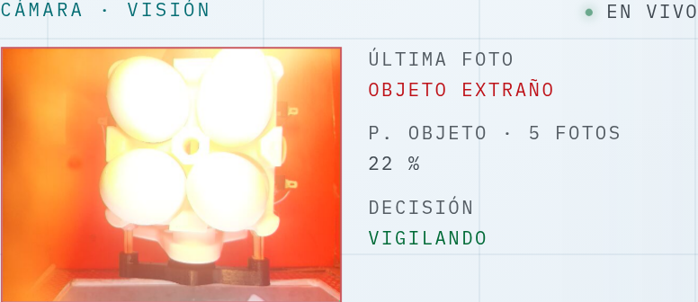 |

**Justificación del framework.** Elegimos Three.js para el Observatorio por su
cámara, materiales y controles de órbita, que permiten inspeccionar la
incubadora desde cualquier ángulo. Para las gráficas elegimos ECharts frente a
Chart.js porque trae zoom temporal, áreas y líneas de marca, mapas visuales,
series personalizadas y medidores, con configuración declarativa. Su curva de
aprendizaje es mayor, pero nos permitió dar a las gráficas el mismo acabado que
la consola. El detalle está en [`client/README.md`](client/README.md#visualización-avanzada).

## 13. Orquestación con Docker

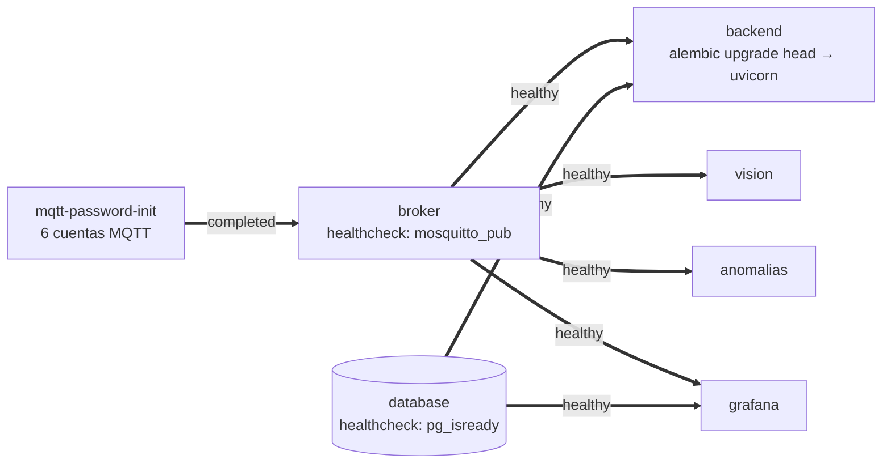

- **Un solo archivo** ([`docker-compose.yml`](docker-compose.yml)) levanta los
  siete servicios en la red `smartegg`; los contenedores se encuentran por nombre
  (`broker`, `database`).
- **Orden de arranque con healthchecks:** el backend y Grafana esperan a que la
  base responda a `pg_isready` y el broker acepte una publicación autenticada.
- **Secretos fuera de Git:** todas las contraseñas salen de `.env`
  (plantilla en `.env.example`); `mqtt-password-init` genera el archivo de
  contraseñas de Mosquitto en un volumen.
- **Modelos montados como volúmenes de solo lectura** (`ml/vision/modelo`,
  `ml/anomalias/modelo`): reentrenar solo requiere reiniciar el servicio.
- **Imágenes ligeras:** visión usa `opencv-python-headless` sin PyTorch y
  anomalías fija la versión de scikit-learn con la que se entrenó (1.9.1).
- **Volúmenes persistentes:** `postgres_data`, `mosquitto_data`,
  `mosquitto_secrets` y `grafana_data`.

```bash
docker compose up -d --build   # levantar
docker compose ps              # estado y salud de cada servicio
docker compose logs -f backend vision anomalias
docker compose down            # detener sin borrar volúmenes
```

## 14. HTTP vs. MQTT en SmartEgg

HTTP sigue el modelo **petición/respuesta**: el cliente pide un recurso y el
servidor responde. MQTT sigue el modelo **publicación/suscripción**: los clientes
publican en topics y el broker entrega cada mensaje a todos los suscriptores.

| Criterio | HTTP | MQTT |
|---|---|---|
| Modelo | Cliente-servidor, petición/respuesta | Publicación/suscripción mediante un broker |
| Quién inicia | El cliente en cada consulta | El publicador; el broker empuja a los suscriptores |
| Sobrecarga | Método, URI y cabeceras en cada petición | Cabecera fija de 2 bytes, topic y payload |
| Garantía de entrega | Depende de reintentos del cliente | QoS 0, 1 y 2 |
| Último estado | Hay que volver a consultar | Mensajes retained |
| Caída de un cliente | Se detecta por timeout o polling | Last Will and Testament |
| Uno a muchos | Cada consumidor hace su propia petición | Un mensaje llega a todos los suscriptores |
| Uso en SmartEgg | Inicio de sesión, cuentas, lotes, huevos, historial y PDF | Telemetría, alarmas, visión, anomalías, consumo, bloqueo y **todos los comandos** |

**Por qué lo usamos así.** El enunciado exige MQTT como único canal de control, y
además es lo que conviene: una lectura de la ESP32 llega con una sola
publicación al backend, a los dos servicios de ML, a Grafana y a la consola; el
retained da el estado actual a quien se conecta; y el LWT avisa de la caída del
gateway o de un servicio sin polling. HTTP queda para operaciones puntuales que
sí son petición/respuesta (iniciar sesión, descargar un PDF, consultar el
histórico).

Fuentes: [RFC 9110 — HTTP Semantics](https://www.rfc-editor.org/rfc/rfc9110.html) ·
[MQTT 3.1.1 — OASIS Standard](https://docs.oasis-open.org/mqtt/mqtt/v3.1.1/os/mqtt-v3.1.1-os.html).

## 15. Hardware y firmware

Mantuvimos el nodo físico de la Fase 2 y su control por umbrales en la ESP32
DevKit con ESP-IDF y FreeRTOS. Para la Fase 3 agregamos el **estado de
bloqueo**: un comando serial `{"type":"system","action":"lock"}` activa el buzzer,
el LED rojo de GPIO 13 y la pantalla de bloqueo de la LCD, y la telemetría lo
reporta como `LOCK:1`.

| Categoría | Componentes |
|---|---|
| Sensores | DHT11, 4 microinterruptores de posición, final de carrera de la puerta, RC522 |
| Calefacción | Foco incandescente de 40 W por relé |
| Ventilación | Ventilador DC por relé |
| Volteo | Servo de la bandeja |
| Acceso | Servo de la cerradura + RFID |
| Señalización | Buzzer, LED rojo de bloqueo, LCD 16×2 I²C |
| Cámara | Celular Android con IP Webcam, por USB a la laptop |

Pines, montaje, carga del firmware y pruebas: [`firmware/README.md`](firmware/README.md),
[guía de montaje](firmware/MONTAJE_PASO_A_PASO.md) y
[diagrama de Wokwi](docs/evidencias/diagrama-conexiones-wokwi.png).

## 16. Pruebas automatizadas

| Módulo | Comando | Qué cubre |
|---|---|---|
| Backend | `cd server && uv run pytest` | Ingesta, alarmas, comandos MQTT, bloqueo, consumo, roles y reportes |
| Gateway | `cd gateway && uv run pytest` | Ida y vuelta serial ↔ MQTT con el puerto virtual `loop://` |
| Visión | `cd vision && uv run pytest` | Regla de la ventana y el modelo real sobre fotos del dataset |
| Anomalías | `cd anomalias && uv run pytest` | Lecturas estables sin alerta; pico y sensor sin datos con alerta |
| Firmware | ver [`firmware/README.md`](firmware/README.md) | Lógica de control y animaciones sin la placa |

---

# Manual de usuario

## Acceso a la plataforma

| Superficie | Dirección | Credenciales |
|---|---|---|
| Consola web | La dirección donde se sirve el cliente | Usuario y contraseña, o tarjeta RFID para operadores |
| Grafana | `http://100.63.122.66:3001` | Los tableros se ven sin iniciar sesión; para editar, `GRAFANA_ADMIN_USER` / `GRAFANA_ADMIN_PASSWORD` de `.env` |
| Swagger | `http://100.63.122.66:8000/docs` | Token obtenido en `POST /auth/login` |

Hay dos roles. **Operador** (Operador 1 y Operador 2 son cuentas separadas): abre
la puerta con su tarjeta, registra lotes y huevos y ve solo sus incubadoras,
diagnósticos e informes. **Administrador**: crea cuentas, asigna incubadoras,
cambia la configuración y ve la vista general; no abre la puerta con RFID.

## Uso e interpretación de los dashboards de Grafana

1. Entrar a Grafana; la portada es **SmartEgg · Centro de control**. La barra
   superior navega entre los cuatro dashboards.
2. **Tarjetas de estado:** verde = en línea / normal; rojo = desconectado o
   bloqueado. Las tarjetas de *Visión* y *Anomalías* indican si esos servicios
   están vivos.
3. **Gauges de temperatura y humedad:** la banda verde es el rango óptimo
   (37–38 °C y 50–65 %); rojo es zona crítica (≥ 39 °C).
4. **Visión:** muestra la clase de la última foto, su confianza, las tres
   probabilidades y la media de `objeto` en la ventana de 5 fotos. *Objeto
   confirmado* significa que el sistema se va a bloquear.
5. **Detector de anomalías:** cada punto es el puntaje LOF de una lectura; la
   línea es el umbral. Puntos rojos sobre la línea son lecturas anómalas; tres
   seguidos generan la alerta.
6. **Estado normal / bloqueado:** escudo verde o candado rojo con el motivo.
7. **Tiempo real** no tiene refresco automático: los paneles se actualizan solos
   con cada mensaje MQTT. **Histórico** y **Consumo eléctrico** usan el selector
   de rango (última hora, 24 h, semana) y las variables Incubadora, Lote, Huevo y Operador.
8. **Alertas:** *Alerting → Alert rules → SmartEgg* muestra la regla de consumo y
   si está en *Normal*, *Pending* o *Firing*.

## Uso del panel de la aplicación

| Pantalla | Para qué sirve |
|---|---|
| **Centro de control** | Estado en vivo, actuadores, cámara y consumo |
| **Observatorio** | Explorar el modelo 3D: arrastrar para girar, rueda para acercar, alternar temperatura/humedad, seleccionar una posición |
| **Incubación** | Ver la ocupación detectada y registrar huevos con **Registrar huevo** (código, lote, fecha, posición y observaciones) |
| **Historial** | Gráficas de las últimas 30, 120 o 240 lecturas; **Ver valores** abre la tabla |
| **Reportes** | **GENERAR PDF** descarga el informe; el administrador elige *Vista general* u operador |
| **Perfiles** | (Administrador) crear operadores, registrar su UID RFID y asignar incubadoras |
| **Configuración** | (Administrador) umbrales de temperatura, humedad, temperatura crítica y rotación; se envían por MQTT |

| Incubación | Reportes | Perfiles |
|---|---|---|
| 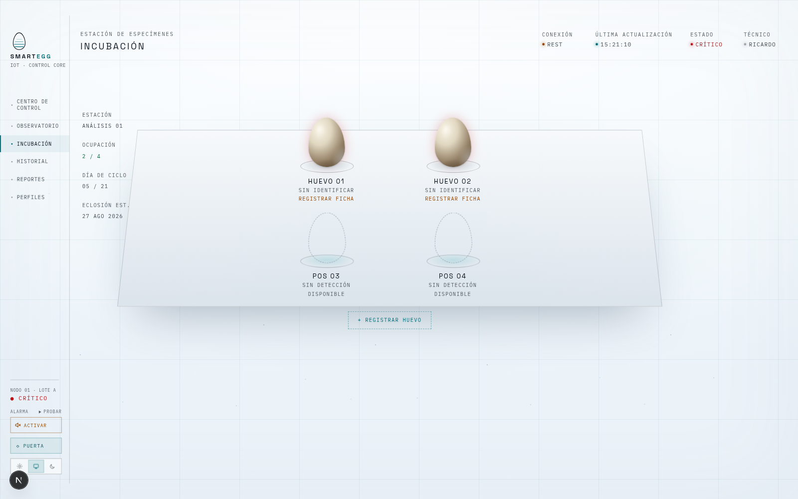 | 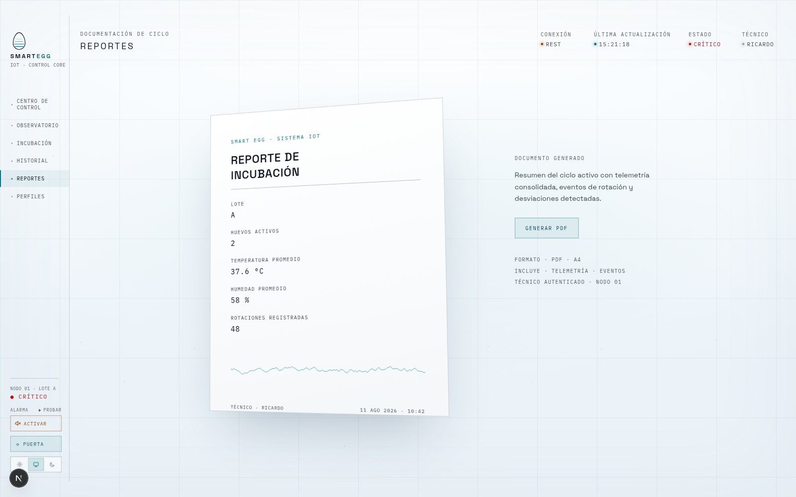 | 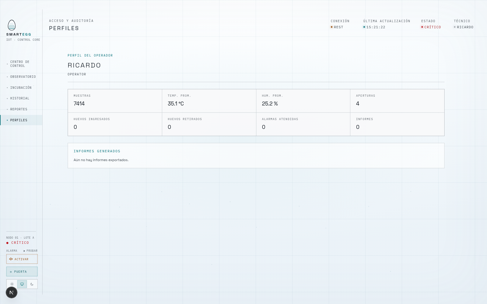 |

En **Reportes**, la lámina es una vista previa; el informe real es el PDF que
descarga **GENERAR PDF**.

## Uso de los botones y paneles para accionar los actuadores

Todos los controles publican un comando MQTT; la respuesta del backend llega por
`comandos/resultado` y la consola muestra si se aplicó.

| Panel | Control | Efecto |
|---|---|---|
| **Actuadores** (Centro de control) | Fila de cada actuador | Muestra el estado real de foco, ventilador, bandeja y buzzer; al seleccionarla, el inspector muestra el detalle |
| **Consumo eléctrico › TEMPORIZADOR** | Dispositivo (**FOCO** / **VENTILADOR**), **ENCENDER** / **APAGAR**, **MIN** e **INICIAR** | Fuerza el dispositivo durante N minutos y luego lo devuelve al control automático; **CANCELAR TEMPORIZADOR** lo termina antes |
| **Consumo eléctrico › Horarios** | Dispositivo, **ENCENDIDO** / **APAGADO**, inicio, fin y **AGREGAR** | Franja diaria en la que el dispositivo queda forzado; sin franjas se ve **SIN HORARIOS: CONTROL AUTOMÁTICO** |
| **Consumo eléctrico › LÍMITE DIARIO** | Límite en Wh, **SOLO ALERTA** / **APAGAR FOCO** y **GUARDAR** | Al superar el límite abre la alarma y, si se eligió, apaga el foco hasta medianoche |
| **Configuración › CALIBRACIÓN DE SETPOINTS** (administrador) | **TEMPERATURA OBJETIVO**, **HUMEDAD OBJETIVO**, **UMBRAL DE ALARMA**, **INTERVALO DE ROTACIÓN** | Cambia los umbrales con que la ESP32 enciende foco y ventilador y gira la bandeja (`comandos/config`) |

El encendido manual directo y la rotación manual también se pueden enviar desde
cualquier cliente MQTT con la cuenta del frontend, por ejemplo:

```bash
mosquitto_pub -h 100.63.122.66 -u smartegg-frontend -P '<clave>' -q 1 \
  -t smartegg/NODE-01/comandos/actuador -m '{"kind":"fan","enabled":true,"mode":"manual"}'
mosquitto_pub -h 100.63.122.66 -u smartegg-frontend -P '<clave>' -q 1 \
  -t smartegg/NODE-01/comandos/rotar -m '{"angle_degrees":30,"direction":"left"}'
```

La seguridad local manda: aunque se pida el foco encendido, la ESP32 lo apaga
al llegar a la temperatura máxima. Si la respuesta trae `delivered: false`, el
cambio quedó registrado pero el gateway estaba desconectado.

## Interpretación de las alertas del modelo de ML

| Lo que se ve | Qué significa | Qué hacer |
|---|---|---|
| Puntaje sobre el umbral, un punto aislado | Lectura rara, normalmente ruido del sensor | Nada |
| Alarma **ml_anomaly** abierta | Tres lecturas anómalas seguidas | Revisar la *causa* que acompaña la alerta |
| Causa: *la temperatura cambia demasiado rápido* | Pico o caída de temperatura | Revisar el foco, la puerta y el relé |
| Causa: humedad | Cambio brusco de humedad | Revisar el recipiente de agua y la puerta |
| Temperatura 0 °C / humedad 0 % | Sensor desconectado | Revisar el cable del DHT11 |

La alarma se cierra sola cuando la telemetría vuelve a la normalidad. Las reglas
fijas por umbral siguen activas en paralelo.

## Funcionamiento del módulo de visión y del bloqueo (valor disruptivo)

1. El panel **CÁMARA · VISIÓN** del Centro de control muestra la **ÚLTIMA FOTO**,
   su clase, la probabilidad media de objeto en las últimas 5 fotos y la
   **DECISIÓN**. En el ejemplo, una foto salió como *objeto extraño* pero la media
   es 22 %, así que la decisión sigue en *VIGILANDO* y no bloquea:

   

2. Si se coloca un objeto que no es huevo, en unos 4 s suena el buzzer, se
   enciende el LED rojo, la LCD muestra `!! BLOQUEADO !!` y la página entera se cubre con
   la pantalla **SISTEMA BLOQUEADO**, que indica **BLOQUEADO DESDE**, la última foto y
   cuántas de las 5 fotos fueron objeto. Los botones dejan de responder:

   

3. Para desbloquear: pasar una **tarjeta RFID autorizada** de operador por el
   lector, incluso con la puerta todavía abierta, y retirar el objeto. El sistema
   vuelve a normal y durante 30 s la visión no vuelve a bloquear, para dar tiempo
   de sacar el objeto y cerrar la puerta.
4. El bloqueo, el operador que desbloqueó y la alarma quedan en el historial.

Consideraciones: mantener la cámara fija y con la bandeja completa en el cuadro;
con muy poca luz la confianza baja y el sistema prefiere no bloquear.

## Incidencias frecuentes

| Síntoma | Comprobación |
|---|---|
| Nodo *desconectado* en Grafana | `gateway/status`: ¿corre `gateway.py`, está el USB conectado y el monitor serial cerrado? |
| *Visión offline* | `docker compose logs vision`; ¿la cámara publica `camara/foto`? (`adb forward tcp:8080 tcp:8080`) |
| *Anomalías offline* | `docker compose logs anomalias` |
| Comando rechazado con `system_locked` | El sistema está bloqueado: retirar el objeto y desbloquear con tarjeta |
| Grafana histórico vacío | Rango temporal correcto y lecturas persistidas (`consultas_calificacion.sql`, consulta 6) |
| Sin sonido de alarma en la página | Activar el audio desde el control lateral y probar con **TEST** |

El manual de la Fase 2, con el detalle de RFID, puerta y reportes, está en
[`docs/MANUAL_USUARIO.md`](docs/MANUAL_USUARIO.md).

---

# Evidencias de funcionamiento

### Inteligencia artificial

| Evidencia | Archivo |
|---|---|
| Métricas y matriz de confusión del detector de anomalías | [`ml/anomalias/resultados/`](ml/anomalias/resultados/) |
| Distribución de sensores y sesión de ejemplo con fallas | [`distribucion_sensores.png`](ml/anomalias/resultados/distribucion_sensores.png), [`sesion_ejemplo.png`](ml/anomalias/resultados/sesion_ejemplo.png) |
| Métricas, matriz de confusión, curvas y errores del clasificador | [`ml/vision/resultados/`](ml/vision/resultados/) |
| Dataset real de 800 fotos | [`dataset/`](dataset/) |
| Ejemplos de fotos procesadas con OpenCV y clasificadas | [`docs/evidencias/vision/vision-ejemplos.png`](docs/evidencias/vision/vision-ejemplos.png) |
| Documentación de la API en Swagger | [`docs/evidencias/api/api-swagger.png`](docs/evidencias/api/api-swagger.png) |

| Distribución de sensores (Fase 2) | Curvas de entrenamiento de visión |
|---|---|
| 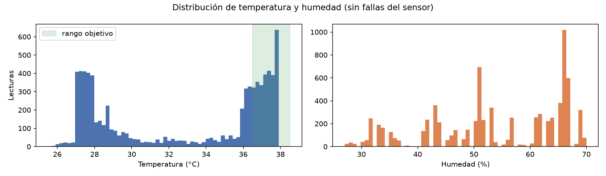 | 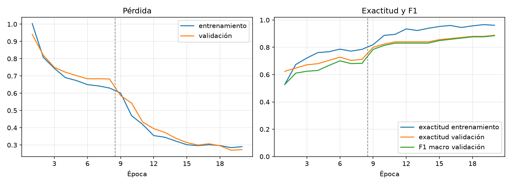 |

### Grafana de la Fase 3

Capturas tomadas el 24-10-2026 del Grafana desplegado en la EC2
(<http://100.63.122.66:3001>), con el nodo `NODE-01` enviando datos. Están en [`docs/evidencias/grafana/`](docs/evidencias/grafana/).

| Captura | Qué muestra |
|---|---|
| [Centro de control](docs/evidencias/grafana/grafana-centro-control.png) | Nodo, visión y detector ML **en línea**; sistema **Normal**; la visión clasifica la última foto como *Huevo* con sus tres probabilidades y la ventana de 5 fotos; temperatura y humedad en vivo |
| [Tiempo real](docs/evidencias/grafana/grafana-tiempo-real.png) | Datos por MQTT: 36.1 °C, 23 % de humedad, puerta abierta, ocupación 2/4, calefactor encendido, buzzer sonando y bandeja a −45° |
| [Histórico](docs/evidencias/grafana/grafana-historico.png) | Últimas 24 h desde PostgreSQL: 6 611 lecturas, aperturas con tarjeta RFID por operador, resumen por lote y 509 alarmas, entre ellas 2 `object_detected` (bloqueo por visión) y 2 `ml_anomaly` (modelo de anomalías) |
| [Consumo eléctrico](docs/evidencias/grafana/grafana-consumo.png) | Potencia actual (41.56 W), energía y costo del día, uso del límite diario, promedio de la última hora y potencia por componente |
| [Regla de alerta](docs/evidencias/grafana/grafana-regla-alerta.png) | *Consumo eléctrico anómalo o límite superado*: regla provisionada, evaluada cada minuto, estado *Normal* al momento de la captura |

| Tiempo real | Consumo eléctrico |
|---|---|
| 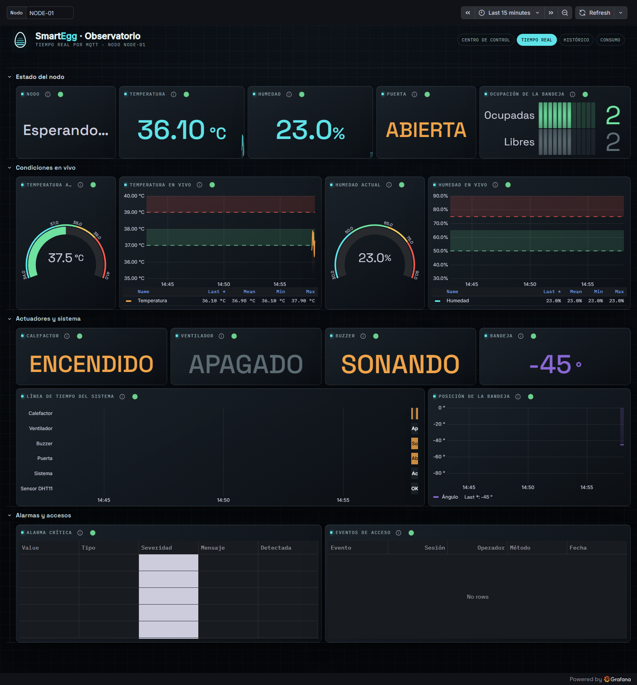 | 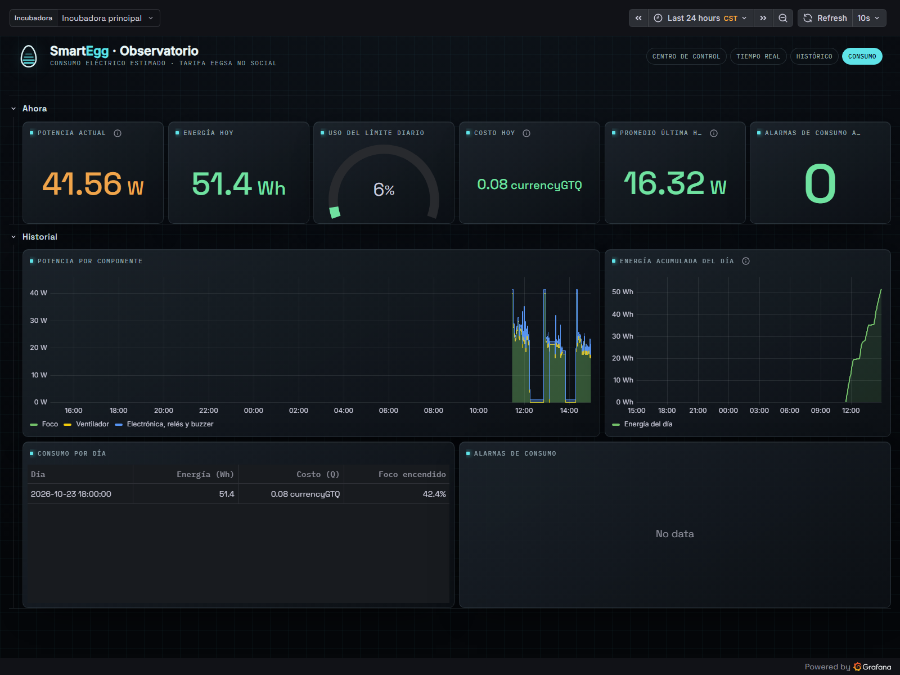 |

| Histórico (24 h) | Regla de alerta |
|---|---|
| 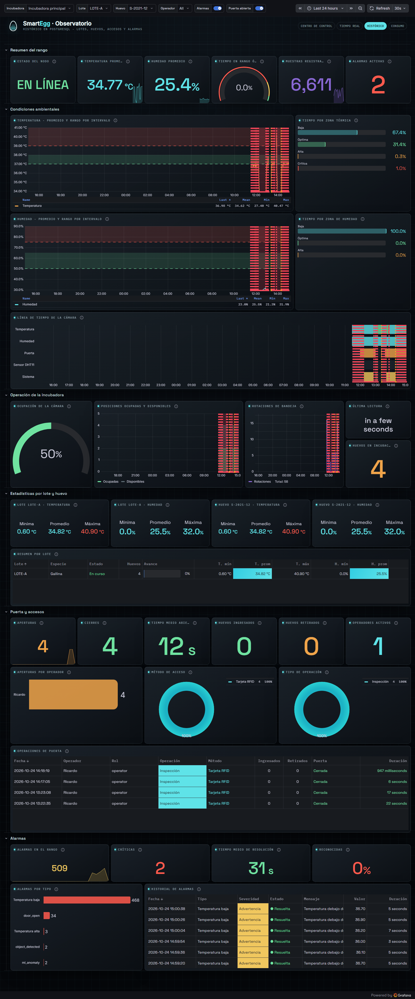 | 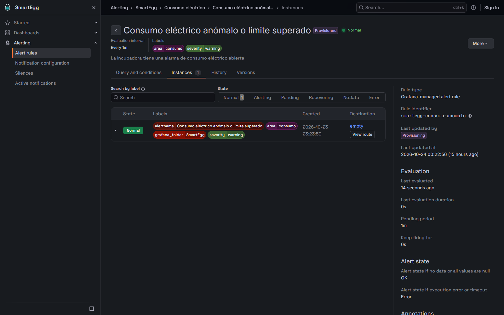 |

### Plataforma, base de datos y montaje (Fase 2)

| Evidencia | Archivo |
|---|---|
| Índice completo de capturas | [`docs/evidencias/README.md`](docs/evidencias/README.md) |
| Grafana en tiempo real e histórico (Fase 2) | [`plataforma/grafana-tiempo-real-con-datos.png`](docs/evidencias/plataforma/grafana-tiempo-real-con-datos.png), [`plataforma/grafana-historico-con-datos.png`](docs/evidencias/plataforma/grafana-historico-con-datos.png) |
| MQTT Explorer publish/subscribe | [`mqtt-explorer-prueba-manual-sin-esp32.png`](docs/evidencias/mqtt-explorer-prueba-manual-sin-esp32.png) |
| Base de datos | [`docs/evidencias/base-datos/`](docs/evidencias/base-datos/) |
| Montaje físico | [`docs/evidencias/fisico/`](docs/evidencias/fisico/) |
| Commits por integrante | [`docs/evidencias/commits/`](docs/evidencias/commits/) |
| Video demostrativo | [`smartegg-observatorio-3d.mp4`](docs/evidencias/smartegg-observatorio-3d.mp4) |

| Montaje de la incubadora | Lector RFID |
|---|---|
| 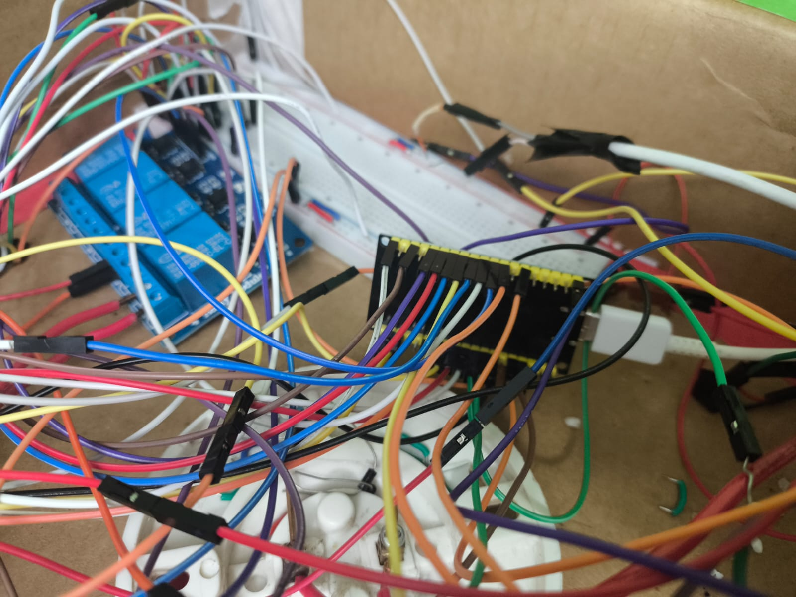 | 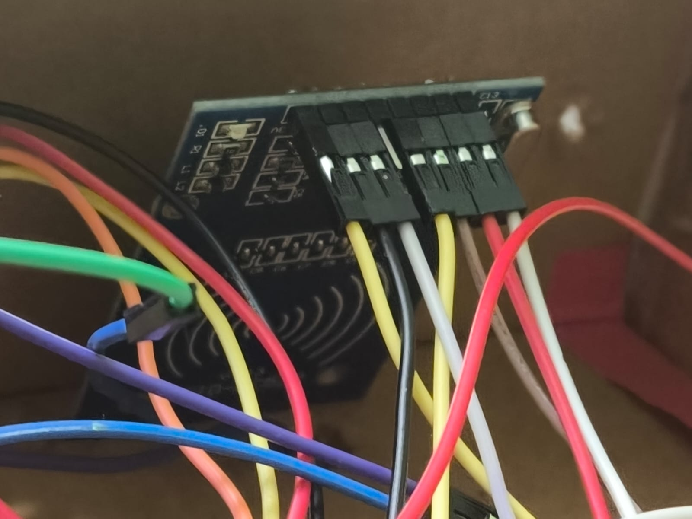 |

### Consola web y cámara

Capturas del 24-10-2026 de la consola conectada al stack de la nube, en
[`docs/evidencias/consola/`](docs/evidencias/consola/) y
[`docs/evidencias/camara/`](docs/evidencias/camara/).

| Captura | Qué muestra |
|---|---|
| [Pantalla de bloqueo](docs/evidencias/consola/ui_bloqueo_seguridad.png) | **SISTEMA BLOQUEADO** por la cámara desde las 15:20:54, con la foto de la bandeja y la instrucción de pasar una tarjeta RFID autorizada |
| [Centro de control](docs/evidencias/consola/ui_centro_de_control.png) | Alerta crítica *Objeto extraño detectado: sistema bloqueado*, estado CRÍTICO, actuadores, sensores, panel de cámara y eventos en vivo |
| [Panel Cámara · Visión](docs/evidencias/consola/ui_panel_camara.png) | Una foto clasificada como *objeto extraño* con media de 22 % en 5 fotos: la decisión sigue en *VIGILANDO* (la regla de la ventana evita el bloqueo por una foto suelta) |
| [Observatorio](docs/evidencias/consola/ui_observatorio.png) | Modelo 3D con telemetría activa: 37.5 °C, foco encendido, bandeja a 45°, 2 de 4 posiciones ocupadas |
| [Incubación](docs/evidencias/consola/ui_incubacion.png) | 2 de 4 posiciones con huevo detectado por los microinterruptores, aún sin ficha registrada |
| [Historial](docs/evidencias/consola/ui_historial.png) | 240 lecturas reales en las cinco gráficas de ECharts |
| [Reportes](docs/evidencias/consola/ui_reportes.png) | Vista previa del informe y botón **GENERAR PDF** (la lámina no es el PDF descargado) |
| [Perfiles](docs/evidencias/consola/ui_perfiles.png) | Perfil del operador con 7 414 muestras y 4 aperturas |
| [Fotos de la cámara](docs/evidencias/camara/) | 6 fotos JPEG de 640×480 tomadas una por segundo por el gateway |

### Despliegue en AWS

Capturas del 24-10-2026 en [`docs/evidencias/nube/`](docs/evidencias/nube/).

| Captura | Qué muestra |
|---|---|
| [`docker compose ps`](docs/evidencias/nube/01-docker-compose-ps.png) | Dentro de la EC2 (`/opt/smartegg`): el ID de la instancia leído del servicio de metadatos y los 7 servicios. `backend`, `broker` y `database` *healthy*; `vision`, `anomalias` y `grafana` arriba; `mqtt-password-init` terminó con código 0. La base solo escucha en `127.0.0.1:5432` |
| [Instancia por CLI](docs/evidencias/nube/02-instancia-ec2.png) | `aws ec2 describe-instances`: `smartegg-fase3`, *running*, `t3.medium`, `us-east-1c`, Linux; y `describe-addresses`: IP elástica `100.63.122.66` asociada a la instancia |
| [Grupo de seguridad por CLI](docs/evidencias/nube/03-grupo-seguridad.png) | `smartegg-sg`: puertos 8000, 22, 3001, 9001 y 1883 con su origen y uso; 5432 no aparece |
| [Consola de instancias](docs/evidencias/nube/04-consola-instancias.jpg) | Instancia *En ejecución*, 3/3 comprobaciones de estado, DNS público e IP elástica |
| [Detalle de la instancia](docs/evidencias/nube/05-consola-detalle-instancia.jpg) | IPv4 pública y privada, VPC, subred, IP elástica e IMDSv2 requerido |
| [Grupo de seguridad en la consola](docs/evidencias/nube/06-consola-grupo-seguridad.jpg) | Las 7 reglas de entrada de `smartegg-sg` |

| Grupo de seguridad | Detalle de la instancia |
|---|---|
| 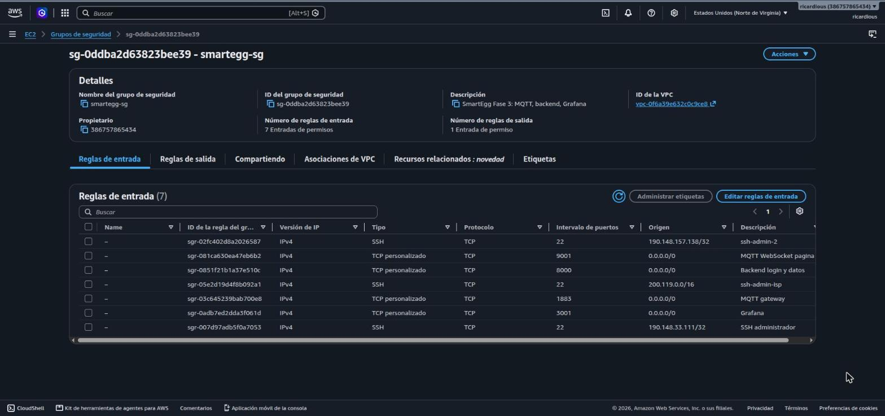 | 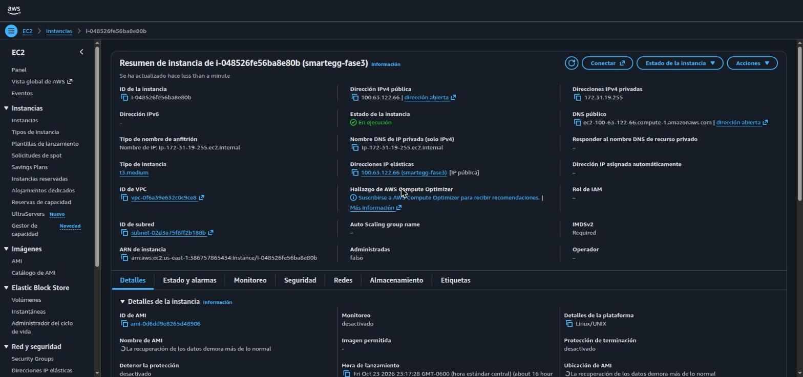 |

### Evidencia de la Fase 3 pendiente

| Captura | Qué debe mostrar |
|---|---|
| `ml-anomalia-alerta.png` | Puntaje sobre el umbral y alarma `ml_anomaly` |

---

# Bitácora de desarrollo

| Fecha | Trabajo realizado |
|---|---|
| 18-09 a 02-10-2026 | Operación de la Fase 2 que generó el histórico de 7 899 lecturas usado para entrenar |
| 19-09 a 23-10-2026 | Periodo de lectura del enunciado de la Fase 3 (cronograma) |
| 20-10-2026 | Creación de `Proyecto_2_SmartEgg` a partir de la Fase 2 y registro del enunciado |
| 23-10-2026 | **Visión:** dataset de 800 fotos (`huevo`, `objeto`, `vacio`), captura guiada, entrenamiento MobileNetV2, validación cruzada por tandas y exportación a ONNX |
| 23-10-2026 | **Gateway y MQTT:** puente USB ↔ MQTT, backend alimentado por `gateway/rx`, eliminación del control por REST y comandos por `comandos/*` |
| 23-10-2026 | **Bloqueo:** estado de bloqueo en el firmware (comando, LED y LCD), servicio de visión, bloqueo desde el backend, pantalla de bloqueo en la página; cambio de la regla de 3 de 5 votos a probabilidad media por bloqueos falsos en la prueba en vivo |
| 23-10-2026 | **Anomalías:** exportación del histórico, comparación LOF / Isolation Forest / One-Class SVM, servicio MQTT, tabla `anomaly_scores` y alarma `ml_anomaly` |
| 23-10-2026 | **Consumo eléctrico:** estimación, límite, horarios, temporizador, topics `energia` y `comandos/energia`, tablero y alerta en Grafana, panel en la consola |
| 23-10-2026 | Correcciones de hardware: despertar tarjetas RFID con WUPA, antirrebote y tiempo máximo de puerta abierta |
| 24-10-2026 | **Grafana:** imagen propia con identidad SmartEgg, portada Centro de control con visión, anomalías y bloqueo |
| 24-10-2026 | **Consola:** panel Cámara · Visión y foto de la bandeja en la pantalla de bloqueo |
| 24-10-2026 | **Firmware:** el lector acepta la tarjeta durante un bloqueo aunque la puerta siga abierta, para poder liberar el sistema con el operador frente a la bandeja |
| 24-10-2026 | Documentación final, evidencias y calificación |

El historial completo está en los commits de la rama `develop`
(`git log -- Proyecto_2_SmartEgg`).

# Entregables

| Entregable del enunciado | Ubicación |
|---|---|
| Documento técnico | [Manual técnico](#manual-técnico) de este README · [`docs/DOCUMENTO_TECNICO.md`](docs/DOCUMENTO_TECNICO.md) (Fase 2) |
| Manual de usuario | [Manual de usuario](#manual-de-usuario) · [`docs/MANUAL_USUARIO.md`](docs/MANUAL_USUARIO.md) (Fase 2) |
| Notebook de ML | [`ml/anomalias/entrenar_anomalias.ipynb`](ml/anomalias/entrenar_anomalias.ipynb) · [`ml/vision/entrenar_vision.ipynb`](ml/vision/entrenar_vision.ipynb) |
| Módulo de visión computacional | [`vision/`](vision/) · [`ml/vision/`](ml/vision/) |
| Infraestructura en la nube | [`docker-compose.yml`](docker-compose.yml) · [§4](#4-infraestructura-en-la-nube) · [capturas de AWS](docs/evidencias/nube/) |
| Dashboards exportados de Grafana | [`grafana/dashboards/`](grafana/dashboards/) |
| Repositorio Git | Este repositorio, carpeta `Proyecto_2_SmartEgg` |
| Evidencias de funcionamiento | [Evidencias](#evidencias-de-funcionamiento) |
| Bitácora de desarrollo | [Bitácora](#bitácora-de-desarrollo) |
| Video de presentación | _Enlace pendiente: agregar aquí el enlace al video_ |
| Justificación del consumo eléctrico | [`docs/CONSUMO_ELECTRICO.md`](docs/CONSUMO_ELECTRICO.md) |
| Contrato MQTT | [`mqtt/TOPICS.md`](mqtt/TOPICS.md) |
| Consultas SQL de calificación | [`db/consultas_calificacion.sql`](db/consultas_calificacion.sql) |

# Integrantes

| Nombre | Carné |
|---|---|
| Alex Ricardo Castañeda Rodríguez | 202300476 |
| Carlos Javier Pérez Pocón | 202206425 |
| José Adrian Orozco Ramírez | 202210908 |
| Alex Oswaldo López Alquejay | 202100171 |
| Kevin Rodrigo Sandoval Hernández | 202001376 |
