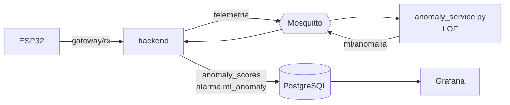

# Servicio de anomalías

Califica cada lectura de la incubadora con el **Local Outlier Factor** entrenado
en [`ml/anomalias`](../ml/anomalias/) y avisa cuando la telemetría deja de
parecerse a la operación normal: picos de temperatura, cambios bruscos de
humedad o un sensor desconectado. Corre en Docker junto al broker, en la nube.



## Qué califica

Cada lectura se describe con el último minuto del mismo nodo, con el mismo
`FeatureBuilder` que usó el entrenamiento:

| Característica | Qué mide |
|---|---|
| `temperatura` | temperatura actual (°C) |
| `vel_temp` | cambio de temperatura en el último minuto (°C/min) |
| `vel_hum` | cambio de humedad en el último minuto (%/min) |
| `ruido_temp` | salto medio entre lecturas seguidas (°C) |

- Necesita 20 s de historial antes de calificar; un hueco de más de 2 min
  (la ESP32 se reinició) empieza de cero.
- Ignora la lectura retenida del broker y la segunda copia de cada lectura
  (el backend publica en vivo y otra vez al guardarla).
- Con el sistema apagado no califica.
- Si la lectura no trae temperatura o humedad, la califica como 0 °C y 0 %,
  igual que las fallas del sensor del histórico.

## Regla: 3 lecturas anómalas seguidas

Una lectura es **anómala** cuando su puntaje pasa el umbral del modelo
(percentil 99.9 de las lecturas normales del entrenamiento). La **alerta**
pide 3 anómalas seguidas, unos 8 s: una lectura rara suelta es ruido del
sensor. En la validación cruzada esto dio 1.3 % de lecturas normales marcadas y
6.6 alertas falsas por hora en promedio (ver
[el notebook](../ml/anomalias/entrenar_anomalias.ipynb)). Se ajusta con
`ML_ALERT_NEEDED` y `ML_ALERT_WINDOW` sin reentrenar.

## Topics

| Topic | Sentido | QoS | Retenido |
|---|---|---:|:---:|
| `smartegg/{nodo}/telemetria` | backend → anomalías | 0 | Solo la última persistida (se ignora) |
| `smartegg/{nodo}/ml/anomalia` | anomalías → backend, Grafana, página | 0 | Sí |
| `smartegg/ml/estado` | online/offline del servicio, con LWT | 1 | Sí |

Ejemplo de `ml/anomalia`:

```json
{
  "puntaje": 3.3286,
  "umbral": 1.1672,
  "anomalia": true,
  "alerta": true,
  "causa": "la temperatura cambia demasiado rápido",
  "caracteristicas": {"temperatura": 44.0, "vel_temp": 6.52, "vel_hum": 0.0, "ruido_temp": 0.21},
  "lectura_at": "2026-10-23T22:15:03.512+00:00",
  "recorded_at": "2026-10-23T22:15:03.530+00:00"
}
```

`causa` es la característica más alejada de su media en el entrenamiento y
solo viene con `anomalia: true`. El backend guarda cada resultado en la tabla
`anomaly_scores` y mantiene abierta la alarma `ml_anomaly` mientras `alerta`
sea `true`. Más detalle en [`mqtt/TOPICS.md`](../mqtt/TOPICS.md).

## Uso

Con Docker Compose se levanta junto al resto (`docker compose up -d anomalias`).
Para correrlo fuera de Docker:

```bash
cd Proyecto_2_SmartEgg/anomalias
uv run anomaly_service.py --broker localhost --clave '<clave-de-smartegg-ml>' -v
```

| Variable | Opción | Por defecto |
|---|---|---|
| `ML_MODEL_PATH` | `--modelo` | `../ml/anomalias/modelo/smartegg_anomalias.joblib` |
| `MQTT_HOST` / `MQTT_PORT` | `--broker` / `--puerto-mqtt` | `localhost` / `1883` |
| `MQTT_USERNAME` / `MQTT_PASSWORD` | `--usuario` / `--clave` | `smartegg-ml` / — |
| `ML_ALERT_NEEDED` / `ML_ALERT_WINDOW` | `--alerta` / `--ventana` | `3` / `3` |
| `MQTT_TLS` / `MQTT_CA_CERT` | `--tls` / `--ca` | `false` / — |

El modelo se guarda con `joblib`, así que el servicio usa la misma versión de
scikit-learn con la que se entrenó (1.9.1, fijada en `pyproject.toml`).

## Pruebas

```bash
uv run pytest
```

Las pruebas cargan el modelo real: lecturas estables no alertan; un pico de
temperatura y un sensor sin datos sí, al tercer intento.
