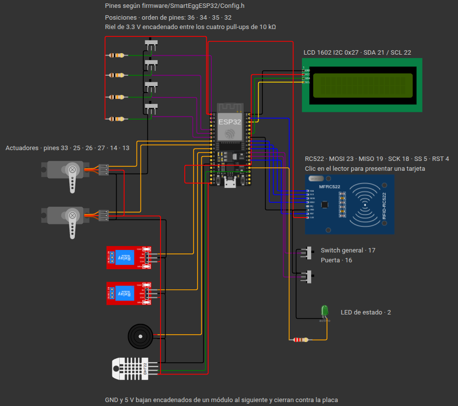

# Simulación en Wokwi

`diagram.json` reproduce el nodo del Proyecto 2 con el mismo mapa de pines que
[`Config.h`](../SmartEggESP32/Config.h). Sirve para probar el firmware y para
grabar el video sin depender del hardware.



[Abrir la captura del circuito](../../docs/evidencias/diagrama-conexiones-wokwi.png).

## Cómo se ejecuta

Requiere la extensión **Wokwi for VS Code** y una licencia gratuita.

```bash
cd Proyecto_2_SmartEgg/firmware
uvx platformio run          # deja firmware.bin y firmware.elf en .pio/build/esp32dev/
```

Después, con `wokwi/diagram.json` abierto en VS Code: `F1` → **Wokwi: Start Simulator**.
La extensión toma el `wokwi.toml` de esta carpeta, cuyas rutas `firmware` y `elf`
apuntan un nivel arriba, al build de PlatformIO.

> Si la extensión no encontrara el firmware, subir `wokwi.toml` y `diagram.json` un
> nivel (a `firmware/`) resuelve el problema: la única condición del formato es que los
> dos archivos vivan juntos.

## Orden del diagrama

El trazado sigue cinco reglas para que ningún componente quede encima de otro y para que
los cables no crucen por arriba de las piezas:

1. **Cada componente va del lado donde están sus pines.** En la DevKit C los GPIO 36, 34,
   35, 32, 33, 25, 26, 27, 14 y 13 salen por el borde izquierdo, y 23, 22, 21, 19, 18, 5,
   17, 16 y 2 por el derecho.
2. **El orden vertical de los componentes copia el orden de los pines.** Así los cables
   salen paralelos en lugar de cruzarse. Por eso las posiciones aparecen como 4-2-3-1 de
   arriba abajo: ese es el orden físico de los pines 36, 34, 35 y 32.
3. **Cada módulo se gira lo necesario para que sus pines miren a la placa.** Servos y
   relés llevan los pines en un borde lateral y van a 180°; el buzzer y el DHT los traen
   en el borde inferior y van a 270°, porque a 180° apuntarían hacia arriba y el cable
   tendría que volver por encima del cuerpo del módulo. Los dos switches de la derecha
   van a 90° por la misma razón.
4. **La alimentación va encadenada, no en estrella.** GND y 5 V bajan de un módulo al
   siguiente por dos carriles paralelos —uno para cada riel, para que no queden
   superpuestos— y cierran contra la placa por el extremo que cae más cerca del pin: GND
   sube del DHT a `GND.1` y 5 V baja del pin de la placa al DHT, que es el último de la
   cadena. Los cuatro pull-ups comparten un riel de 3.3 V.
5. **Cada cable de señal lleva su propio carril.** Las conexiones traen trazado explícito
   (`h`/`v` en el cuarto campo) para que los tramos verticales del abanico queden lado a
   lado en el pasillo entre los módulos y la placa, en vez de apilarse sobre la misma
   línea.

Los únicos cables largos son los de 3.3 V del RC522 y 5 V del LCD, porque en esta placa
ambas alimentaciones salen solo por el borde izquierdo. El de 3.3 V rodea por arriba de
la placa y el de 5 V por debajo; ninguno de los dos pasa por encima de un componente.

Quedan dos cruces inevitables en el lado derecho: los pines del LCD (21 y 22) y los de
los switches (16 y 17) caen dentro del rango que ocupa el RC522 (23 a 4), así que el
cable de MOSI y el de RST tienen que pasar por encima del resto del bus. Los dos llevan
trazado explícito para rodear en lugar de atravesar.

## Qué contiene el diagrama

| Parte | Pines | Nota |
|---|---|---|
| ESP32 DevKit C v4 | — | Wokwi no trae la DevKit V1; los GPIO son los mismos |
| RC522 | SS 5 · RST 4 · SCK 18 · MISO 19 · MOSI 23 | Clic en el lector para presentar una tarjeta |
| LCD 1602 I2C | SDA 21 · SCL 22 | Dirección `0x27` |
| DHT | DATA 15 | Ver la limitación más abajo |
| Servo bandeja | 25 | |
| Servo cerradura | 33 | |
| Relés calefacción / ventilador | 26 / 27 | Activos en bajo (`transistor: pnp`) |
| Buzzer activo | 14 | |
| Final de carrera de puerta | 16 | Deslizante: arriba = abierta (HIGH) |
| Switch general | 17 | Deslizante: abajo = encendido (LOW) |
| Posiciones 1-4 | 32 · 34 · 35 · 36 | Deslizantes; abajo = ocupada (LOW) |
| LED de estado | 2 | Refleja el switch general |

Las cuatro posiciones llevan su resistencia de 10 kΩ a 3V3 porque `Hardware.cpp` las
configura con `GPIO_PULLUP_DISABLE`. El final de carrera de la puerta y el switch general
usan el pull-up interno, así que no llevan resistencia. En el montaje físico, conecte
`COM` del final de carrera a GND, `NO` a GPIO 16 y deje `NC` libre.

El UID de la tarjeta azul está en el atributo `uid` del RC522 (`A1:B2:C3:D4`). Debe
coincidir con el `rfid_uid` de un Operador registrado en `SMARTEGG_INITIAL_TECHNICIANS`,
sin los dos puntos: `A1B2C3D4`.

## Lo que funciona y lo que no

**Funciona tal cual**: control por umbrales, histéresis, LCD, rotación de la bandeja,
relés, buzzer, lectura de posiciones, puerta con interrupción, switch general y la
presentación de tarjetas RFID con el panel del lector.

**Tres limitaciones que conviene conocer antes de grabar el video:**

### 1. El DHT simulado habla DHT22, no DHT11

Wokwi solo ofrece `wokwi-dht22`. Un DHT22 envía humedad y temperatura como enteros de
16 bits divididos entre 10; el decodificador de `Hardware.cpp` espera el formato DHT11
(byte entero + byte decimal), así que en simulación devolvería valores equivocados sin
avisar.

`config::kDhtType` ya existe pero hoy no lo usa nadie. Basta con hacerlo efectivo:

```cpp
if (config::kDhtType == 22) {
  humidityPct = ((data[0] << 8) | data[1]) * 0.1F;
  temperatureC = (((data[2] & 0x7F) << 8) | data[3]) * 0.1F;
} else {
  humidityPct = static_cast<float>(data[0]) + data[1] * 0.1F;
  temperatureC = static_cast<float>(data[2]) + (data[3] & 0x0F) * 0.1F;
}
if ((data[2] & 0x80) != 0 || (data[3] & 0x80) != 0) temperatureC = -temperatureC;
```

Con eso, `kDhtType = 22` sirve para la simulación y `11` para la placa real.

### 2. El nodo físico no usa Wi-Fi

La telemetría, el UID RFID, los eventos de puerta y la respuesta de autorización viajan
por el puerto serial. No se necesita `Wokwi-GUEST`, `secrets.h` ni un gateway HTTP para
el ESP32.

### 3. El puente serial del backend no acepta URLs

`wokwi.toml` publica el puerto serial simulado en `rfc2217://localhost:4000`, pero
`server/app/services/serial_bridge.py` usa `serial.serial_for_url`, que acepta tanto
`/dev/ttyUSB0` como `rfc2217://localhost:4000`, y permite alimentar
toda la plataforma con el nodo simulado:

```bash
SMARTEGG_SERIAL_DEVICE=rfc2217://localhost:4000 uv run fastapi dev
```

Es la forma más simple de demostrar telemetría, Grafana y la consola sin la placa
física.
