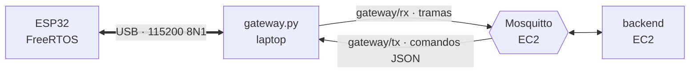

# Gateway USB ↔ MQTT

La ESP32 no usa Wi-Fi: se conecta por USB a la laptop. El gateway corre en esa
laptop y hace de puente con el broker de la nube. **No interpreta las tramas**:
reenvía cada línea del serial al broker y escribe en el serial cada comando que
publica el backend. Las reglas (telemetría, alarmas, RFID, comandos) siguen en el
backend.



## Topics

Prefijo `smartegg/{nodo}/gateway`, con `{nodo}` = `NODE-01` por defecto.

| Topic | Sentido | Payload | QoS | Retenido |
|---|---|---|---:|:---:|
| `rx` | ESP32 → backend | Una línea serial en texto plano, por ejemplo `MSG:1,TEMP:37.52,HUM:58.1,...` o `RFID:A1B2C3D4` | 1 | No |
| `tx` | backend → ESP32 | Un comando JSON, por ejemplo `{"type":"actuator","kind":"fan","enabled":true,"mode":"manual"}` | 1 | No |
| `status` | gateway → todos | `{"status":"online","serial":"connected","port":"/dev/ttyUSB0","recorded_at":"..."}` | 1 | Sí |

`status` lleva un Last Will: si la laptop pierde la conexión, Mosquitto publica
`{"status":"offline","reason":"unexpected_disconnect"}`. El campo `serial` indica
si la ESP32 está conectada por USB.

Los comandos que llegan con el serial desconectado se descartan: un comando viejo
no debe ejecutarse minutos después al reconectar la placa.

## Uso

```bash
cd Proyecto_2_SmartEgg/gateway
cp .env.example .env        # ajustar puerto, broker y clave
uv run gateway.py           # o: uv run gateway.py -v  para ver cada trama
```

También se puede pasar todo por línea de comandos:

```bash
uv run gateway.py --puerto /dev/serial/by-id/usb-Silicon_Labs_CP2102_... \
  --broker <IP-publica-EC2> --clave '<clave-del-gateway>'
```

| Variable de `.env` | Opción | Por defecto |
|---|---|---|
| `GATEWAY_SERIAL_PORT` | `--puerto` | `/dev/ttyUSB0` |
| `GATEWAY_BAUDRATE` | `--baudios` | `115200` |
| `MQTT_HOST` / `MQTT_PORT` | `--broker` / `--puerto-mqtt` | `localhost` / `1883` |
| `MQTT_USERNAME` / `MQTT_PASSWORD` | `--usuario` / `--clave` | `smartegg-gateway` / — |
| `NODE_CODE` | `--nodo` | `NODE-01` |
| `MQTT_TLS` / `MQTT_CA_CERT` | `--tls` / `--ca` | `false` / — |

Si el USB se desconecta o el broker no responde, el gateway reintenta solo. Al
abrir el puerto deja DTR y RTS inactivos para no reiniciar la ESP32.

El puerto serial es exclusivo: cierren el monitor de PlatformIO antes de iniciar
el gateway.

## Pruebas

```bash
uv run pytest
```

Las pruebas usan el puerto virtual `loop://` de pyserial: el comando que se
escribe vuelve como si lo hubiera enviado la ESP32, así se comprueban los dos
sentidos sin hardware.
