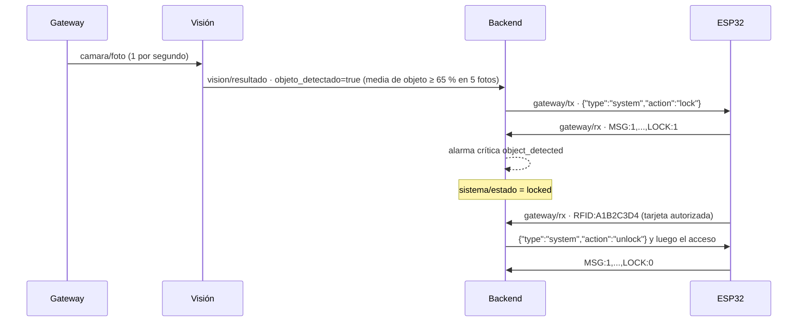

# Topics que usamos

Para ordenar los mensajes usamos el prefijo `smartegg/{id}`. El valor `{id}` es el
código de la incubadora, por ejemplo `NODE-01`. El backend publica objetos JSON,
salvo el payload vacío usado para retirar una alarma crítica retenida.
Las fechas de ejemplo usan `Z` para UTC; Python normalmente serializa la misma
zona horaria como `+00:00` mediante `datetime.isoformat()`.

Definimos los topics de la siguiente forma:

| Topic | Publicador | Suscriptores | QoS | Retained |
|---|---|---|---:|:---:|
| `smartegg/{id}/sensores/temperatura` | Backend | Grafana | 0 | Sí |
| `smartegg/{id}/sensores/humedad` | Backend | Grafana | 0 | Sí |
| `smartegg/{id}/telemetria` | Backend | Frontend, Grafana | 0 | Sí para la última lectura persistida; no para el adelanto en vivo |
| `smartegg/{id}/actuadores/estado` | Backend | Frontend, Grafana | 1 | Sí |
| `smartegg/{id}/alarmas/critica` | Backend | Frontend, Grafana | 1 | Sí; se borra con payload vacío |
| `smartegg/{id}/acceso/eventos` | Backend | Grafana | 1 | No |
| `smartegg/{id}/status` | Backend/LWT | Frontend, Grafana | 1 | Sí |
| `smartegg/{id}/gateway/rx` | Gateway | Backend | 1 | No |
| `smartegg/{id}/gateway/tx` | Backend | Gateway | 1 | No |
| `smartegg/{id}/gateway/status` | Gateway/LWT | Backend, Frontend | 1 | Sí |
| `smartegg/{id}/comandos/actuador` | Frontend | Backend | 1 | No |
| `smartegg/{id}/comandos/rotar` | Frontend | Backend | 1 | No |
| `smartegg/{id}/comandos/config` | Frontend | Backend | 1 | No |
| `smartegg/{id}/comandos/resultado` | Backend | Frontend | 1 | No |
| `smartegg/{id}/camara/foto` | Gateway | Visión | 0 | No |
| `smartegg/{id}/vision/resultado` | Visión | Backend, Frontend, Grafana | 0 | Sí |
| `smartegg/vision/estado` | Visión/LWT | Frontend, Grafana | 1 | Sí |
| `smartegg/{id}/sistema/estado` | Backend | Frontend, Grafana | 1 | Sí |

El frontend recibe los eventos de acceso por el WebSocket de FastAPI, no por
`acceso/eventos`; su cuenta MQTT puede leer `telemetria`, `alarmas/critica`,
`status` y `actuadores/estado`, tal como establece [`config/acl`](config/acl). El healthcheck
de Compose publica `{"status":"ok"}` en `smartegg/healthcheck` con QoS 1,
sin retención y sin suscriptores de aplicación. No es un estado del nodo.
La prueba manual de [`README.md`](README.md) usa
`smartegg/diagnostico/manual`, también con QoS 1 y sin retención; ninguna
vista de la aplicación se suscribe a ese topic.
El backend publica `status` y registra el LWT sólo para el código definido en
`DEFAULT_INCUBATOR_CODE` (por defecto `NODE-01`); los demás topics de esta tabla
usan el código de la lectura o evento correspondiente.

## Formato de los mensajes

### Temperatura

Publicamos la última temperatura medida:

```json
{"value":37.6,"unit":"celsius","recorded_at":"2026-09-04T18:30:00Z"}
```

### Humedad

Publicamos la última humedad medida:

```json
{"value":58.2,"unit":"percent","recorded_at":"2026-09-04T18:30:00Z"}
```

### Telemetría consolidada

También enviamos una lectura completa para tener todos los valores en un solo mensaje:

```json
{
  "temperature_c": 37.6,
  "humidity_pct": 58.2,
  "door_open": false,
  "system_enabled": true,
  "sensor_ok": true,
  "system_locked": false,
  "occupied_slots": 3,
  "available_slots": 1,
  "recorded_at": "2026-09-04T18:30:00Z"
}
```

`door_open`, `system_enabled`, `sensor_ok` y `system_locked` pueden ser `null` cuando la trama
de origen no informa ese estado. Para la ESP32 se publica primero una versión
en vivo, no retenida, directamente al leer el serial y antes de escribir en la
base de datos; esta versión omite `available_slots`. Después de persistirla se
publica el snapshot completo y retenido. El frontend ignora mensajes más
antiguos para que una escritura lenta no revierta la lectura actual.

### Estado de actuadores

En este topic enviamos el estado actual de los actuadores:

```json
{
  "heater": false,
  "fan": true,
  "servo_angle": 45,
  "buzzer": false,
  "recorded_at": "2026-09-04T18:30:00Z"
}
```

`servo_angle` puede ser `null` si aún no existe un valor registrado para el
servo. El topic comunica el estado observado, no una orden de accionamiento.

### Alarma crítica

Cuando detectamos una condición crítica publicamos:

```json
{
  "kind": "temperature_high",
  "severity": "critical",
  "message": "Sobrecalentamiento detectado",
  "value": 39.5,
  "occurred_at": "2026-09-04T18:30:00Z"
}
```

Sólo se publica aquí una alarma activa de severidad `critical`; las advertencias
quedan registradas en la base de datos. Cuando no hay alarma crítica, el
backend publica **cero bytes** con QoS 1 y retained: Mosquitto elimina el
último mensaje retenido y los suscriptores actuales despejan el aviso. Ese
payload vacío no es JSON.

### Disponibilidad y LWT

Al iniciar la conexión publicamos el nodo como disponible:

```json
{"status":"online","recorded_at":"2026-09-04T18:30:00Z"}
```

También configuramos este mensaje como LWT con QoS 1. Mosquitto lo publica si el backend
se desconecta de forma inesperada:

```json
{"status":"offline","reason":"unexpected_disconnect"}
```

El LWT no lleva `recorded_at`: lo registra el backend antes de conectarse y
Mosquitto lo emite sólo si la conexión cae abruptamente. Al terminar de forma
ordenada, el backend publica un estado diferente:

```json
{"status":"offline","recorded_at":"2026-09-04T18:30:00Z","reason":"graceful_shutdown"}
```

### Acceso RFID y puerta

Cada autorización, apertura y cierre genera un evento no retenido:

```json
{
  "event": "door_closed",
  "session_id": 12,
  "operator_id": 1,
  "method": "rfid",
  "recorded_at": "2026-09-07T18:10:00Z"
}
```

`authorized`, `door_opened`, `door_closed` y `access_cancelled` usan los
campos `event`, `session_id`, `method` y `recorded_at`; los tres primeros
incluyen también `operator_id`. Para `rejected` se publican `event`, `method`,
`reason` y `recorded_at`. Si llega un evento de puerta con sesión inválida,
el payload lleva `event: "invalid_session"`, `session_id` y `recorded_at`.
Los emisores son tanto el puente serial como la ruta HTTP de acceso; la
autorización HTTP no publica un `rejected` cuando la petición devuelve error.

Ejemplos de las variantes del puente serial:

```json
{"event":"rejected","method":"rfid","reason":"card_not_authorized","recorded_at":"2026-09-07T18:10:00Z"}
```

```json
{"event":"access_cancelled","session_id":12,"method":"rfid","recorded_at":"2026-09-07T18:10:00Z"}
```

```json
{"event":"invalid_session","session_id":12,"recorded_at":"2026-09-07T18:10:00Z"}
```

La ruta HTTP publica `access_cancelled` con `operator_id` adicional, porque
conoce al operador de la sesión.

## Gateway USB ↔ MQTT

La ESP32 no usa Wi-Fi: [`gateway/gateway.py`](../gateway/README.md) corre en la
laptop conectada por USB y es el único puente entre el serial y el broker.

### Tramas del nodo (`gateway/rx`)

Cada mensaje es una línea serial tal como la emite el firmware, en texto plano:

```text
MSG:1,TEMP:37.52,HUM:58.1,DOOR:0,SLOTS:3,HEATER:0,FAN:1,SERVO:-45,BUZZER:0,POWER:1,SENSOR:1
```

```text
RFID:A1B2C3D4
```

El backend las interpreta con el mismo parser del puente serial de la Fase 2.

### Comandos al nodo (`gateway/tx`)

Sólo el backend publica aquí; el gateway escribe cada mensaje en el serial
seguido de un salto de línea:

```json
{"type":"actuator","kind":"fan","enabled":true,"mode":"manual","value":null}
```

### Estado del gateway (`gateway/status`)

```json
{"status":"online","serial":"connected","port":"/dev/ttyUSB0","recorded_at":"2026-10-23T18:40:34Z"}
```

`serial` pasa a `disconnected` si se desconecta el USB. El Last Will retenido es
`{"status":"offline","reason":"unexpected_disconnect"}`. El backend considera el
nodo conectado sólo con `status: online` y `serial: connected`.

## Comandos de control

MQTT es el único canal de control. El navegador publica en `comandos/{tipo}`; el
backend valida, registra y reenvía al nodo. La cuenta del navegador no puede
escribir en `gateway/tx`, así que ningún comando llega a la ESP32 sin pasar por
el backend. `request_id` es opcional y vuelve en el resultado.

```json
{"kind":"heater","enabled":false,"mode":"automatic","request_id":"k3x9-a1"}
```

```json
{"angle_degrees":30,"direction":"left"}
```

```json
{"temperature_min_c":37.2,"temperature_max_c":38.1,"humidity_min_pct":52,"humidity_max_pct":62,"critical_temperature_c":39.5,"rotation_interval_seconds":300,"rotation_angle_degrees":40}
```

Respuesta en `comandos/resultado`:

```json
{"command":"actuador","request_id":"k3x9-a1","ok":true,"delivered":true,"recorded_at":"2026-10-23T18:40:52Z"}
```

```json
{"command":"rotar","ok":false,"error":"invalid_payload","detail":"Input should be less than or equal to 90","recorded_at":"2026-10-23T18:40:53Z"}
```

`error` vale `invalid_payload` (no cumple el esquema), `rejected` (nodo o
actuador desconocido, JSON inválido) o `backend_error`. `delivered: false`
indica que el cambio quedó registrado pero el gateway estaba desconectado.

`error` también vale `system_locked` cuando el nodo está bloqueado por la
cámara: ningún comando se aplica hasta que una tarjeta RFID lo desbloquea.

## Visión y bloqueo del sistema



### Foto de la bandeja (`camara/foto`)

JPEG en bytes, tal como lo entrega IP Webcam. Sin retener y con QoS 0: si el
broker va lento se pierde una foto en vez de acumular fotos viejas.

### Resultado de visión (`vision/resultado`)

```json
{
  "clase": "objeto",
  "confianza": 0.9132,
  "probabilidades": {"huevo": 0.0521, "objeto": 0.9132, "vacio": 0.0347},
  "votos_objeto": 4,
  "prob_objeto_media": 0.7412,
  "ventana": 5,
  "objeto_detectado": true,
  "inferencia_ms": 18.4,
  "recorded_at": "2026-10-23T22:15:03.512+00:00"
}
```

`objeto_detectado` vale `true` cuando la probabilidad media de `objeto` en las
últimas 5 fotos llega al 65 % (`VISION_MIN_PROBABILITY`). El backend solo
reacciona a resultados en vivo: ignora el retenido que el broker reenvía al
reconectar, que puede tener minutos.

### Estado del servicio de visión (`vision/estado`)

```json
{"status":"online","modelo":"smartegg_vision.onnx","clases":["huevo","objeto","vacio"],"regla":"objeto medio >= 65% en 5 fotos","recorded_at":"2026-10-23T22:14:00Z"}
```

El Last Will retenido es `{"status":"offline"}`.

### Estado del sistema (`sistema/estado`)

Lo publica el backend con el `LOCK` que confirma la ESP32 en su telemetría:

```json
{"state":"locked","locked":true,"reason":"object_detected","recorded_at":"2026-10-23T22:15:04Z"}
```

```json
{"state":"normal","locked":false,"reason":null,"recorded_at":"2026-10-23T22:16:30Z"}
```

Mientras dura el bloqueo hay además una alarma crítica `object_detected` en
`alarmas/critica`. Al desbloquear con la tarjeta, `acceso/eventos` recibe un
evento `system_unlocked` con el `operator_id` y el `session_id` de la tarjeta.
Durante los 30 s siguientes (`VISION_UNLOCK_GRACE_SECONDS`) visión no vuelve a
bloquear, para que el operador saque el objeto.
