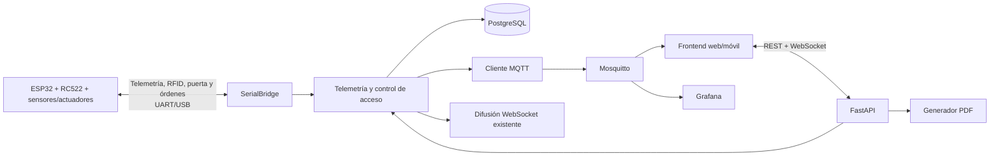

# SmartEgg API

Backend FastAPI para el Proyecto 1 **SmartEgg: Plataforma IoT Distribuida**. Recibe la
telemetría ambiental de la ESP32 por UART/USB, conserva el ciclo de incubación en PostgreSQL,
expone la información al frontend por REST y publica el estado del nodo mediante MQTT.

## Cobertura del enunciado

- Registro autenticado del técnico y nombre verificable en el informe.
- Incubadoras con capacidad, espacios ocupados/disponibles y configuración persistente.
- Ficha de identificación de lotes y huevos rotulados, con validación de posiciones.
- Lecturas históricas de temperatura/humedad y estado de sensores.
- Estados y comandos de calefacción, ventilador, servo y buzzer.
- Alarmas automáticas por temperatura, humedad y puerta abierta, con resolución y acuse.
- Rotación manual bidireccional y registro de rotaciones.
- Puente Serial UART/USB preparado para conectar la ESP32 real.
- Acceso RFID con sesión por operador, servo de cerradura y cierre automático.
- Publicación MQTT de telemetría, actuadores, alarmas y disponibilidad del nodo.
- Actualización en tiempo real mediante WebSocket y consultas históricas/estadísticas.
- Descarga PDF con identificación, técnico, lotes, extremos diarios y alarmas.
- OpenAPI, Swagger UI y ReDoc generados por FastAPI.

Los requisitos puramente físicos —sketch C++, FreeRTOS/interrupciones, LCD, circuito,
encapsulado y evidencias— corresponden al firmware/prototipo y quedan fuera de este
backend. La API conserva y refleja sus datos sin sustituir el control de seguridad local
del microcontrolador.

## Arquitectura



```text
server/
├── app/
│   ├── api/              # Routers: auth, nodos, incubación, telemetría, reportes
│   ├── services/         # Ingesta, UART, tiempo real y PDF
│   ├── config.py         # Configuración desde entorno
│   ├── database.py       # Motor y sesiones SQLAlchemy
│   ├── models.py         # Modelo relacional
│   ├── schemas.py        # Contratos y validaciones Pydantic
│   ├── security.py       # Argon2 + JWT
│   └── main.py           # Fábrica de aplicación y ciclo de vida
├── scripts/              # Simulador opcional
├── tests/                # Pruebas funcionales y del protocolo Serial
├── migrations/           # Versionado del esquema con Alembic
├── main.py               # Entrada ASGI
├── .env.example
├── pyproject.toml
└── uv.lock
```

### Modelo de datos

| Entidad | Responsabilidad |
|---|---|
| `Technician` | Operador autenticado, rol y UID RFID |
| `AccessSession` | Sesión RFID ligada a operador, incubadora y puerta |
| `Incubator` / `IncubatorConfig` | Nodo, capacidad y umbrales configurables |
| `Lot` / `Egg` | Lotes y ficha individual con posición física |
| `Sensor` / `TelemetryReading` | Estado del sensor e historial ambiental |
| `ActuatorState` | Estado/modo de calefacción, ventilador, servo y buzzer |
| `Alarm` | Eventos críticos, resolución y reconocimiento |
| `RotationEvent` | Historial de giros manuales/automáticos |
| `DoorEvent` | Aperturas, cierres y movimientos de huevos por operador |

## Instalación y configuración

Requiere Python 3.12+ y [`uv`](https://docs.astral.sh/uv/).

```bash
cd Practica_1_SmartEgg/server
uv sync
cp .env.example .env
uv run alembic upgrade head
```

Genere un secreto propio; nunca suba `.env`:

```bash
python -c "import secrets; print(secrets.token_urlsafe(48))"
```

Asigne el resultado a `SMARTEGG_JWT_SECRET`. Si se omite en desarrollo, el servidor crea
uno efímero y los tokens dejan de servir al reiniciar.

Variables principales:

| Variable | Uso | Predeterminado |
|---|---|---|
| `SMARTEGG_DATABASE_URL` | URL SQLAlchemy de PostgreSQL | `postgresql+psycopg://...` |
| `SMARTEGG_AUTO_CREATE_SCHEMA` | Solo pruebas; en operación se usa Alembic | `false` |
| `SMARTEGG_JWT_SECRET` | Firma de tokens | aleatorio por proceso |
| `SMARTEGG_DEVICE_API_KEY` | Compatibilidad con endpoints HTTP de acceso | vacío |
| `SMARTEGG_KIOSK_API_KEY` | Emparejamiento del login RFID local | vacío |
| `SMARTEGG_ACCESS_SERVO_UNLOCK_DEGREES` | Ángulo de desbloqueo | `90` |
| `SMARTEGG_ACCESS_SERVO_LOCK_DEGREES` | Ángulo de bloqueo | `0` |
| `SMARTEGG_CORS_ORIGINS` | Orígenes JSON autorizados | `["http://localhost:3000"]` |
| `SMARTEGG_TIMEZONE` | Día/hora del reporte | `America/Guatemala` |
| `SMARTEGG_INITIAL_TECHNICIANS` | Usuarios iniciales en JSON | `[]` |
| `SMARTEGG_INITIAL_INCUBATORS` | Incubadoras iniciales en JSON | `[]` |
| `SMARTEGG_SERIAL_ENABLED` | Activa el lector UART | `false` |
| `SMARTEGG_SERIAL_PORT` | Puerto, p. ej. `/dev/ttyUSB0` | vacío |
| `SMARTEGG_SERIAL_BAUDRATE` | Velocidad UART | `115200` |
| `SMARTEGG_DEFAULT_INCUBATOR_CODE` | Nodo usado si UART no envía `NODE` | `NODE-01` |
| `SMARTEGG_MQTT_ENABLED` | Activa la publicación hacia Mosquitto | `false` |
| `SMARTEGG_MQTT_HOST` | Host del broker MQTT | `localhost` |
| `SMARTEGG_MQTT_PORT` | Puerto MQTT TCP/TLS | `1883` |
| `SMARTEGG_MQTT_USERNAME` | Usuario del broker | vacío |
| `SMARTEGG_MQTT_PASSWORD` | Contraseña del broker | vacío |
| `SMARTEGG_MQTT_TLS_ENABLED` | Activa TLS para el broker | `false` |
| `SMARTEGG_MQTT_CA_CERT` | Ruta del certificado CA | vacío |
| `SMARTEGG_REPORT_LOGO_PATH` | PNG/JPG para el informe | vacío |

## Publicación MQTT

Activamos el cliente en `server/.env`:

```env
SMARTEGG_MQTT_ENABLED=true
SMARTEGG_MQTT_HOST=localhost
SMARTEGG_MQTT_PORT=1883
SMARTEGG_MQTT_USERNAME=smartegg
SMARTEGG_MQTT_PASSWORD=la-misma-clave-del-broker
```

Después de guardar cada lectura publicamos temperatura, humedad, telemetría consolidada
y actuadores como mensajes retained. Las alarmas críticas y el estado del nodo usan QoS
1. El cliente registra un LWT retained para marcar el nodo como desconectado si el backend
pierde la conexión inesperadamente. La lista completa está en `../mqtt/TOPICS.md`.

## Ejecución

Con Docker, desde la raíz de `Proyecto_1_SmartEgg`:

```bash
docker compose up -d --build backend
```

El contenedor espera a PostgreSQL y Mosquitto, aplica las migraciones de Alembic y luego
inicia FastAPI. Para usar el puerto Serial del host ejecutamos el Compose con
`docker-compose.serial.yml`, como se indica en el README general.

Sin Docker, desde esta carpeta:

Red local (laptop, teléfono y tablet en la misma red):

```bash
uv run fastapi dev --host 0.0.0.0
```

Producción sin recarga:

```bash
uv run fastapi run --host 0.0.0.0
```

- API: `http://<IP_LOCAL>:8000`
- Swagger UI: `http://<IP_LOCAL>:8000/docs`
- ReDoc: `http://<IP_LOCAL>:8000/redoc`
- Salud: `GET /health`

### Inicialización segura

Para crear automáticamente uno o varios técnicos al arrancar, configure la lista en
`server/.env`:

```env
SMARTEGG_INITIAL_TECHNICIANS=[{"username":"admin","full_name":"Administrador","role":"admin","password":"una-clave-segura"}]
```

Cada nombre de usuario se crea solamente si todavía no existe. Los reinicios no cambian
su contraseña ni duplican la cuenta. No suba el archivo `.env` al repositorio.

La incubadora física también puede quedar lista sin llamadas manuales a Swagger:

```env
SMARTEGG_INITIAL_INCUBATORS=[{"code":"NODE-01","name":"Incubadora principal","capacity":4,"serial_number":"ARDUINO-UNO-R3"}]
```

Al crearla se generan su configuración predeterminada y los estados de calefacción,
ventilador, servo y buzzer. Los reinicios no duplican ni reemplazan el nodo existente.

Como alternativa, el primer técnico puede crearse manualmente una única vez:

```bash
curl -X POST http://127.0.0.1:8000/api/v1/auth/bootstrap \
  -H 'Content-Type: application/json' \
  -d '{"username":"admin","full_name":"Administrador","role":"admin","password":"clave-segura"}'
```

Luego use `POST /api/v1/auth/login` y envíe el token como
`Authorization: Bearer <token>`. La creación de incubadora, lote y huevos se realiza desde
Swagger o los endpoints siguientes.

## Control por MQTT

El enunciado de la Fase 3 prohíbe controlar sensores y actuadores mediante una API: la
API REST solo consulta y administra (cuentas, lotes, huevos, reportes). Todo cambio que
afecta al nodo se publica en el broker y el backend lo valida con los mismos esquemas
Pydantic, lo registra en PostgreSQL y lo reenvía a la ESP32:

| Topic | Payload | Efecto |
|---|---|---|
| `smartegg/{id}/comandos/actuador` | `{"kind":"fan","enabled":true,"mode":"manual"}` | Actualiza `actuator_states` y envía `{"type":"actuator",...}` |
| `smartegg/{id}/comandos/rotar` | `{"angle_degrees":30,"direction":"left"}` | Registra `rotation_events` y envía `{"type":"rotate","angle_degrees":-30}` |
| `smartegg/{id}/comandos/config` | Campos de `IncubatorConfigUpdate` | Actualiza `incubator_configs` y envía `{"type":"config",...}` |
| `smartegg/{id}/comandos/resultado` | `{"command":"rotar","ok":true,"delivered":true,"request_id":"..."}` | Respuesta del backend; `delivered:false` si el gateway está desconectado |

Con `SMARTEGG_NODE_TRANSPORT=gateway` (valor de Compose) el backend no abre el USB: recibe
las tramas del [gateway](../gateway/README.md) en `gateway/rx` y le envía los comandos en
`gateway/tx`. Con `serial` conserva el puente USB directo de la Fase 2.

## Contrato de API

Todos los endpoints funcionales usan el prefijo `/api/v1`. Los endpoints del dashboard
requieren JWT. Los endpoints físicos `/access/rfid/authorize` y
`/access/sessions/{id}/door` requieren `X-Device-Key`.

| Área | Operaciones principales |
|---|---|
| Auth | `POST /auth/bootstrap`, `POST /auth/login`, `GET /auth/me`, `GET/POST/PATCH /auth/technicians`, `PUT /auth/technicians/{id}/incubators` |
| Acceso RFID | `POST /access/rfid/authorize`, `POST /access/sessions/{id}/door`, `POST .../{id}/cancel`, `GET .../{id}`, `WS /access/ws/{code}` |
| Incubadoras | `POST/GET /incubators`, `GET /incubators/{id}/state` |
| Configuración | `GET /incubators/{id}/config` (el cambio llega por MQTT: `comandos/config`) |
| Lotes | `POST/GET /lots`, `GET/PATCH /lots/{id}` |
| Huevos | `POST/GET /eggs`, `GET/PATCH /eggs/{id}` |
| Ocupación | `GET /incubators/{id}/occupancy` |
| Sensores | `GET /incubators/{id}/sensors`, `PATCH .../sensors/{sensor_id}` |
| Telemetría | `POST /telemetry`, `GET .../telemetry`, `GET .../latest`, `GET .../stats` |
| Actuadores | `GET .../actuators` (el control llega por MQTT: `comandos/actuador`) |
| Rotación | `GET /incubators/{id}/rotations` (la rotación manual llega por MQTT: `comandos/rotar`) |
| Alarmas | `GET .../alarms`, `POST .../alarms/{alarm_id}/acknowledge` |
| Puerta | `POST/GET .../door-events`, `PATCH .../door-events/{event_id}/close` |
| Perfiles | `GET /me/diagnostics`, `GET /admin/diagnostics?operator_id={id}` |
| Reporte | `GET /reports`, `GET /reports/incubators/{id}/daily.pdf?day=AAAA-MM-DD&operator_id={id}` |
| Tiempo real | `WS /ws/incubators/{id}?token=<JWT>` |
| Serial | `GET /serial/status` (USB directo o gateway MQTT, según `SMARTEGG_NODE_TRANSPORT`) |

El contrato exacto, ejemplos, restricciones y respuestas 422 siempre se mantienen en
`/openapi.json` y Swagger. El endpoint agregado `state` entrega en una petición el nodo,
configuración, última lectura, ocupación, sensores, actuadores y alarmas activas.

La autorización se valida en el servidor, no sólo en la navegación. `admin` administra
perfiles, configuración, sensores, actuadores y rotaciones manuales y tiene visibilidad
global, pero no abre la puerta. Las cuentas con rol `operator` abren la puerta y operan
únicamente los nodos asignados; sus lotes, huevos, eventos e informes quedan aislados
por ID de usuario. Así, Operador 1 y Operador 2 son perfiles independientes sin duplicar
el rol técnico. Desactivar una cuenta invalida sus JWT en la siguiente petición.
Si una base anterior sólo contiene operadores, `GET /auth/admin-status` activa en la
consola una recuperación única: cualquier operador autenticado puede crear el primer
`admin`; en cuanto existe uno, esa excepción deja de estar disponible.

## Acceso físico con ESP32

El ESP32 autentica cada solicitud con `X-Device-Key`. La clave, los ángulos del servo y
la tarjeta asignada a cada operador se configuran en `.env`:

```dotenv
SMARTEGG_DEVICE_API_KEY=una-clave-exclusiva-del-esp32
SMARTEGG_KIOSK_API_KEY=una-clave-exclusiva-de-la-consola
SMARTEGG_ACCESS_SERVO_UNLOCK_DEGREES=90
SMARTEGG_ACCESS_SERVO_LOCK_DEGREES=0
```

El UID se guarda normalizado, en mayúsculas y sin separadores. Se admiten UID de 4, 7 y
10 bytes. Una lectura válida crea `access_sessions`, emite un JWT ligado a esa sesión y
devuelve el ángulo de desbloqueo:

```http
POST /api/v1/access/rfid/authorize
X-Device-Key: una-clave-exclusiva-del-esp32
Content-Type: application/json

{"uid":"A1:B2:C3:D4","incubator_code":"NODE-01"}
```

```json
{
  "result": "authorized",
  "servo_action": "unlock",
  "servo_angle": 90,
  "session_id": 12,
  "access_token": "<JWT>",
  "token_type": "bearer",
  "expires_in": 28800,
  "technician": {
    "id": 1,
    "username": "operador1",
    "full_name": "Operador 1",
    "age": 25,
    "gender": "masculino",
    "role": "operator",
    "rfid_uid": "A1B2C3D4",
    "is_active": true,
    "created_at": "2026-09-07T12:00:00Z"
  }
}
```

La pantalla de acceso mantiene abierto
`WS /api/v1/access/ws/NODE-01?key=<KIOSK_API_KEY>`. Al autorizar la tarjeta, ese canal
recibe `rfid_authenticated` con el JWT y abre el dashboard del operador sin solicitar
usuario ni contraseña.

El sensor informa la apertura sin registrar cantidades:

```http
POST /api/v1/access/sessions/12/door
X-Device-Key: una-clave-exclusiva-del-esp32
Content-Type: application/json

{"state":"open"}
```

El operador registra previamente el tipo de operación y la cantidad desde el dashboard
mediante `POST /incubators/{id}/door-events`. El registro queda enlazado a su sesión
RFID. Si no registra una operación, el cierre queda como inspección.

El sensor informa el cierre. También puede incluir la operación como respaldo. Este
evento bloquea el servo, termina `access_sessions`, completa `door_events` e invalida
inmediatamente el JWT RFID:

```http
POST /api/v1/access/sessions/12/door
X-Device-Key: una-clave-exclusiva-del-esp32
Content-Type: application/json

{"state":"closed","event_type":"egg_entry","eggs_added":4}
```

Los cambios también se emiten por WebSocket y por el topic
`smartegg/{id}/acceso/eventos`. Solamente se permite una sesión física activa por
incubadora.

Si la puerta no se abre durante 15 segundos, la ESP32 bloquea el servo y ejecuta
`POST /access/sessions/{id}/cancel`. El evento `access_cancelled` cierra también el
dashboard que se hubiera abierto.

## Protocolo Serial UART/USB

Cada mensaje ocupa una línea terminada en `\n`. Se admiten dos representaciones:

```json
{"incubator_code":"NODE-01","temperature_c":37.6,"humidity_pct":58,"door_open":false,"occupied_slots":3,"heater":false,"fan":false,"servo_angle":45,"buzzer":false}
```

```text
NODE:NODE-01,TEMP:37.6,HUM:58,DOOR:0,SLOTS:3,HEATER:0,FAN:0,SERVO:45,BUZZER:0
```

Campos mínimos: temperatura y humedad. Los booleanos aceptan `0/1`, `true/false` u
`on/off`. El puente reconecta automáticamente si la ESP32 se desconecta. Los comandos
hacia el microcontrolador se envían como JSON por línea:

```json
{"type":"rotate","angle_degrees":-45}
{"type":"actuator","kind":"fan","enabled":true,"mode":"manual","value":null}
{"type":"config","temperature_min_c":37.0,"temperature_max_c":38.0}
```

La ESP32 conserva su control ON/OFF y alarmas aun cuando la computadora se
desconecte. El backend vuelve a evaluar los umbrales para mantener consistente la vista y
el historial, pero no reemplaza esa protección local.

## Umbrales y decisión ante contradicciones

La configuración inicial sigue los requisitos explícitos del objetivo y la rúbrica:

- temperatura segura: 37–38 °C;
- humedad segura: 50–65 %;
- rotación: ±45° cada 120 segundos;
- temperatura crítica inicial: 39 °C.

El frontend de referencia muestra “2 H”, pero el objetivo medible del PDF ordena rotación
“cada 2 minutos”; se priorizó el requisito explícito y evaluable. Todos los valores quedan
persistidos y pueden ajustarse publicando en `smartegg/{id}/comandos/config` sin rediseñar
el backend.

## Simulador y pruebas

Con el servidor iniciado, configure credenciales existentes y ejecute:

```bash
SMARTEGG_SIM_USERNAME=tecnico1 \
SMARTEGG_SIM_PASSWORD=clave-segura \
uv run python scripts/simulate_telemetry.py
```

Pruebas:

```bash
uv run pytest
uv run pytest --cov=app --cov-report=term-missing
```
