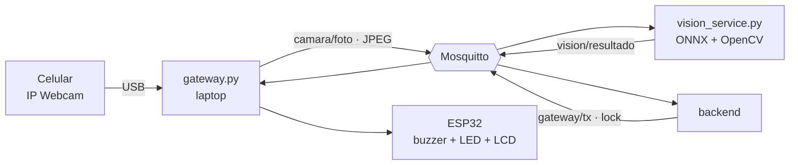

# Servicio de visión

Clasifica las fotos de la bandeja con el modelo entrenado en
[`ml/vision`](../ml/vision/) (`huevo` / `objeto` / `vacio`) y avisa al backend
cuando hay un objeto extraño. Corre en Docker junto al broker, en la nube. Solo
usa **OpenCV** (`cv2.dnn`), sin PyTorch.



## Regla: probabilidad media de las últimas 5 fotos

Una sola foto no bloquea la incubadora. El servicio guarda las últimas 5 fotos
de cada nodo y confirma el objeto cuando la **probabilidad media de `objeto`**
en esas 5 fotos llega al **65 %**.

Primero contábamos votos (3 de 5 fotos como `objeto`), pero en la prueba en vivo
una bandeja con huevos quedaba justo en el borde: el modelo oscilaba entre 45 %
y 55 % de `objeto` y tarde o temprano juntaba 3 votos y bloqueaba sin motivo.
Con el promedio, esa escena se queda cerca del 50 % y no bloquea. Un objeto que
el modelo ve claro (90 % o más) bloquea en la 4.ª foto, unos 4 s después de
ponerlo. El costo es que un objeto que el modelo ve con poca seguridad (60–65 %)
tampoco bloquea; se puede ajustar con `VISION_MIN_PROBABILITY`.

## Topics

| Topic | Sentido | QoS | Retenido |
|---|---|---:|:---:|
| `smartegg/{nodo}/camara/foto` | gateway → visión (JPEG) | 0 | No |
| `smartegg/{nodo}/vision/resultado` | visión → backend, Grafana, página | 0 | Sí |
| `smartegg/vision/estado` | online/offline del servicio, con LWT | 1 | Sí |

Ejemplo de `vision/resultado`:

```json
{
  "clase": "objeto",
  "confianza": 0.9132,
  "probabilidades": {"huevo": 0.0521, "objeto": 0.9132, "vacio": 0.0347},
  "votos_objeto": 4,
  "prob_objeto_media": 0.7412,
  "ventana": 5,
  "objeto_detectado": true,
  "inferencia_ms": 18.4,
  "recorded_at": "2026-10-23T22:15:03.512+00:00"
}
```

`objeto_detectado` es el resultado de la regla (`prob_objeto_media` ≥ 0.65 con la
ventana llena): es lo que el backend usa para bloquear el nodo. `clase` y
`confianza` son de la última foto; `votos_objeto` cuenta cuántas de las 5 fotos
salieron como `objeto` y es solo informativo.

## Uso

Con Docker Compose se levanta junto al resto (`docker compose up -d vision`).
Para correrlo fuera de Docker:

```bash
cd Proyecto_2_SmartEgg/vision
uv run vision_service.py --broker localhost --clave '<clave-de-smartegg-vision>' -v
```

| Variable | Opción | Por defecto |
|---|---|---|
| `VISION_MODEL_PATH` | `--modelo` | `../ml/vision/modelo/smartegg_vision.onnx` |
| `MQTT_HOST` / `MQTT_PORT` | `--broker` / `--puerto-mqtt` | `localhost` / `1883` |
| `MQTT_USERNAME` / `MQTT_PASSWORD` | `--usuario` / `--clave` | `smartegg-vision` / — |
| `VISION_WINDOW` / `VISION_MIN_PROBABILITY` | `--ventana` / `--umbral` | `5` / `0.65` |
| `MQTT_TLS` / `MQTT_CA_CERT` | `--tls` / `--ca` | `false` / — |

## Pruebas

```bash
uv run pytest
```

Las pruebas de la regla usan un clasificador falso; dos pruebas cargan el modelo
real y lo corren sobre fotos del dataset.
